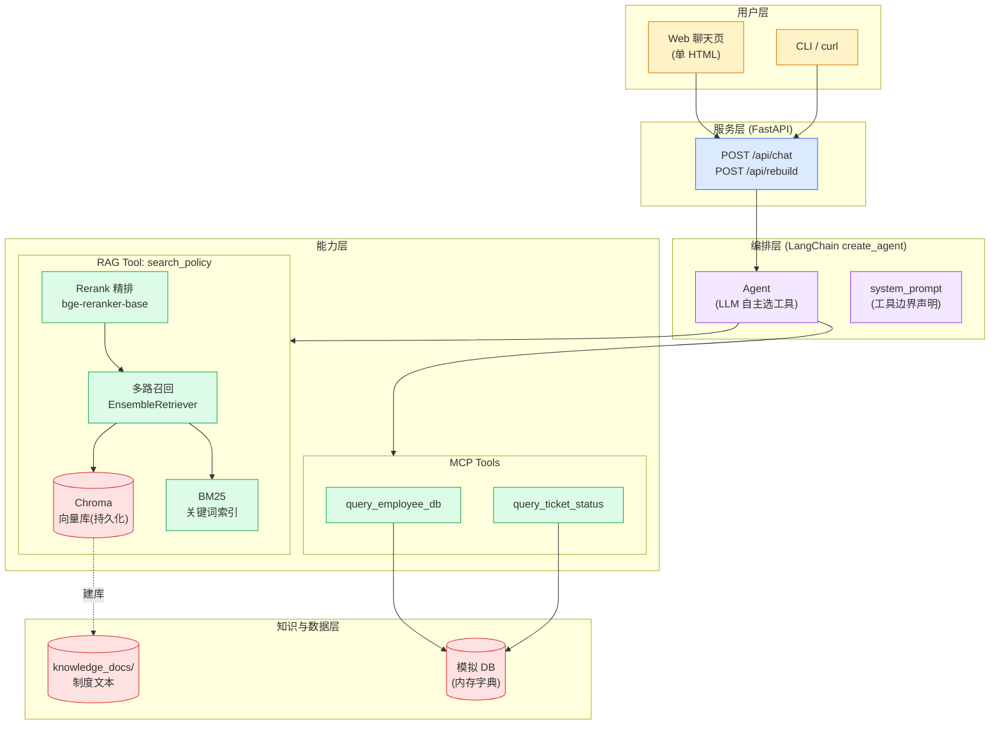

# 02 · 架构设计（ai-cs 企业智能客服系统）

> 状态：规划定稿
> 上游：[01_系统分析.md](01_系统分析.md)
> 技术栈锁定：Python + LangChain + RAG + Chroma + MCP（课程第 13 章案例 1）
> 本文档面向后续实施 Agent，含架构图、模块职责、接口契约、数据流。

---

## 1. 总体架构

### 1.1 分层架构图



### 1.2 架构决策（承接系统分析 ADR）

| # | 决策 | 理由 |
|---|---|---|
| D1 | LangChain `create_agent` 单 Agent，不引入 LangGraph | 问答流程无循环；课程 13.5 选型原则 |
| D2 | RAG 检索包成 `search_policy` Tool，而非硬编码在 Chain 里 | 让 LLM 自主决定"要不要检索"（课程案例 1 关键设计） |
| D3 | 业务查询独立成 Tool（MCP 形态） | 静态知识用 RAG、动态数据用工具（课程 13.7 陷阱 3） |
| D4 | 检索链路 = 粗召回(k=20) → Rerank(top 4) → 塞 LLM | 课程 5.4 两阶段检索范式 |
| D5 | 模拟 DB 与工具层隔离（`mock_data.py`） | 替换真实系统时只动一层 |

---

## 2. 目录结构（实施蓝图）

```
ai-cs/
├── README.md                     # 项目总览与快速开始
├── docs/                         # ← 本套规划文档
│   ├── 01_系统分析.md
│   ├── 02_架构设计.md
│   ├── 03_开发计划.md
│   └── 04_实施注意事项.md
├── knowledge_docs/               # 企业制度语料（RAG 数据源）
│   ├── hr/
│   │   ├── leave_policy.txt      # 请假制度
│   │   └── employee_handbook.txt # 员工手册
│   ├── finance/
│   │   ├── travel_policy.txt     # 差旅报销
│   │   └── expense_policy.txt    # 日常报销
│   └── admin/
│       └── it_support.txt        # IT 支持
├── src/
│   ├── __init__.py
│   ├── core/
│   │   ├── __init__.py
│   │   ├── config.py             # 配置（路径/模型名/k值，读环境变量）
│   │   └── logging.py            # 统一日志（对话日志/工具调用日志）
│   ├── rag/
│   │   ├── __init__.py
│   │   ├── loader.py             # 文档加载 + 切分（带 metadata）
│   │   ├── vectorstore.py        # Chroma 建库/加载（持久化）
│   │   ├── retriever.py          # 多路召回 + Rerank 组装
│   │   └── chain.py              # 纯 RAG 问答链（不走 Agent，供评估/对比）
│   ├── tools/
│   │   ├── __init__.py
│   │   ├── mock_data.py          # 模拟 HR/工单 DB（唯一可替换点）
│   │   ├── langchain_tools.py    # @tool 定义（进程内直连形态）
│   │   └── mcp_server.py         # FastMCP Server（P1：独立进程形态）
│   ├── agents/
│   │   ├── __init__.py
│   │   └── customer_service.py   # create_agent 组装（system prompt 在此）
│   └── api/
│       ├── __init__.py
│       ├── app.py                # FastAPI 入口（/api/chat, /api/rebuild）
│       └── schemas.py            # Pydantic 请求/响应模型
├── scripts/
│   ├── ingest.py                 # 建库脚本（python scripts/ingest.py）
│   └── evaluate.py               # 评估脚本（跑测试集出指标）
├── tests/
│   ├── testdata.py               # 测试集（≥10 条问答对，含知识库外问题）
│   ├── test_rag_offline.py       # 检索层测试（无需 API Key）
│   └── test_scenarios.py         # 端到端场景测试（需 API Key）
└── requirements.txt              # 指向课程根 requirements（或最小子集）
```

**模块依赖方向（严格单向）**：

```
api → agents → tools  ┐
           → rag      ├→ core
tests → 上述全部       ┘
```

禁止反向依赖（rag 不得 import agents）。mock_data 只被 tools 引用。

---

## 3. 核心模块设计

### 3.1 配置模块 `src/core/config.py`

```python
from pathlib import Path

class Config:
    # 路径
    ROOT = Path(__file__).resolve().parents[2]        # ai-cs/
    KNOWLEDGE_DIR = ROOT / "knowledge_docs"
    CHROMA_DIR = ROOT / "chroma_db"                   # 持久化向量库
    # 模型（环境变量优先，默认与课程一致）
    LLM_MODEL = os.getenv("DEEPSEEK_MODEL", "deepseek-chat")
    EMBED_MODEL = "BAAI/bge-small-zh-v1.5"
    RERANK_MODEL = "BAAI/bge-reranker-base"
    # 检索参数（第 5 章：粗召回留空间，精排收口）
    RECALL_K = 20          # 每路召回条数
    RERANK_TOP_N = 4       # 精排保留
    CHUNK_SIZE = 400       # 中文字符（5.8 节：中文建议 300~800）
    CHUNK_OVERLAP = 60     # 15%
```

### 3.2 RAG 模块

**`loader.py` — 加载与切分**

- 遍历 `knowledge_docs/**/*.txt`，`TextLoader(encoding="utf-8")` 逐个加载；
- **关键**：为每个 chunk 注入 metadata：`{"source": 相对路径, "domain": hr/finance/admin, "doc": 文件名}`；
- 切分：`RecursiveCharacterTextSplitter(chunk_size=400, chunk_overlap=60)`，分隔符显式含中文标点：
  ```python
  splitter = RecursiveCharacterTextSplitter(
      chunk_size=400, chunk_overlap=60,
      separators=["\n\n", "\n", "。", "；", " ", ""],   # 中文友好
  )
  ```

**`vectorstore.py` — Chroma 持久化**

- 建库：`Chroma.from_documents(chunks, embeddings, persist_directory=str(CHROMA_DIR))`；
- 加载：已存在则 `Cha(persist_directory=..., embedding_function=embeddings)` 直接打开，不重复 embedding；
- embeddings 用 `SentenceTransformerEmbeddings(model_name=EMBED_MODEL)`。
- ⚠️ 建库与查询必须同一个 Embedding 模型（课程 5.8 陷阱 3）。

**`retriever.py` — 多路召回 + Rerank（P1 完整版）**

```
查询 → [向量检索 k=20] ─┐
                        ├→ EnsembleRetriever(RRF) → CrossEncoderReranker(top 4) → Top4 片段
       [BM25 k=20] ─────┘
```

```python
from langchain_classic.retrievers import EnsembleRetriever
from langchain_classic.retrievers import ContextualCompressionRetriever
from langchain_classic.retrievers.document_compressors import CrossEncoderReranker
from langchain_community.cross_encoders import HuggingFaceCrossEncoder
from langchain_community.retrievers import BM25Retriever

def build_retriever(chunks=None):
    vec = vectorstore.as_retriever(search_kwargs={"k": 20})
    bm25 = BM25Retriever.from_documents(chunks, k=20) if chunks else None
    hybrid = EnsembleRetriever(retrievers=[vec, bm25], weights=[0.5, 0.5])
    reranker = CrossEncoderReranker(
        model=HuggingFaceCrossEncoder(model_name=cfg.RERANK_MODEL), top_n=4)
    return ContextualCompressionRetriever(base_compressor=reranker, base_retriever=hybrid)
```

> import 路径以课程 5.4 节代码为准（`langchain_classic.retrievers`，langchain≥0.3 的迁移位置）。P0 阶段可先用纯向量 `k=3` 顶住，P1 再升级。

**`chain.py` — 纯 RAG 问答链（离线可评估）**

LCEL 链，**必须用 `itemgetter("question")` 抽字符串**（课程 5.6 明确的坑，否则 dict 直接进 retriever 报 `AttributeError`）：

```python
chain = (
    {"context": itemgetter("question") | retriever
              | (lambda docs: format_with_sources(docs)),
     "question": itemgetter("question")}
    | PROMPT | model | StrOutputParser()
)
```

Prompt 模板（防幻觉核心，措辞参考课程 04_rag_demo）：

```
你是企业制度客服助手，根据以下检索到的制度片段回答问题。
要求：
1. 只基于片段内容回答，禁止编造。
2. 如果片段中没有答案，明确回答"知识库中未找到相关内容"。
3. 回答末尾注明来源文档。

【制度片段】
{context}

【问题】
{question}
```

### 3.3 工具模块 `src/tools/`

**`langchain_tools.py`（P0 进程内形态）**

两个 `@tool`，**docstring 精确描述触发条件**（LLM 靠它选工具）：

```python
@tool
def search_policy(query: str) -> str:
    """搜索企业规章制度文档（年假/病假/报销/差旅/IT支持等制度条款）。
    当用户询问公司制度、政策、标准、流程时调用。"""
    docs = retriever.invoke(query)
    return format_docs_with_sources(docs)      # 片段 + 来源

@tool
def query_employee_db(emp_id: str) -> str:
    """查询员工信息（姓名/部门/职位/入职日期）。参数为工号如 E001。
    当用户提到具体工号或查某位员工时调用。"""
    ...

@tool
def query_ticket_status(ticket_id: str) -> str:
    """查询报销单/工单的处理状态。参数为单号如 RB2024001。"""
    ...
```

**`mcp_server.py`（P1 独立进程形态）**

- FastMCP 暴露同样两个查询工具（参考课程 `examples/06_mcp_server.py`）；
- Agent 侧用 `langchain-mcp-adapters` 接入；
- 与进程内形态**并存**，配置开关选择（`TOOLS_MODE=inprocess|mcp`）。

### 3.4 Agent 模块 `src/agents/customer_service.py`

```python
from langchain.agents import create_agent        # 1.x 入口（AgentExecutor 已移除！）
from langchain_deepseek import ChatDeepSeek

def build_agent(tools):
    model = ChatDeepSeek(
        model=cfg.LLM_MODEL,
        api_key=os.getenv("DEEPSEEK_API_KEY"),
        temperature=0.1,                          # 问答要稳定
    )
    return create_agent(model, tools, system_prompt=SYSTEM_PROMPT)

SYSTEM_PROMPT = """你是企业智能客服，负责回答员工关于公司规章制度的问题。
规则：
1. 制度类问题（假期/报销/差旅/IT流程）→ 调 search_policy 检索文档作答；
2. 查员工信息 → 调 query_employee_db；查工单状态 → 调 query_ticket_status；
3. 只依据检索到的内容回答，没有就说"知识库中未找到"，禁止编造；
4. 回答简洁准确，注明制度出处。"""
```

### 3.5 API 层 `src/api/`

**`schemas.py`**

```python
class ChatRequest(BaseModel):
    question: str = Field(..., min_length=1, max_length=500)

class ChatResponse(BaseModel):
    answer: str
    sources: list[str]          # ["knowledge_docs/finance/travel_policy.txt"]
    tool_calls: list[str]       # ["search_policy"]
    elapsed_ms: int
```

**`app.py` 路由**

| 方法 | 路径 | 说明 |
|---|---|---|
| POST | `/api/chat` | 主问答接口；解析 agent 输出消息，提取 sources/tool_calls |
| POST | `/api/rebuild` | 重建索引（内部调 ingest 逻辑，串行加锁） |
| GET | `/health` | 健康检查（不调 LLM） |

Agent 输出解析：遍历 `result["messages"]`，ToolMessage 记 tool 名，最终 AIMessage 取 answer；sources 由工具返回文本中携带（工具返回时内联来源行，如 `[来源: knowledge_docs/.../travel_policy.txt]`）。

---

## 4. 关键数据流

### 4.1 建库流（离线，一次性/文档更新后）

```
knowledge_docs/*.txt
   → TextLoader 逐个加载（保留文件路径）
   → 注入 metadata(domain/source)
   → RecursiveCharacterTextSplitter(400/60, 中文分隔符)
   → SentenceTransformerEmbeddings(bge-small-zh) 向量化
   → Chroma.persist → chroma_db/
   → 输出统计：文档数 / chunk 数 / 各域分布
```

### 4.2 问答流（在线）

```
POST /api/chat {question}
   → Agent(LLM 第 1 轮决策)
       ├─ 制度类 → search_policy(query)
       │     → 向量召回20 + BM25召回20 → RRF融合 → rerank → top4
       │     → 返回"片段+来源"给 LLM
       ├─ 工号类 → query_employee_db(emp_id) → 模拟DB
       └─ 工单类 → query_ticket_status(ticket_id) → 模拟DB
   → Agent(LLM 第 2 轮生成，基于工具返回内容)
   → 解析 messages → {answer, sources, tool_calls}
   → 日志落盘（问题/工具链/耗时）
```

### 4.3 评估流（回归）

```
tests/testdata.py（≥10 条 {question, gold_answer, expect_tool}）
   → 逐条跑 Agent（或纯 RAG chain）
   → 指标1 context_precision：gold 关键词在召回片段中的命中率
   → 指标2 faithfulness：回答关键词被上下文支持的比例
   → 指标3 tool_accuracy：工具选择与 expect_tool 一致率
   → 输出对比基线的回归表
```

---

## 5. 接口契约汇总

### 5.1 内部模块接口

| 模块 | 暴露函数 | 签名 | 备注 |
|---|---|---|---|
| rag.loader | `load_and_split()` | `-> list[Document]` | 含 metadata |
| rag.vectorstore | `build_vectorstore(chunks)` | `-> Chroma` | 建库+持久化 |
| rag.vectorstore | `load_vectorstore()` | `-> Chroma` | 已存在时直连 |
| rag.retriever | `build_retriever(chunks=None)` | `-> Retriever` | P0 纯向量 / P1 完整 |
| rag.chain | `build_rag_chain(retriever)` | `-> Runnable` | 输入 `{"question": str}` |
| tools.langchain_tools | `build_tools(retriever)` | `-> list[BaseTool]` | 3 个工具 |
| agents.customer_service | `build_agent(tools)` | `-> Agent` | create_agent |

### 5.2 对外 HTTP 接口

见 3.5。错误码约定：`400` 参数校验失败；`503` LLM Key 未配置；`500` 内部错误（含工具异常）。

---

## 6. 横切关注点

| 关注点 | 方案 |
|---|---|
| 日志 | `core/logging.py`：控制台 + `logs/chat.log`；记录每轮 question/tool_calls/sources/耗时 |
| 配置 | 全部收敛 `core/config.py`；环境变量：DEEPSEEK_API_KEY / DEEPSEEK_MODEL / TOOLS_MODE / HF_ENDPOINT |
| 错误处理 | 工具内 try/except 返回友好错误文本（不让异常打断 Agent 循环）；API 层统一异常处理器 |
| 安全 | API 入参长度限制；日志不落敏感信息（模拟数据无敏感项）；生产替换真实 DB 时需加鉴权（预留中间件位） |
| 可扩展 | 新增制度域 = 加 txt 文件 + 重跑 ingest；新增工具 = 加 @tool + 更新 system prompt |

---

## 7. 与课程示例的映射（实施 Agent 的代码参考）

| 本项目模块 | 课程参考代码 | 参考什么 |
|---|---|---|
| rag/chain.py | `examples/04_rag_demo.py` | 6 步管线 + itemgetter 坑 + 防幻觉 Prompt |
| rag/retriever.py | `examples/04b_rag_advanced.py` | 多路召回 + RRF + Rerank 完整管线 |
| tools/ + agents/ | `examples/12_case_knowledge_agent.py` | **架构母版**：RAG 包 Tool + MCP 工具 + create_agent 组装 |
| tools/mcp_server.py | `examples/06_mcp_server.py` | FastMCP Server 写法 |
| api/app.py | `examples/11_enterprise_arch.py` | 分层组织思路 |
| scripts/evaluate.py | `chapters/05_rag.md` 5.4.3 | keyless 迷你评估 |

**实施铁律：先读课程对应示例再写代码，API 用法以示例为准，不要凭记忆写。**

---

> 下一份文档：[03_开发计划.md](03_开发计划.md)
