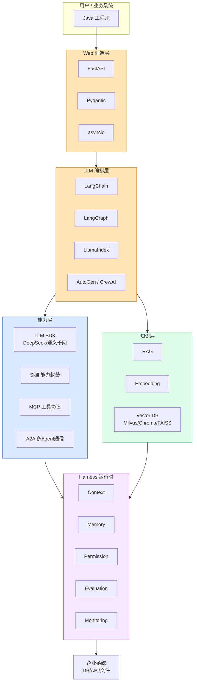

# 第 1 章 · Python AI 生态概览

> 阶段 A · 认知地基 · 难度 ★☆☆
> 配套：[diagrams/01_python_ai_ecosystem.mmd](../diagrams/01_python_ai_ecosystem.mmd) · [examples/00_setup.py](../examples/00_setup.py)

---

## 1.1 本章导读

如果你是 Java 后端工程师，第一次接触 AI 项目时大概率会冒出三个疑问：

1. 为什么公司里的 AI 后端都用 Python 写，不用 Java？
2. 那些 AI 项目里 import 的一堆陌生库（langchain、chromadb、mcp）到底是什么？
3. 我作为一个 Java 工程师，要参与到 AI 项目里，最少要懂哪些东西？

这一章回答前两个问题，并给你一张 "Python AI 技术栈地图"。第三个问题留给后续章节。

**本章不涉及任何机器学习原理**。我们把 LLM 当成一个 "通过 HTTP 调用、会推理的外部服务"，从工程视角看 Python 生态。

---

## 1.2 为什么 Python 成为 AI 应用开发主流

很多 Java 工程师的第一反应是："Python 连类型都不严格，凭什么 AI 用它？" 答案不是语法优雅，而是**工具链的原生地**。具体四个原因：

### 原因 1：AI SDK 丰富且官方优先

OpenAI、Anthropic、Google、Meta 发布新模型时，**官方 SDK 几乎都是 Python 优先**。Java SDK 要么是社区翻译，要么滞后半年以上。

```python
# 调用 DeepSeek（OpenAI 兼容接口），Python 全部代码就这几行
import os
from openai import OpenAI

client = OpenAI(
    api_key=os.getenv("DEEPSEEK_API_KEY"),
    base_url="https://api.deepseek.com",
)
resp = client.chat.completions.create(
    model="deepseek-chat",
    messages=[{"role": "user", "content": "你好"}],
)
print(resp.choices[0].message.content)
```

> Java 工程师注意：这里的 `OpenAI()` 指向 DeepSeek 端点，会自动读环境变量 `DEEPSEEK_API_KEY`。这和 Spring 的 `@Value("${deepseek.api-key}")` 思路一致，只是 Python 用环境变量更普遍。

AI 迭代极快，半年就是一两个大版本。滞后意味着你永远在追官方文档的旧版。所以工程上选 Python 是务实选择。

### 原因 2：快速实验能力

Python 有 REPL（交互式命令行）和 Jupyter Notebook，**改一行立刻看结果**，不用重启 Spring 容器、不用重新编译。AI 开发的本质是大量试错——换 Prompt、调参数、看效果——快速反馈循环至关重要。

```
# REPL 里直接试
>>> import os
>>> from openai import OpenAI
>>> client = OpenAI(api_key=os.getenv("DEEPSEEK_API_KEY"), base_url="https://api.deepseek.com")
>>> client.chat.completions.create(model="deepseek-chat", messages=[{"role":"user","content":"1+1"}])
... 立刻返回 ...
```

Java 工程师可以类比：Python REPL 像一个永远不关的 `main` 方法，每敲一行就执行一行。

### 原因 3：数据处理生态

AI 应用离不开数据处理：清洗文档、生成 Embedding、做向量计算。Python 有 **NumPy / Pandas / PyTorch**，这些是数据科学的事实标准库，Java 没有等价物。

- 训练模型？PyTorch / TensorFlow 是 Python。
- 数据清洗？Pandas 是 Python。
- 数值计算？NumPy 是 Python。

模型训练和推理都在 Python 里完成，应用层自然也用 Python，避免跨语言序列化开销。

### 原因 4：LLM 工具链成熟

围绕 LLM 的编排框架（LangChain / LangGraph / LlamaIndex）**Python 版本是 "一等公民"**，其他语言版本是社区翻译，功能滞后。

```
框架              Python 版本      Java 版本
LangChain         一等公民          langchain4j（社区，滞后）
LangGraph         一等公民          无
LlamaIndex        一等公民          llamaindex4j（早期）
MCP SDK           官方 Python       官方 Java（滞后）
```

一句话总结：**AI 的工具链原生长在 Python 里**。这不是语言优劣问题，是生态惯性。

---

## 1.3 核心技术栈地图

我把 Python AI 技术栈分成五层，从下往上看：（下面内嵌架构图，源码见 [diagrams/01_python_ai_ecosystem.mmd](../diagrams/01_python_ai_ecosystem.mmd)）：




### 五层详解

**Web 层**：把 AI 能力对外暴露成 HTTP API。
- `FastAPI`：现代 Python Web 框架，类比 Spring Boot。基于类型提示自动生成 OpenAPI 文档。
- `Pydantic`：数据校验库，类比 Bean Validation / DTO。用类型注解定义数据模型，自动校验。
- `asyncio`：Python 异步运行时，类比 Reactor / WebFlux。LLM 调用是 IO 密集型，异步能大幅提吞吐。

**编排层**：把零散组件（LLM、检索、工具）拼成完整应用。这是本教程主体。
- `LangChain`：最知名的编排框架，组件化 Prompt / 检索 / 记忆。
- `LangGraph`：LangChain 团队出的状态机框架，处理循环、状态、人工介入。
- `LlamaIndex`：RAG 专用框架，更精细（第 6 章）。
- `AutoGen`：微软出的多 Agent 对话框架。
- `CrewAI`：角色分工的多 Agent 框架。

**能力层**：被编排层调用的具体能力。
- `LLM SDK`：deepseek / 通义千问 官方 SDK（均 OpenAI 兼容）。
- `Skill`：能力封装（第 10 章）。
- `MCP`：工具协议，标准化暴露工具（第 7 章）。
- `A2A`：多 Agent 通信（第 8 章）。

**知识层**：让 LLM 用上私有知识。
- `RAG`：检索增强生成（第 5 章）。
- `Embedding`：文本转向量。
- `Vector DB`：Milvus / Chroma / FAISS，存向量做近邻检索。

**运行时**：让 Agent 稳定上生产的工程基础设施（第 9 章 Harness）。

---

### 微调与后训练（概念速览，本教程不展开）

前面五层都是在 **"用现成 LLM 做应用"**。还有一类工作叫 **微调 / 后训练（Fine-tuning / Post-training）**：在基座模型上用自有数据**继续训练**，把特定风格或领域知识"烧"进模型权重（比如统一的客服口吻、医疗术语）。主流工具：

- **LoRA / PEFT**：不训全量参数，只训一小撮"适配器"权重，省显存、快；
- **Unsloth**：给微调做提速 + 省显存的优化层，对新手最友好；
- **TRL**（Transformer Reinforcement Learning）：HuggingFace 的微调 / 对齐训练库。

**本教程边界**：我们聚焦 **AI Agent 应用开发**，不深入微调。绝大多数业务用 **RAG + Prompt** 就能解决私有知识问题，不必微调；只有"风格/领域必须固化进权重"或"数据极敏感、不能外发做 RAG"时才考虑微调。知道有这门技术、何时该用它即可，真要做再单独学。

---

## 1.4 Java 工程师的认知映射

记住下面这张映射表，后续每讲一个组件，你都能在 Java 里找到对应物：

| Python 组件 | Java 类比 | 说明 |
|---|---|---|
| FastAPI | Spring Boot | Web 框架 |
| Pydantic | Bean Validation / DTO | 数据校验 |
| asyncio | Reactor / WebFlux | 异步运行时 |
| DeepSeek SDK | HttpClient + Jackson | 调外部 API |
| LangChain | Spring Integration | 组件编排 |
| LangGraph | Camunda / BPMN | 流程引擎 |
| AutoGen / CrewAI | 微服务编排 | 多 Agent |
| Milvus / Chroma | Elasticsearch（向量版） | 向量检索 |
| MCP | gRPC / RPC | 工具协议 |
| Harness | Spring 容器 + AOP | 运行时基础设施 |

**关键认知**：你已有的 Java 工程经验（分层、依赖注入、异常处理、可观测性）在 Python AI 项目里全部适用，只是换了套库的名字。

---

## 1.5 代码示例：第一个 LLM 调用

打开 [examples/00_setup.py](../examples/00_setup.py)。这是全教程最简单的代码——8 行调通 LLM。

```python
import os
from openai import OpenAI

# 1. 从环境变量读 API Key（不要硬编码！）
client = OpenAI(
    api_key=os.getenv("DEEPSEEK_API_KEY"),
    base_url=os.getenv("DEEPSEEK_BASE_URL", "https://api.deepseek.com"),  # 默认指向 DeepSeek
)

# 2. 发起一次对话补全
response = client.chat.completions.create(
    model="deepseek-chat",
    messages=[
        {"role": "system", "content": "你是一个简洁的助手。"},
        {"role": "user", "content": "用一句话解释什么是 LLM。"},
    ],
)

# 3. 打印返回
print(response.choices[0].message.content)
print(f"消耗 token: {response.usage.total_tokens}")
```

### 逐段精讲

**第 1 段（构造 client）**：
- `os.getenv("DEEPSEEK_API_KEY")` 读环境变量。Java 类比 `System.getenv("DEEPSEEK_API_KEY")`。
- `OpenAI(...)` 是 SDK 的入口类。不传 `api_key` 时它会自动找环境变量，传了就以你传的为准。
- `base_url` 是关键：这里默认就指向 DeepSeek 官方端点 `https://api.deepseek.com`。DeepSeek 提供 OpenAI 兼容接口，国产模型都实现了这套接口，调用方式完全一致。

**第 2 段（发起请求）**：
- `client.chat.completions.create(...)` 是核心调用。链式属性访问 `client.chat.completions` 对应 OpenAI 的 REST 路径 `/chat/completions`。
- `messages` 是消息列表，每条有 `role` 和 `content`：
  - `system`：系统设定，告诉 LLM "你是谁"。
  - `user`：用户输入。
  - `assistant`：LLM 之前的回复（用于多轮）。
- 这和 Java 里构造请求体 JSON 没本质区别，只是 SDK 帮你封装了。

**第 3 段（解析返回）**：
- `response.choices[0].message.content` 取第一条候选的回复文本。
- `response.usage.total_tokens` 显示本次消耗的 token 数。**token 是 LLM 计费和上下文窗口的基本单位**，第 2 章详讲。

### 运行预期

```bash
$ python examples/00_setup.py
[环境自检] Python: 3.12 | openai SDK: 1.30.0
[模型] deepseek-chat
[问答] 用一句话解释什么是 LLM
LLM（大语言模型）是一种基于海量文本训练、能理解和生成自然语言的人工智能系统。
消耗 token: 58 (prompt: 32, completion: 26)
```

如果你看到 token 消耗数字，说明环境通了。后面所有示例都依赖这个基础。

---

## 1.6 实际应用场景

**场景 1：团队选型汇报**
CTO 问 "为什么 AI 后端要用 Python，前端网关还在 Java？" 你能用四个原因回答：SDK 优先、快速实验、数据处理生态、工具链成熟。并补充："Python 做 AI 编排，Java 做对外 API 网关和事务，这是合理分工。"

**场景 2：看懂 AI 项目代码**
拿到一个 Python AI 项目，你能快速定位：`from langchain...` 是编排层、`from chromadb...` 是知识层、`from mcp...` 是能力层、`import asyncio` 说明用了异步。

**场景 3：评估技术选型**
有人提议 "用 Java 的 langchain4j 做 AI 项目"。你能判断：简单场景可以，但要用 LangGraph / LlamaIndex 等新组件时 Java 没有对应实现，会卡住。

---

## 1.7 陷阱与最佳实践

**陷阱 1：把 API Key 硬编码进代码**
新手最常犯的错误。API Key 一旦提交到 Git，泄漏后会被盗刷。**永远用环境变量**，`os.getenv("DEEPSEEK_API_KEY")`。生产环境用密钥管理服务。

**陷阱 2：直接用 OpenAI 官方端点但网络不通**
国内访问 `api.openai.com` 经常超时（实际上 OpenAI 官方服务在国内不可用）。本教程直接采用 DeepSeek 作为默认模型，设置 `DEEPSEEK_API_KEY` 即可运行，无需任何 OpenAI 相关配置。

**陷阱 3：以为要学完 Python 才能做 AI**
不需要。能读懂 `import / def / class / if / for` 就够了。Python 特殊语法（decorator / async / 类型提示）在本教程代码注释里都会标注。

**最佳实践：用虚拟环境隔离**
```bash
python -m venv .venv
.venv/Scripts/activate        # Windows
source .venv/bin/activate     # macOS/Linux
```
类比 Java 的隔离 classpath / Maven 的 module 隔离。每个 AI 项目一个独立 venv，避免依赖冲突。

---

## 1.8 小结

- Python 成为 AI 主流不是语法优势，是**工具链原生地**：SDK 优先、快速实验、数据处理、编排框架成熟。
- 技术栈分五层：**Web / 编排 / 能力 / 知识 / 运行时**。后续 10 章逐层展开。
- Java 工程师已有经验全部适用，只是换了套库名。
- 8 行代码就能调通 LLM，环境用虚拟环境隔离，API Key 用环境变量。

下一章我们打地基的最后一块：LLM 应用的 8 个基础术语。这是后续所有章节的共同语言。

---

> **下一章**：[第 2 章 · LLM Application 开发基础](02_llm_app_basics.md)
