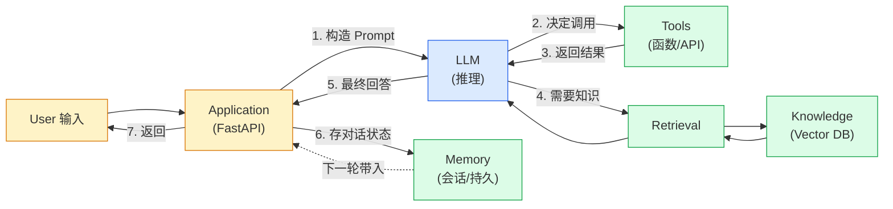

# 第 2 章 · LLM Application 开发基础

> 阶段 A · 认知地基 · 难度 ★★☆
> 配套：[diagrams/02_llm_app_stack.mmd](../diagrams/02_llm_app_stack.mmd) · [examples/01_llm_basics.py](../examples/01_llm_basics.py)

---

## 2.1 本章导读

在讲框架之前，必须把 8 个术语讲清楚。这 8 个词你在所有 AI 文档里都会看到，不讲清楚后面每章都卡。它们是：

**Prompt / Token / Context / Embedding / Retrieval / Tool Calling / Memory / Agent**

本章不是字典式罗列，而是讲清**它们之间怎么协作**，最终画出 LLM 应用的完整数据流。读完你能区分 "聊天机器人" 和 "LLM 应用" 的本质差别。

---

## 2.2 八个基础术语

### 术语 1：Prompt（提示词）

**定义**：给 LLM 的输入文本，告诉它 "要做什么"。

**Java 类比**：HTTP 请求体。

**详解**：Prompt 不只是用户问题，还包含系统设定、上下文、示例。一个工程化 Prompt 通常长这样：

```
[系统设定] 你是企业知识库助手，只根据提供的上下文回答。
[上下文]   {检索到的文档片段}
[示例]     问：xxx 答：xxx
[用户问题] {当前问题}
```

Prompt 工程的核心：**把期望的输出格式、约束、示例都写清楚**，LLM 才会稳定输出。

### 术语 2：Token（令牌）

**定义**：LLM 处理文本的最小单元。**不是字符，也不是单词**。

**Java 类比**：字节。

**详解**：Token 是 LLM 计费和上下文窗口的基本单位。粗略换算：
- 英文：1 个单词 ≈ 1.3 token（"hello" = 1 token，"hamburger" = 2 token）
- 中文：1 个汉字 ≈ 2 token（"你好" = 4 token）

```python
response = client.chat.completions.create(...)
print(response.usage)
# {prompt_tokens: 32, completion_tokens: 26, total_tokens: 58}
```

`prompt_tokens` 是输入消耗，`completion_tokens` 是输出消耗。**输出 token 通常比输入贵 3-5 倍**。

### 术语 3：Context（上下文窗口）

**定义**：单次请求 LLM 能 "看见" 的最大 token 数。

**Java 类比**：方法栈大小。

**详解**：不同模型窗口不同：
- GPT-4o：128K token（约 9 万汉字）
- Claude 3.5：200K token
- GPT-3.5：16K token

**关键认知**：上下文窗口是硬上限。超了就要**截断、压缩、或分块处理**。这正是第 9 章 Harness 的 Context Management 要解决的。长对话不是无限制的，到点必须压缩。

### 术语 4：Embedding（嵌入/向量化）

**定义**：把文本转成一串数字（向量），让机器能算 "语义相似度"。

**Java 类比**：特征提取。

**详解**：
```
"今天天气很好" → [0.12, -0.45, 0.78, ..., 0.03]  # 比如 1536 维
"今日气候不错" → [0.11, -0.44, 0.80, ..., 0.05]  # 相似度高
"我想吃火锅"   → [-0.33, 0.67, 0.12, ..., -0.89] # 相似度低
```

两个向量算 "余弦相似度"，越接近 1 越相似。Embedding 是 RAG（第 5 章）的基础——把文档变成向量，用户提问也变成向量，找最相似的文档片段。

### 术语 5：Retrieval（检索）

**定义**：从一堆向量里召回最相似的片段。

**Java 类比**：Elasticsearch search。

**详解**：用户问题 → Embedding → 向量库做近邻搜索 → 返回 Top-K 相关片段。这是 RAG 的核心动作。"近邻搜索" 不是精确匹配，是 "找最接近的 K 个"，所以叫**召回（recall）**，可能不准，需要 Rerank 精排（第 5 章详讲）。

### 术语 6：Tool Calling（工具调用）

**定义**：LLM 自己决定 "我要调这个函数"，然后应用层执行函数，把结果回灌给 LLM。

**Java 类比**：反射调用 / 动态代理。

**详解**：这是 Agent 的核心机制。流程是四步闭环：

```
1. 应用把 "可用工具的 schema" 和用户问题一起发给 LLM
2. LLM 返回 "我要调 get_weather('北京')"
3. 应用执行 get_weather('北京')，得到 {"temp": 25}
4. 应用把结果回灌给 LLM，LLM 生成自然语言 "北京今天 25 度"
```

**关键**：LLM 不直接执行代码，它只返回 "要调什么、参数是什么"。真正执行的是应用层。这是安全设计——LLM 不可信，不能让它直接操作文件系统。

### 术语 7：Memory（记忆）

**定义**：跨轮次的会话状态。

**Java 类比**：HttpSession。

**详解**：LLM 本身是无状态的——每次调用都是独立的。要实现多轮对话，必须把历史消息**每次都带上**发给 LLM。这就是 Memory：

```python
# 简单 Memory 就是维护一个消息列表
history = [
    {"role": "user", "content": "我叫张三"},
    {"role": "assistant", "content": "你好张三"},
]
# 下一轮把 history 全带上
client.chat.completions.create(messages=history + [{"role":"user","content":"我叫什么"}])
# LLM 能答出 "张三"，因为它在 history 里看到了
```

**问题**：历史越长 token 越多，超窗口就要压缩（第 9 章 Harness）。

### 术语 8：Agent（智能体）

**定义**：LLM + 工具 + 循环决策。

**Java 类比**：一个会调外部 API 的 Spring Service，但 "调哪个 API" 由 LLM 决定。

**详解**：Agent 不是单个 API 调用，而是**循环**：
```
while 未完成:
    LLM 思考 → 决定调工具 → 执行工具 → 看结果 → 再思考 → ...
    直到 LLM 认为可以给用户最终答案
```

这就是 Agent 和普通 LLM 调用的本质区别：**Agent 会自主多步推理**。第 4 章 LangGraph 就是控制这个循环的框架。

---

## 2.3 LLM 应用完整架构

把 8 个术语拼起来，就是 LLM 应用的完整数据流：（下面内嵌架构图，源码见 [diagrams/02_llm_app_stack.mmd](../diagrams/02_llm_app_stack.mmd)）：




### 聊天机器人 vs LLM 应用

这是本章最重要的认知：

| 维度 | 聊天机器人 | LLM 应用 |
|---|---|---|
| LLM 用法 | 直接问答 | 推理 + 调工具 + 检索知识 |
| 工具 | 无 | 有（Tool Calling） |
| 知识 | 无 | 有（RAG） |
| 记忆 | 无或简单 | 有（Memory） |
| 决策 | 单轮 | 多步循环（Agent） |

**企业要的是 LLM 应用，不是聊天机器人**。后者只是个玩具，前者能接业务系统、用私有知识、做复杂决策。

---

## 2.4 代码示例：三段基础演示

打开 [examples/01_llm_basics.py](../examples/01_llm_basics.py)。三段代码分别演示：纯调用、Tool Calling、Memory。

### 段 1：直接调用 LLM + 看 token 消耗

```python
from openai import OpenAI
import os

client = OpenAI(
    api_key=os.getenv("DEEPSEEK_API_KEY"),
    base_url=os.getenv("DEEPSEEK_BASE_URL", "https://api.deepseek.com"),
)

response = client.chat.completions.create(
    model="deepseek-chat",
    messages=[{"role": "user", "content": "用一句话解释什么是 LLM。"}],
)
print(response.choices[0].message.content)
print(f"消耗 token: {response.usage.total_tokens}")
```

**精讲**：和第 1 章的 `00_setup.py` 一样，重点看 `response.usage`。你会看到 `prompt_tokens` 和 `completion_tokens`，理解 token 是怎么算的。**改一下问题长度，观察 token 变化**，建立直觉。

### 段 2：Tool Calling 四步闭环

```python
# 第1步：定义工具的 schema（告诉 LLM 有什么工具可用）
tools = [{
    "type": "function",
    "function": {
        "name": "get_weather",
        "description": "查询某城市天气",
        "parameters": {
            "type": "object",
            "properties": {
                "city": {"type": "string", "description": "城市名"}
            },
            "required": ["city"],
        },
    },
}]

# 第2步：把问题 + 工具 schema 一起发给 LLM
response = client.chat.completions.create(
    model="deepseek-chat",
    messages=[{"role": "user", "content": "北京天气怎么样？"}],
    tools=tools,
)

# 第3步：LLM 返回 "我要调 get_weather('北京')"
tool_call = response.choices[0].message.tool_calls[0]
import json
args = json.loads(tool_call.function.arguments)  # {"city": "北京"}

# 第4步：应用执行函数，结果回灌
def get_weather(city):
    return {"city": city, "temp": 25, "weather": "晴"}

result = get_weather(args["city"])
# 把工具结果发给 LLM，让它生成自然语言
final = client.chat.completions.create(
    model="deepseek-chat",
    messages=[
        {"role": "user", "content": "北京天气怎么样？"},
        response.choices[0].message,  # LLM 之前的 tool_call 决策
        {"role": "tool", "tool_call_id": tool_call.id, "content": json.dumps(result, ensure_ascii=False)},
    ],
)
print(final.choices[0].message.content)  # "北京今天 25 度，晴"
```

**逐段精讲**：

- **第 1 步**：`tools` 是 JSON Schema 数组，描述每个工具的名字、用途、参数。这就是 "工具的元信息"。LLM 看着这个 schema 决定要不要调。
- **第 2 步**：请求里多了 `tools=tools` 参数。LLM 收到后，除了能直接回答，还能选择 "调工具"。
- **第 3 步**：`response.choices[0].message.tool_calls` 不为空，说明 LLM 决定调工具。`function.arguments` 是 LLM 生成的参数 JSON 字符串，要 `json.loads` 解析。
- **第 4 步**：**最关键、最容易漏的一步**。执行完函数，要把结果**回灌**给 LLM，它才能生成自然语言回答。回灌的消息 `role` 是 `"tool"`，要带上 `tool_call_id` 让 LLM 知道这是哪个工具的结果。

> Java 工程师注意：这四步是**所有 Agent 的内核**。第 3 章 LangChain、第 4 章 LangGraph 的 Agent，底层都是这四步循环，只是封装得更优雅。

### 段 3：Memory 多轮对话

```python
class ChatSession:
    """简单的会话记忆：维护消息列表。"""
    def __init__(self):
        self.history = []

    def chat(self, user_input):
        # 每次把完整历史带上
        self.history.append({"role": "user", "content": user_input})
        response = client.chat.completions.create(
            model="deepseek-chat",
            messages=self.history,
        )
        reply = response.choices[0].message.content
        self.history.append({"role": "assistant", "content": reply})
        return reply

session = ChatSession()
print(session.chat("我叫张三，记住我的名字"))   # "好的，张三"
print(session.chat("我叫什么？"))                # "张三"（因为它在 history 里）
```

**精讲**：
- `ChatSession` 用一个 `list` 存历史消息。每次请求把整个 list 发给 LLM。
- `class` 是 Python 的类定义，和 Java 的 class 几乎一样。`__init__` 是构造器（Java 的构造方法）。
- LLM 能记住名字，**不是因为它有记忆**，而是因为每次都把历史全发了。这是 Memory 的本质——**靠重复发送历史模拟记忆**。
- **问题**：历史越长 token 越多，成本越高，还会超窗口。所以真实项目要压缩历史（第 9 章）。

### 段 4：本地与自托管模型运行（Ollama / vLLM）

前面三段都调**云端 API**（DeepSeek / OpenAI）。但真实开发常遇到三种情况：① 数据**不能出内网**；② 想省调用费、本地跑 demo；③ 生产要**自己扛高并发**。这时就要把模型跑在本地或自建服务上。两个最主流的选择：

- **Ollama**：本地一键跑开源模型（`ollama run qwen2.5`），自动帮你下权重、起一个 **OpenAI 兼容**的本地服务（`http://localhost:11434`）。适合开发调试、单机。
- **vLLM**：生产级高性能推理引擎（PagedAttention + 连续批处理），吞吐是原生推理的数倍，同样暴露 **OpenAI 兼容 API**。适合自建推理服务扛并发。

关键在于：**两者都兼容 OpenAI 接口**，所以你前面写的（以及后面所有 LangChain / LlamaIndex 示例）代码几乎不用改——只要把 `base_url` 指向本地服务、`api_key` 随便填即可从云端切到本地。

```python
from openai import OpenAI

# 指向本地 Ollama / vLLM 起的 OpenAI 兼容服务，业务代码零改动
client = OpenAI(
    base_url="http://localhost:11434/v1",  # vLLM 同理，换成它的端口
    api_key="not-needed",                  # 本地服务一般不校验 key
)

resp = client.chat.completions.create(
    model="qwen2.5:7b",     # Ollama 拉取的模型名；vLLM 用启动时的 --model
    messages=[{"role": "user", "content": "用一句话解释 RAG"}],
)
print(resp.choices[0].message.content)
```

> 口诀：**Ollama 管开发、vLLM 管生产；换底座不换代码，因为都讲 OpenAI 方言。**

### 运行预期

```bash
$ python examples/01_llm_basics.py
[段1] 纯调用
LLM 是一种基于海量文本训练的大规模神经网络模型，能理解和生成自然语言。
消耗 token: 58 (prompt: 32, completion: 26)

[段2] Tool Calling
LLM 决定调用: get_weather({'city': '北京'})
工具执行结果: {'city': '北京', 'temp': 25, 'weather': '晴'}
最终回答: 北京今天 25 度，天气晴朗。

[段3] Memory
第1轮: 好的，张三，我记住了。
第2轮: 你叫张三。

[段4] 本地模型（Ollama/vLLM）
# 需先 ollama run qwen2.5 或起 vLLM 服务，输出形如：RAG 是让模型先检索再生成答案。
```

---

## 2.5 实际应用场景

**场景 1：评估一个 AI 需求的复杂度**
产品说 "做个能回答员工请假制度的机器人"。你判断：纯 LLM 不行（不知道公司制度），要 RAG（检索制度文档）。如果要能 "帮员工提交请假申请"，那还要 Tool Calling（调 HR 系统接口）。如果流程复杂（3 天以上要审批），要 Agent（多步决策）。这 8 个术语就是评估工具。

**场景 2：估算 API 成本**
用 GPT-4o 做客服，每天 1 万次对话，每次平均输入 500 token、输出 200 token。你能算出：每天 500 万输入 token + 200 万输出 token。按定价算月成本，决定要不要换更便宜的模型或加缓存。

**场景 3：诊断 Agent 为什么答错**
Agent 答错了，从 8 个术语定位：
- 是 Prompt 没写清楚？（Prompt）
- 是上下文太长被截断了？（Context）
- 是检索到的文档不对？（Retrieval）
- 是工具返回的数据有误？（Tool Calling）
- 是历史记忆干扰了？（Memory）

每个术语都是一个排查维度。

---

## 2.6 陷阱与最佳实践

**陷阱 1：以为 LLM 有 "持久记忆"**
LLM 本身完全无状态。你昨天跟它说的话，今天它不知道——除非你把历史再发一遍。所有 "记忆" 都是应用层模拟的。理解这点，才能理解为什么需要 Memory 组件和 Harness 的持久化。

**陷阱 2：Tool Calling 漏了回灌步骤**
新手最常犯的错误：调了工具拿到结果，直接返回给用户，没回灌给 LLM。结果用户看到的是原始 JSON 而不是自然语言。**四步闭环缺一不可**。

**陷阱 3：把所有历史无脑发给 LLM**
10 轮对话后历史可能几千 token，每轮都全发，成本爆炸且超窗口。真实项目要做**滑动窗口 / 摘要压缩**（第 9 章 Harness）。

**陷阱 4：混淆 Embedding 和 LLM**
Embedding 模型和 LLM 是两个不同的模型。Embedding 只做 "文本→向量"，不做推理；LLM 做推理但不直接算相似度。RAG 里两者都要：Embedding 负责检索，LLM 负责生成。

**最佳实践：先用最简单的方式跑通**
任何 AI 需求，先用 "直接调 LLM" 跑通最小版本，再逐步加 Tool / RAG / Memory。别一上来就上全套框架，调试困难。

---

## 2.7 小结

- 8 个术语：**Prompt（输入）/ Token（计费单位）/ Context（窗口上限）/ Embedding（向量化）/ Retrieval（检索）/ Tool Calling（调工具）/ Memory（会话状态）/ Agent（循环决策）**。
- LLM 应用 = User → Application → LLM + Tools + Knowledge + Memory。
- 聊天机器人 ≠ LLM 应用：后者带工具、知识、记忆，能做复杂决策。
- Tool Calling 四步闭环是所有 Agent 的内核，务必记住。
- LLM 本身无状态，"记忆" 全靠应用层重复发送历史。

地基打完了。下一章进入框架主体——LangChain，看怎么把这 8 个概念组件化。

---

> **上一章**：[第 1 章 · Python AI 生态概览](01_python_ai_ecosystem.md)
> **下一章**：[第 3 章 · LangChain](03_langchain.md)
