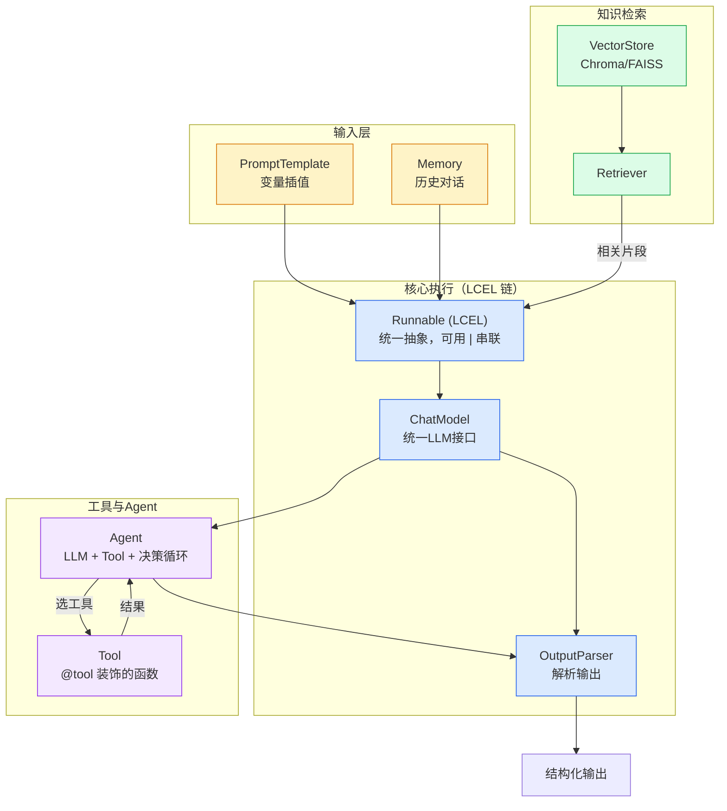

# 第 3 章 · LangChain

> 阶段 B · 核心组件 · 难度 ★★☆
> 配套：[diagrams/03_langchain.mmd](../diagrams/03_langchain.mmd) · [examples/02_langchain_demo.py](../examples/02_langchain_demo.py)

---

## 3.1 本章导读

LangChain 是 Python AI 生态里**知名度最高**的框架。但它也是被吐槽最多的——"过度封装"、"API 变动频繁"。这一章不吹不黑，讲清楚三件事：

1. LangChain 到底解决什么问题（值得用）；
2. 它的 9 个核心组件分别是什么；
3. LCEL（LangChain Expression Language）的 `|` 管道符为什么是精髓。

读完你能写出 "调 LLM → Prompt 模板 → LCEL Chain → Agent 选 Tool" 四段最小代码。

---

## 3.2 LangChain 解决什么问题

**不用 LangChain**，每个项目都要手写这些胶水代码：
- 拼 Prompt 字符串（变量插值、转义）；
- 调 LLM（不同 SDK 接口不一样）；
- 解析 LLM 返回（取 content、处理 tool_calls）；
- 维护对话历史；
- 接向量库做检索。

每个项目重写一遍，重复且易错。

**用 LangChain**，这些封装成可复用组件：Prompt 模板、统一 Model 接口、输出解析器、Memory、Retriever。组件之间用统一的 `Runnable` 抽象串联。

> 类比：不用 Spring，你每个项目手写 Bean 管理、事务、AOP；用 Spring，这些都有了。LangChain 之于 LLM 应用，就像 Spring 之于 Java 后端。

**什么时候不用 LangChain**：
- 极简场景（就调一次 LLM），直接用 OpenAI SDK 更轻；
- RAG 专精场景，LlamaIndex 更精细；
- 嫌封装太重，直接用 SDK + 自己写编排。

但对认知课，LangChain 仍是入门最佳——概念全、文档多、生态广。

---

## 3.3 九大核心组件

| 组件 | 解决的问题 | Java 类比 |
|---|---|---|
| **Chat Model** | 统一不同 LLM 的调用接口 | 统一的 Service 接口 |
| **Prompt Template** | 变量插值复用提示词 | MessageFormat / 模板引擎 |
| **Runnable** | LCEL 的统一抽象，可串联/并行 | `Function<T,R>` 家族 |
| **Chain** | 多步组合（**正被 Runnable 取代**） | 责任链 |
| **Retriever** | 从 Vector Store 召回 | DAO 的查询接口 |
| **Vector Store** | 存 Embedding | 数据库 |
| **Memory** | 跨轮对话状态 | Session |
| **Tool** | LLM 可调用的函数 | @Service 方法 |
| **Agent** | LLM + Tool + 决策循环 | 会调外部 API 的 Service |

重点理解三个：

### Chat Model：统一接口
```python
from langchain_deepseek import ChatDeepSeek
model = ChatDeepSeek(model="deepseek-chat")
# 换成其他国产模型（如通义千问 / 智谱 GLM），只改这一行即可
# 各厂商都有对应的 langchain 集成包，用法完全一致
```
换模型不改业务代码，这是抽象的价值。

### Runnable：统一抽象
所有组件都实现 `Runnable` 接口，统一方法：
- `invoke(input)`：同步调用
- `ainvoke(input)`：异步调用（async/await）
- `batch(inputs)`：批量
- `stream(input)`：流式

这意味着**任何组件都能用同一套 API**，这是 LCEL 能用 `|` 串联的前提。

### LCEL：用 `|` 串成链
```python
chain = prompt | model | parser
```
这是 LangChain 的精髓，下面详讲。

---

## 3.4 架构图解读

下面是内嵌的架构图（源码同步保存在 [diagrams/03_langchain.mmd](../diagrams/03_langchain.mmd)）：



看核心执行部分：`prompt | model | parser` 这条链。数据流是：
1. `prompt` 接收 `{concept: "RAG"}`，填模板生成消息；
2. `model` 接收消息，调 LLM；
3. `parser` 接收 LLM 返回，解析成纯字符串。

下面还有检索（VectorStore → Retriever → 注入 prompt）和工具（Agent → Tool 循环）。这些在第 5 章和本章节 4 段代码里展开。

---

## 3.5 代码逐段精讲

打开 [examples/02_langchain_demo.py](../examples/02_langchain_demo.py)。四段代码对应四个核心能力。

### 段 1：调 LLM（Chat Model）

```python
from langchain_deepseek import ChatDeepSeek

model = ChatDeepSeek(
    model=os.getenv("DEEPSEEK_MODEL", "deepseek-chat"),
    api_key=os.getenv("DEEPSEEK_API_KEY"),
    temperature=0.3,
)
response = model.invoke("用一句话解释什么是 LLM。")
print(response.content)
```

**精讲**：
- `ChatDeepSeek` 是 LangChain 对 DeepSeek 模型的封装（DeepSeek 提供 OpenAI 兼容接口）。`temperature` 控制随机性：0 最确定（适合问答），1 最发散（适合创意）。
- `model.invoke(...)` 是 Runnable 统一接口。返回的是 `AIMessage` 对象，`.content` 取文本。
- 对比第 2 章裸用 DeepSeek（OpenAI 兼容）SDK：这里不用自己拼 `messages` 列表，传字符串即可，LangChain 自动包装。

### 段 2：Prompt Template

```python
from langchain_core.prompts import ChatPromptTemplate

template = ChatPromptTemplate.from_template(
    "你是一位{role}。请用一句话解释{topic}。"
)
r1 = template.invoke({"role": "Java 架构师", "topic": "Pydantic"})
r2 = template.invoke({"role": "AI 研究员", "topic": "Embedding"})
```

**精讲**：
- `ChatPromptTemplate.from_template("...{role}...")` 把带 `{变量}` 的字符串变成模板。
- `invoke({"role": ..., "topic": ...})` 填变量，返回消息对象。
- **价值**：同一个模板复用，填不同变量。比手写 f-string 或字符串拼接更规范，还能做变量校验。
- Java 类比：`MessageFormat.format("你是一位{0}", role)`，但 LangChain 模板能直接产出到 LLM 的消息结构。

### 段 3：LCEL Chain（★ 精髓）

```python
from langchain_core.output_parsers import StrOutputParser

prompt = ChatPromptTemplate.from_template("用一句话解释 {concept}。")
chain = prompt | model | StrOutputParser()
result = chain.invoke({"concept": "RAG"})
```

**这是全章最重要的一行**：`prompt | model | StrOutputParser()`。

- `|` 是 Python 的按位或运算符，但 LangChain **重载**了它，变成 "把左边的输出作为右边的输入"。
- 数据流：
  ```
  {"concept": "RAG"} →[prompt]→ 消息 →[model]→ AIMessage →[parser]→ 纯字符串
  ```
- Java 类比：`Stream.map().filter().collect()`，但这里每步可能是 LLM 调用。
- **为什么这是精髓**：所有组件都是 Runnable，都能用 `|` 串。你可以随意组合：`retriever | prompt | model | parser`，加检索只多一段。这就是 LCEL 的表达力。

> Python 知识点：运算符重载。Python 允许类定义 `__or__` 方法来重载 `|`。LangChain 的 Runnable 实现了 `__or__`，所以 `a | b` 实际调用 `a.__or__(b)`，返回一个新的组合 Runnable。Java 不支持运算符重载，所以这种写法对 Java 工程师很新鲜。

`StrOutputParser()` 把 `AIMessage` 解析成纯字符串。还有 `JsonOutputParser`、`PydanticOutputParser` 等，按需选。

### 段 4：Agent + Tool

```python
from langchain_core.tools import tool
from langchain.agents import create_agent

@tool
def add(a: int, b: int) -> int:
    """两个整数相加。当用户要做加法时调用。"""
    return a + b

@tool
def multiply(a: int, b: int) -> int:
    """两个整数相乘。当用户要做乘法时调用。"""
    return a * b

tools = [add, multiply]
# create_agent：组装一个会自主选工具的 Agent（LangChain 1.x 推荐入口）
agent = create_agent(model, tools, system_prompt="你是一个能算术的助手。")
# 输入是 messages 列表；输出取最后一条 AI 消息
result = agent.invoke({"messages": [{"role": "user", "content": "计算 3 乘以 4，再加 5。"}]})
print(result["messages"][-1].content)
```

**精讲**：

- **`@tool` 装饰器**：把普通 Python 函数自动转成 Tool 对象。
  - 函数名 → 工具名
  - **docstring → 工具描述**（关键！LLM 看着这个决定何时用）
  - **类型提示 → 参数 schema**（`a: int` 变成 JSON Schema 的 `{"type": "integer"}`）
  - Java 类比：像 `@Tool` 注解 + 反射读方法签名。
  - 所以**写好 docstring 是 Tool 工程的关键**，描述不清 LLM 就不会调。

- **`create_agent`**：组装一个会自主选工具的 Agent。它把第 2 章讲的 Tool Calling 四步闭环封装了（`model` + `tools` + 可选 `system_prompt`）。

- **决策循环**：`create_agent` 返回的对象负责执行循环。LLM 决定调 `multiply(3,4)` → 执行得 12 → LLM 再决定调 `add(12,5)` → 执行得 17 → LLM 给最终答案 "17"。这就是 Agent 的多步推理。

- **无需手写 `{agent_scratchpad}`**：旧版 `AgentExecutor` 要求 prompt 里放一个 `{agent_scratchpad}` 占位符当临时记忆区；新版 `create_agent` 内部自动管理工具调用循环与中间记忆，不用再手动加占位符。

### 运行预期

```bash
$ python examples/02_langchain_demo.py
[段1] ChatModel.invoke → LLM 是一种基于海量文本训练的大规模神经网络模型...
[段2] 模板1 → 你是一位Java 架构师。请用一句话解释Pydantic。
     模板2 → 你是一位AI 研究员。请用一句话解释Embedding。
[段3] LCEL Chain → RAG 是一种结合检索与生成的技术，先检索相关文档再让 LLM 基于文档回答。
[段4] Agent → 3 乘以 4 等于 12，再加 5 等于 17。
```

---

## 3.6 实际应用场景

**场景 1：内部文档问答（LangChain + RAG）**
员工问 "年假几天？" → Retriever 检索制度文档 → prompt 注入片段 → LLM 回答。第 5 章详讲，骨架就是 `retriever | prompt | model | parser`。

**场景 2：能查数据的客服 Agent**
用户问 "我上个月订单多少？" → Agent 决定调 `query_orders(user_id)` → 执行 → LLM 用结果回答。第 7 章 MCP 把这种工具接入标准化。

**场景 3：多步骤任务编排**
"帮我调研 X，写报告，发邮件" → 用 LCEL 串：`research_chain | report_chain | email_chain`。复杂流程上 LangGraph（第 4 章）。

---

## 3.7 陷阱与最佳实践

**陷阱 1：被 9 大组件吓到**
90% 场景只用四件套：**Prompt Template + Chat Model + Retriever + Runnable（LCEL）**。Memory、Chain（旧版）用得少。用到再查文档。

**陷阱 2：用旧版 Chain 不用 LCEL**
LangChain 早期用 `LLMChain`、`ConversationChain` 这些类，现在**官方推荐 LCEL**。旧版 Chain 还能用但不再演进。新项目直接用 `prompt | model | parser`。

**陷阱 3：Tool 的 docstring 写得太随意**
docstring 是 LLM 选工具的依据。写 "加法" 不如写 "两个整数相加。当用户要做加法时调用。" 描述越具体，LLM 选择越准。

**陷阱 4：以为 LangChain 是唯一选择**
LangChain 适合快速搭建和复杂编排。但简单场景直接用 DeepSeek（OpenAI 兼容）SDK 更轻；RAG 专精用 LlamaIndex。**别为了用而用**。

**最佳实践：用 `debug=True` 调试**
`create_agent(model, tools, debug=True)` 会打印内部每步决策（调了什么工具、得到什么结果）。调试 Agent 必备。

**最佳实践：组件复用**
把常用 prompt、chain 抽成函数或类，跨项目复用。LangChain 的设计初衷就是组件化。

---

## 3.8 小结

- LangChain 解决 "别让每个项目重写 Prompt/检索/记忆胶水代码" 的问题。
- 9 大组件，90% 场景用四件套：Prompt Template / Chat Model / Retriever / Runnable。
- **LCEL 是精髓**：所有组件都是 Runnable，用 `|` 串联，表达力极强。
- `@tool` 装饰器把普通函数变 Tool，**docstring 是工程关键**。
- Agent = LLM + Tool + 决策循环，`create_agent` 封装了第 2 章的四步闭环。

LangChain 的 Chain 是**单向**的。但真实 Agent 需要**循环 + 条件 + 状态**——这就要 LangGraph。

---

> **上一章**：[第 2 章 · LLM Application 开发基础](02_llm_app_basics.md)
> **下一章**：[第 4 章 · LangGraph](04_langgraph.md)
