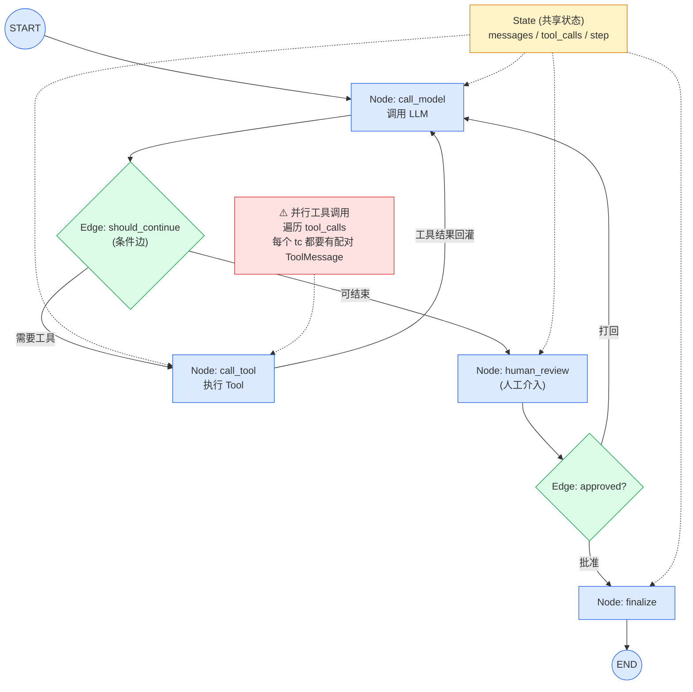

# 第 4 章 · LangGraph

> 阶段 B · 核心组件 · 难度 ★★★（本教程重点）
> 配套：[diagrams/04_langgraph.mmd](../diagrams/04_langgraph.mmd) · [examples/03_langgraph_demo.py](../examples/03_langgraph_demo.py)

---

## 4.1 本章导读

这一章是**全教程最关键**的章节之一。如果说 LangChain 解决 "怎么把组件拼起来"，LangGraph 解决 "怎么让 Agent **可靠地多步推理**"。

读完你能回答：
- 为什么 LangChain 的 Chain 不够，需要 LangGraph？
- Graph / Node / Edge / State 四个原语怎么控制流程？
- 怎么实现循环、人工介入、状态管理？

---

## 4.2 为什么 Chain 不够

LangChain 的 LCEL Chain 是**单向流水线**：

```
prompt → model → parser → 输出
```

数据从头流到尾，不回头。但真实 Agent 的推理是**循环**的：

```
LLM 思考 → 需要调工具 → 调工具 → 看结果 → 还需要再调 → ... → 最终回答
```

Chain 表达不了循环。硬要用 Chain 写，得递归或 while 循环，状态藏在闭包里，**出 bug 难调试、无法中断、无法重放**。

LangGraph 的解法：**把 Agent 流程显式建模成状态机 + 图**。

> 类比：Chain 像一条流水线传送带；LangGraph 像一个 BPMN 流程图，有节点、有条件分支、有循环、能暂停。

---

## 4.3 四个原语

| 原语 | 作用 | Java 类比 |
|---|---|---|
| **Graph** | 工作流拓扑（节点 + 边的集合） | BPMN 流程图 |
| **Node** | 一步操作，是一个函数 | Service 方法 |
| **Edge** | 节点间跳转，可带条件 | 状态机迁移 |
| **State** | 在节点间传递的共享状态 | 流程变量 |

### State：显式化的共享状态

这是 LangGraph 和 Chain 的本质区别。Chain 的状态是隐式的（藏在闭包里），LangGraph 的 State 是**显式定义的 TypedDict**：

```python
from typing import TypedDict, Annotated
import operator

class AgentState(TypedDict):
    messages: Annotated[list, operator.add]  # reducer：列表拼接
    step: int
```

每一步 Node 执行后返回一个 dict，LangGraph 用 **reducer** 把它合并进 State。

- `Annotated[list, operator.add]` 告诉 LangGraph：这个字段不是覆盖，是**拼接**。Node 返回 `{"messages": [新消息]}`，会 append 到已有 list。
- Java 没有等价物，理解为 "每次节点输出都 merge 进共享状态，而非替换"。

### Node：一个函数

Node 就是一个普通 Python 函数，接收 State，返回要更新的字段：

```python
def call_model(state: AgentState) -> dict:
    response = model.invoke(state["messages"])
    return {"messages": [response], "step": state["step"] + 1}
```

### Edge：跳转规则

```python
graph.add_edge("node_a", "node_b")               # 无条件：a 完了一定去 b
graph.add_conditional_edges("agent", should_continue, {...})  # 条件边
```

条件边是一个函数，返回字符串（下一跳节点名）：

```python
def should_continue(state) -> Literal["tools", "__end__"]:
    last_msg = state["messages"][-1]
    if last_msg.tool_calls:      # LLM 想调工具
        return "tools"
    return "__end__"             # 不用调工具，结束
```

---

## 4.4 架构图解读

这是一个典型 Agent 工作流：（下面内嵌架构图，源码见 [diagrams/04_langgraph.mmd](../diagrams/04_langgraph.mmd)）：




看两个关键点：
1. **循环**：`call_model → tools → call_model` 形成环，Agent 可以多次调工具。
2. **人工介入**：`human_review` 节点前可暂停，等人审批。

---

## 4.5 代码逐段精讲

打开 [examples/03_langgraph_demo.py](../examples/03_langgraph_demo.py)。分四部分看。

### 部分 1：定义 State

```python
from typing import TypedDict, Annotated
import operator

class AgentState(TypedDict):
    messages: Annotated[list, operator.add]
    step: int
```

**精讲**：
- `TypedDict` 是 Python 的类型工具，定义一个 dict 的字段结构。运行时不强制，但类型检查器能校验。Java 类比：record / POJO。
- `Annotated[list, operator.add]`：`Annotated` 给类型加元数据。这里元数据是 `operator.add`（一个加法函数），LangGraph 用它当 **reducer**。
- reducer 的作用：当多个 Node 都往 `messages` 写，LangGraph 用 `operator.add`（列表拼接）合并，而不是后写覆盖先写。

### 部分 2：定义 Node 函数

```python
def call_model(state: AgentState) -> dict:
    """调用 LLM。"""
    response = model.invoke(state["messages"])
    return {"messages": [response], "step": state["step"] + 1}

def call_tool(state: AgentState) -> dict:
    """执行 LLM 决定调用的工具（可能一次多个）。"""
    last_msg = state["messages"][-1]
    tool_messages = []
    for tc in last_msg.tool_calls:       # ⚠️ 遍历全部，不能只取 [0]
        tool_messages.append(execute_tool(tc))
    return {"messages": tool_messages, "step": state["step"] + 1}

def human_review(state: AgentState) -> dict:
    """人工评审节点。"""
    print("请审批 Agent 的输出...")
    return {"step": state["step"] + 1}
```

**精讲**：
- 每个 Node 接收完整 `state`，返回**要更新的字段**（不必返回全量）。
- `call_model` 把 LLM 响应 append 到 `messages`（靠 reducer 拼接）。
- `call_tool` 遍历最后一条消息的 `tool_calls`，**为每个工具调用都生成一条 ToolMessage** 再 append。注意这里必须用 `for` 遍历全部，不能只取 `tool_calls[0]`——原因见 4.7 陷阱 5。
- `human_review` 是占位，真实场景这里暂停等人输入。

### 部分 3：条件边

```python
def should_continue(state) -> Literal["tools", "human_review"]:
    last_msg = state["messages"][-1]
    if last_msg.tool_calls:
        return "tools"          # LLM 要调工具 → 去 tools 节点
    return "human_review"       # 不用调工具 → 去人工审批
```

**精讲**：
- 返回值是字符串，等于下一跳节点名。
- `Literal["tools", "human_review"]` 是类型提示，表示返回值只能是这两个字符串之一。帮助类型检查器发现拼写错误。
- 逻辑：LLM 返回里有 `tool_calls` → 还要调工具；没有 → 准备结束，先过人工审批。

### 部分 4：组装 Graph

```python
from langgraph.graph import StateGraph, START, END

g = StateGraph(AgentState)

# 注册节点
g.add_node("call_model", call_model)
g.add_node("call_tool", call_tool)
g.add_node("human_review", human_review)

# 连边
g.add_edge(START, "call_model")                    # 入口
g.add_edge("call_model", "should_continue")        # ← 这其实是条件边，见下
g.add_conditional_edges("call_model", should_continue, {
    "tools": "call_tool",
    "human_review": "human_review",
})
g.add_edge("call_tool", "call_model")              # 工具执行完回到 model（循环！）

# 编译 + 人工介入
app = g.compile(interrupt_before=["human_review"])
```

**精讲**：
- `StateGraph(AgentState)` 创建一个图，绑定 State 类型。
- `add_node(名字, 函数)` 注册节点。
- `add_edge(a, b)` 无条件边：a 完了一定去 b。
- `add_conditional_edges(起点, 判断函数, 映射)` 条件边：判断函数返回的字符串，按映射表找到目标节点。
- **`call_tool → call_model` 这条边形成循环**，这是 Agent 多步推理的核心。
- `compile(interrupt_before=["human_review"])`：编译时指定 "在 human_review 节点之前暂停"。这就是**人工介入**——Agent 跑到这会停，等人确认后继续。

### 运行

```python
result = app.invoke({
    "messages": [{"role": "user", "content": "查北京天气"}],
    "step": 0,
}, config={"recursion_limit": 10})
```

`recursion_limit` 防止 Agent 死循环——最多循环 10 次强制停。

### 运行预期

```bash
$ python examples/03_langgraph_demo.py
[step 0] call_model: LLM 决定调 get_weather('北京')
[step 1] call_tool: 执行 get_weather → {temp: 25}
[step 2] call_model: LLM 基于工具结果生成回答
[暂停] 在 human_review 前等待人工审批...
[审批通过]
最终: 北京今天 25 度，晴。
```

---

## 4.6 实际应用场景

**场景 1：研发 Agent（代码 → 测试 → 评审 → 部署）**
```
research → coding → testing → human_review → deploy
                          ↑        ↓ 批准
                          └─失败回环─┘
```
测试失败回到 coding 重写，审批通过才部署。这就是第 13 章案例 2 的骨架。

**场景 2：审批流 Agent**
员工提交报销 → Agent 检查单据 → 金额小自动通过 / 金额大人工审批 → 调财务系统打款。条件边 + 人工介入天然适合。

**场景 3：运维 Agent**
告警 → Agent 诊断 → 需要重启服务？→ 人工确认 → 执行重启 → 验证。危险操作必须人工介入，LangGraph 的 `interrupt_before` 正好用上。

**场景 4：多步研究 Agent**
"调研 X 公司" → 搜索 → 读财报 → 发现要查关联公司 → 再搜索 → 综合 → 报告。循环搜索直到信息够了。

---

## 4.7 陷阱与最佳实践

**陷阱 1：忘记设 `recursion_limit`**
Agent 可能陷入死循环（工具一直返回需要再调）。`compile` 后 `invoke` 时传 `config={"recursion_limit": N}`，默认 25，按需调。

**陷阱 2：reducer 用错**
如果 State 字段没标 `Annotated[list, operator.add]`，默认 reducer 是**覆盖**。两个 Node 都写 `messages`，后写的把先写的冲掉，历史丢失。**列表型字段一定要标 reducer**。

**陷阱 3：Node 返回全量 State**
Node 只需返回**要更新的字段**。返回全量既啰嗦又容易出错（漏了 reducer 就覆盖）。

**陷阱 4：条件边返回的节点名拼错**
`should_continue` 返回 `"tool"`，但映射表里是 `"tools"`，会报错。用 `Literal["tools", "human_review"]` 类型提示能提前发现。

**陷阱 5：并行工具调用 —— 每个 `tool_call` 必须有配对的 `ToolMessage`**（本教程示例真实踩坑）
LLM 一次可能返回**多个** `tool_calls`（例如用户说"查资料并写代码"，模型同时决定调 `search_docs` 和 `write_code`）。如果你在 `call_tool` 里只处理 `tool_calls[0]`：

```python
# ❌ 错误写法：只处理第一个工具调用
tool_call = last_msg.tool_calls[0]
return {"messages": [ToolMessage(content=..., tool_call_id=tool_call["id"])]}
```

那只有第一个 `tool_call_id` 有对应 `ToolMessage`，第二个 `tool_call` 没有响应。当这些消息回灌给 LLM 时，OpenAI 兼容 API 会直接拒绝（HTTP 400）：

```
openai.BadRequestError: Error code: 400 -
'An assistant message with 'tool_calls' must be followed by
 tool messages responding to each 'tool_call_id'.'
```

**正确写法**：遍历 `tool_calls`，为每个 `tool_call` 都生成一条 `ToolMessage`，用 `tool_call_id` 关联：

```python
# ✅ 正确写法：遍历全部工具调用
tool_messages = []
for tc in last_msg.tool_calls:
    result = tool_map[tc["name"]].invoke(tc["args"])
    tool_messages.append(ToolMessage(content=str(result), tool_call_id=tc["id"]))
return {"messages": tool_messages}
```

> 一句话记住：**带 `tool_calls` 的 assistant 消息，后面必须有等量的 `ToolMessage` 一一配对（靠 `tool_call_id`）。** 这是 LangGraph + OpenAI 兼容接口的硬约束，跟是否用了 `ToolNode` 无关。对应可运行示例已修复：[examples/03_langgraph_demo.py](../examples/03_langgraph_demo.py)。

**最佳实践：用 Checkpointer 持久化**
```python
from langgraph.checkpoint.memory import MemorySaver
app = g.compile(checkpointer=MemorySaver(), interrupt_before=[...])
```
Checkpointer 把 State 存下来，支持：中断后恢复、回放历史、时间旅行调试。生产用数据库版 checkpointer。

**最佳实践：把 LangChain Tool 当 Node 用**
LangChain 的 `@tool` 函数、Retriever 都是 Runnable，可以直接当 Node。LangChain 和 LangGraph 是互补的，不是竞争。

---

## 4.8 LangGraph vs 其他框架

| 框架 | 定位 | 适合场景 |
|---|---|---|
| **LangGraph** | 显式状态机 + 图 | 复杂流程、循环、人工介入、可调试 |
| **LangChain Agent** | 封装好的 Agent | 简单工具调用 |
| **AutoGen** | 多 Agent 对话 | Agent 间聊天协作 |
| **CrewAI** | 角色分工 | 模拟团队角色 |
| **LlamaIndex** | RAG 专精 | 检索为主 |

**选型原则**：流程复杂、要可观测可中断 → LangGraph；多 Agent 对话 → AutoGen/CrewAI；纯 RAG → LlamaIndex（第 6 章）。本教程第 13 章案例 2 用 LangGraph 搭研发 Agent。

---

## 4.9 小结

- LangGraph 解决 "让 Agent 多步推理可调试、可中断、可重放"。Chain 是单向的，Agent 需要循环。
- 四个原语：**Graph（拓扑）/ Node（函数）/ Edge（跳转）/ State（共享状态）**。
- State 用 `TypedDict + Annotated[类型, reducer]` 显式定义，reducer 决定字段怎么合并。
- 条件边返回字符串选下一跳，形成循环和分支。
- `interrupt_before` 实现人工介入，把 Agent 从 "黑盒循环" 变成 "可中断流程"。
- 配合 Checkpointer 可持久化、回放、恢复。

LangGraph 是 "怎么跑 Agent" 的答案。但 Agent 还需要 "知识"——下一章 RAG。

---

> **上一章**：[第 3 章 · LangChain](03_langchain.md)
> **下一章**：[第 5 章 · RAG 技术体系](05_rag.md)
