# 第 5 章 · RAG 技术体系

> 阶段 B · 核心组件 · 难度 ★★★
> 配套：[diagrams/05_rag.mmd](../diagrams/05_rag.mmd) · [examples/04_rag_demo.py](../examples/04_rag_demo.py)

---

## 5.1 本章导读

RAG = Retrieval Augmented Generation，检索增强生成。它解决一个最普遍的问题：**LLM 不知道你公司的私有知识**。

你拿一份内部制度问 ChatGPT，它答不了——训练时没见过。RAG 的思路：**先把你的文档变成向量存起来，用户问的时候先检索相关片段，把片段塞进 Prompt 再让 LLM 答**。

读完你能：
- 画出 RAG 的 6 步管线；
- 区分 Embedding / Vector DB / Hybrid Search / Rerank；
- 用 LangChain + Chroma 跑通一个最小 RAG 问答。

---

## 5.2 为什么需要 RAG

**方案对比**：让 LLM 用上私有知识，有三条路。

| 方案 | 做法 | 优缺点 |
|---|---|---|
| 直接问 LLM | 把知识塞进 Prompt | 知识多了超窗口；每次都发，贵 |
| 微调（Fine-tuning） | 用私有数据训练模型 | 贵、慢、知识更新要重训 |
| **RAG** | 检索相关片段 + 注入 Prompt | 知识可随时增删；只发相关片段，省 token |

**RAG 适合 99% 企业知识库场景**：知识频繁更新、量大、要可追溯（能说 "答案来自哪个文档"）。微调适合改变 LLM 的 "风格/行为"，不适合灌知识。

---

## 5.3 六步管线

### 步骤 1：Document（文档加载）

原始数据来源：PDF / HTML / Word / 数据库 / Wiki。LangChain 提供各种 Loader：

```python
from langchain_community.document_loaders import TextLoader, PyPDFLoader, WebBaseLoader
docs = TextLoader("policy.txt").load()           # 文本
docs = PyPDFLoader("report.pdf").load()          # PDF
docs = WebBaseLoader("https://...").load()       # 网页
```

### 步骤 2：Chunk（切分）

**关键步骤**。文档太长塞不进 LLM 上下文，要切成小块。切分有讲究：
- 切太大：塞不下，且检索不准（一个块包含太多主题）；
- 切太小：丢失上下文，语义断裂。

LangChain 用 `RecursiveCharacterTextSplitter`，按 `["\n\n", "\n", " ", ""]` 层级切，**优先在段落边界断开**：

```python
from langchain_text_splitters import RecursiveCharacterTextSplitter
splitter = RecursiveCharacterTextSplitter(
    chunk_size=200,        # 每块约 200 字符
    chunk_overlap=30,      # 相邻块重叠 30 字符
)
chunks = splitter.split_documents(docs)
```

**为什么要 `chunk_overlap`**：避免把一句话切成两半，重叠区保证语义连续。常见配置：chunk_size 500-1000，overlap 10-20%。

### 步骤 3：Embedding（向量化）

把每个文本块转成向量。用 Embedding 模型：

```python
from langchain_community.embeddings import SentenceTransformerEmbeddings
embeddings = SentenceTransformerEmbeddings(model_name="BAAI/bge-small-zh-v1.5")
# 注意：DeepSeek / 通义 / 智谱 等国产 LLM 不提供 Embedding 接口，
# 因此 Embedding 统一用本地开源模型（如本例的 BAAI/bge-small-zh-v1.5）
```

- `SentenceTransformerEmbeddings`：本地模型，首次运行下载权重，**不耗 API 额度**，适合教程和内网（中文推荐 bge 系列）。
- DeepSeek / 通义 / 智谱等国产 LLM **不提供 Embedding 接口**，Embedding 统一用本地开源模型（如 BAAI/bge 系列）。
- 向量维度通常是 384 / 512 / 768 / 1536，取决于模型。

### 步骤 4：Vector DB（向量库）

把向量存进向量数据库，支持**近邻搜索**（找最相似的 K 个）。

| 向量库 | 定位 | 何时选 |
|---|---|---|
| **Chroma** | 轻量嵌入式 | 教程、原型、百万级以下 |
| **FAISS** | Meta 出的本地库 | 单机、高性能、不想装服务 |
| **Milvus** | 分布式 | 千万级以上、要集群 |
| **pgvector** | PostgreSQL 扩展 | 已有 PG、想统一管理 |

```python
from langchain_community.vectorstores import Chroma
vector_db = Chroma.from_documents(chunks, embeddings)
```

### 步骤 5：Retriever（检索器）

把 VectorStore 包成可调用的检索接口：

```python
retriever = vector_db.as_retriever(search_kwargs={"k": 3})  # 取 Top3
docs = retriever.invoke("年假几天？")  # 返回 3 个最相关片段
```

> 基础版 `k=3` 直接喂 LLM 够用；但若要做多路召回 + Rerank（5.4 节），这里应把 `k` 调大到 20~50，给后续精排留空间。

### 步骤 6：LLM（生成）

把检索到的片段塞进 Prompt，让 LLM 基于片段回答：

```python
prompt = ChatPromptTemplate.from_template("""
根据以下上下文回答问题。上下文没有就说"未找到"。
上下文：{context}
问题：{question}
""")
chain = (
    {"context": itemgetter("question") | retriever | (lambda d: "\n".join(x.page_content for x in d)),
     "question": itemgetter("question")}
    | prompt | model | StrOutputParser()
)
answer = chain.invoke({"question": "年假几天？"})
```

---

## 5.4 进阶：多路召回与 Rerank 重排序

基础 RAG 用**单一向量检索**，但生产上几乎不够用。两个核心问题：

1. **召回不全**：向量检索抓 "语义相关"，但专有名词/编号/代码（"OrderService"、"K8s-2024-01"）字面匹配更强，纯向量常常漏掉；单一路径的召回（recall）有上限。
2. **召回不准**：向量相似度 ≠ 相关度。Top10 里可能混进 5 条只是 "话题沾边" 的噪音，塞给 LLM 既浪费 token 又干扰回答。

于是工业界形成一套 **两阶段检索** 范式（先粗召回、后精排）：

```
阶段一：多路召回（粗，追求 "不遗漏"）
        向量检索 + BM25 关键词 + 多字段…… → 融合去重 → Top 50~100
阶段二：重排序 Rerank（精，追求 "排序准"）
        用更强的相关性模型对 Top 50 精排 → Top 3~5 → 塞进 LLM
```

两个阶段各司其职：**召回管 "别漏"，重排管 "别乱"**。下面分别展开。

### 5.4.1 多路召回（Multi-path Retrieval）

"多路召回" = 用**多条检索路径**各自召回一批候选，再**融合**成一份更全的候选集。常见路径：

| 路径 | 检索方式 | 擅长 |
|---|---|---|
| 稠密向量 | Embedding 余弦相似度 | 语义相关、同义改写 |
| 稀疏关键词 | BM25 / TF-IDF | 专有名词、精确匹配、编号 |
| 多字段/多向量 | 标题向量、正文向量、多粒度 chunk | 结构化文档（标题命中但正文长） |

**为什么必须多路？** 向量检索对 "换个说法" 强（"年假" ↔ "带薪休假"），但对 "精确 token" 弱（"OrderService" 只是一个 token，向量学不到它的业务含义）。BM25 恰好相反。两者互补，召回才全。

**BM25 是什么**：经典关键词检索算法（Elasticsearch 默认评分之一），基于词频 TF 与逆文档频率 IDF 打分。它不 "理解" 语义，只统计 "query 里的词在文档里出现多少次、多罕见"。Java 工程师可类比 Lucene / Elasticsearch 的全文检索评分。

**融合算法**：多路结果怎么合并成一个排序？两种主流：

- **RRF（Reciprocal Rank Fusion，倒数排名融合）**：不关心分数绝对值，只看排名。每个文档得分 = `Σ 1/(k + rank)`，`k` 常取 60。对不同量纲的分数天然鲁棒，是业界默认。
- **加权分数融合**：把各路径分数归一化后按权重相加（如 向量 0.7 + BM25 0.3）。需要调权重，但可解释。

LangChain 里最省事的是 `EnsembleRetriever`（内置 RRF 或加权）：

```python
from langchain_community.retrievers import BM25Retriever
from langchain.retrievers import EnsembleRetriever

# 路 1：向量检索（第 5.3 步的 retriever）
vector_retriever = vector_db.as_retriever(search_kwargs={"k": 20})
# 路 2：BM25 关键词检索（基于 chunks 的纯文本，无需向量）
bm25_retriever = BM25Retriever.from_documents(chunks, k=20)

# 融合：weights=[0.5, 0.5] 即纯 RRF；调成 [0.7, 0.3] 即加权融合
hybrid = EnsembleRetriever(
    retrievers=[vector_retriever, bm25_retriever],
    weights=[0.5, 0.5],
)
docs = hybrid.invoke("OrderService 怎么部署？")
```

> `EnsembleRetriever` 来自 `langchain.retrievers`；`BM25Retriever` 来自 `langchain_community.retrievers`，依赖 `rank-bm25` 包。

### 5.4.2 Rerank 重排序

多路召回得到的是 "尽量全" 的 Top 50，但排序还比较糙。**Rerank 用更强的相关性模型把这 50 条重新精排到 3~5 条**。

**为什么 Rerank 更准？——双塔 vs 交叉编码器**

- **Embedding（双塔 / Bi-encoder）**：query 和 doc **各自独立**编码成向量，再算余弦。快（可预计算、可向量库检索），但 query 与 doc 编码时**互不见面**，相关性表达弱。适合海量召回。
- **Rerank（交叉编码器 / Cross-encoder）**：把 query 和 doc **拼成一对**喂进模型，模型**同时看两边**输出一个相关分。准得多，但每对都要现算，慢。只适合对少量候选精排。

这就是 "双塔召回 + 交叉编码器精排" 的经典两阶段分工。

**常用 Rerank 模型**：

| 模型 | 类型 | 说明 |
|---|---|---|
| `BAAI/bge-reranker-v2-m3` | 开源本地 | 中文效果强，多语言，生产首选 |
| `BAAI/bge-reranker-base` | 开源本地 | 更轻量，中文 |
| `cross-encoder/ms-marco-MiniLM` | 开源本地 | 英文，轻量 |
| Cohere Rerank | 商业 API | 效果领先，需 API Key |
| Jina Reranker | 商业 API | 需 API Key |

**国内建议**：用本地 `bge-reranker`，无需 API Key、数据不出内网，和 Embedding 一样走 sentence-transformers。

**LangChain 实现**：用 `ContextualCompressionRetriever` 把 Rerank 包在检索器外面，一条链搞定 "粗召回 → 精排"：

```python
from langchain.retrievers import ContextualCompressionRetriever
from langchain.retrievers.document_compressors import CrossEncoderReranker
from langchain_community.cross_encoders import HuggingFaceCrossEncoder

# 1) 交叉编码器（bge-reranker 即交叉编码器）
model = HuggingFaceCrossEncoder(model_name="BAAI/bge-reranker-base")
# 2) 用交叉编码器做压缩器，只保留 Top 3
compressor = CrossEncoderReranker(model=model, top_n=3)
# 3) 包住粗召回（先召 20 条，再精排到 3 条）
compression_retriever = ContextualCompressionRetriever(
    base_compressor=compressor,
    base_retriever=hybrid,   # 上面融合后的多路检索器
)
docs = compression_retriever.invoke("OrderService 怎么部署？")  # 只剩 3 条精排结果
```

**配置要点**：
- `top_n`：精排后保留几条。生产常取 3~5，太大浪费 LLM token，太小可能漏。
- 粗召回 `k`：给 rerank 留空间，通常 `k=20~50`，再用 `top_n=3~5` 收口。
- rerank 模型要与 query 语言匹配：中文用 bge-reranker，英文用 ms-marco。

**迟交互重排（ColBERT）**：交叉编码器虽准，但要对 "query × 每条候选" 做联合编码，**候选多时很慢**。ColBERT 走 "迟交互（late interaction）" 路线——离线把文档每个 token 编码成向量，检索时只做 query token 与 doc token 的轻量最大相似度求和（MaxSim），**又快又准**，特别适合候选池大的场景。生产上常见组合：**多路召回（候选 50~200）→ ColBERT/交叉编码器精排（收口到 3~5）→ 进 LLM**。

> 完整可运行示例见 [examples/04b_rag_advanced.py](../examples/04b_rag_advanced.py)：把多路召回 + RRF 融合 + Rerank 串成完整管线。

### 5.4.3 评估闭环：RAGAS 与 DeepEval（生产必加）

第 5.8 节说过 "生产 RAG 必加评估"——但评估**具体怎么落地**？不能靠 "感觉答得还行"。RAG 要测两个独立维度：

- **检索质量**：召回的上下文里，到底有没有正确答案？（RAGAS 的 `context_precision` / `context_recall`）
- **生成忠实度**：LLM 的回答是不是**只基于**检索到的上下文，没瞎编？（RAGAS 的 `faithfulness`——这正是防幻觉的量化指标）

**RAGAS**（开源）是一套专为 RAG 设计的指标集；**DeepEval**（开源）更通用，内置几十种 LLM 评测指标，还能写 "测试用例" 接 CI，每次发版自动回归。

```python
# 真实 RAGAS 用法（pip install ragas，用 LLM 当裁判打分）
# from ragas import evaluate
# from ragas.metrics import faithfulness, context_precision
# score = evaluate(dataset, metrics=[faithfulness, context_precision])
# print(score["faithfulness"], score["context_precision"])  # 0~1，越高越好
```

下面这段 **keyless 迷你评估**帮你理解 "评估到底在算什么"——不依赖任何库，用最朴素的方式近似两个核心指标：

```python
def eval_rag(question, retrieved_contexts, answer, gold_answer):
    """极简版 RAG 评估：近似 context_precision 与 faithfulness"""
    # context_precision ≈ 正确答案的关键词是否出现在召回上下文里
    gold_words = set(gold_answer)  # 演示用字符集合，真实用分词
    ctx_hit = sum(1 for w in gold_words if w in "".join(retrieved_contexts))
    context_precision = round(ctx_hit / max(1, len(gold_words)), 2)

    # faithfulness ≈ 回答里的关键信息是否都能在上下文找到（防幻觉）
    ans_words = set(answer)
    supported = sum(1 for w in ans_words if w in "".join(retrieved_contexts))
    faithfulness = round(supported / max(1, len(ans_words)), 2)
    return {"context_precision": context_precision, "faithfulness": faithfulness}

# 跑一条：召回里有关键信息、回答也基于上下文 → 两项都高
print(eval_rag(
    "年假几天？",
    retrieved_contexts=["员工年假为 5 天，需提前申请"],
    answer="年假 5 天",
    gold_answer="年假 5 天",
))
```

> 经验：**上线前定基线（baseline），之后每次换 Embedding / 改 chunk / 调 Prompt 都跑一遍评估集做回归**。RAGAS / DeepEval 把这套流程标准化了，不用自己手搓。

---

## 5.5 架构图解读

左半是 "建库流程"（Document→Chunk→Embedding→VectorDB），右半是 "查询流程"（Query→Embedding→Retriever→Hybrid→Rerank→Context→LLM）。 下面内嵌架构图（源码在 [diagrams/05_rag.mmd](../diagrams/05_rag.mmd)）：

```mermaid
%% 第5章 · RAG 技术体系
%% Document → Chunk → Embedding → VectorDB → Retriever → LLM
graph LR
    DOC["Document<br/>PDF/HTML/DB"] --> SPLIT["Chunk<br/>RecursiveCharacterTextSplitter"]
    SPLIT --> EMB["Embedding<br/>sentence-transformers / BAAI/bge"]
    EMB --> VDB[("Vector DB<br/>Milvus/Chroma/FAISS")]

    U["User 提问"] --> QEMB["Query Embedding"]
    QEMB --> RETRIEVE["Retriever<br/>相似度检索"]
    VDB --> RETRIEVE

    RETRIEVE --> HYBRID["Hybrid Search<br/>向量+关键词"]
    HYBRID --> RERANK["Rerank<br/>精排 Top-K"]
    RERANK --> CTX["构造 Context"]
    CTX --> LLM["LLM 生成回答"]
    LLM --> U

    classDef data fill:#fef3c7,stroke:#d97706,color:#333
    classDef proc fill:#dbeafe,stroke:#2563eb,color:#333
    classDef store fill:#dcfce7,stroke:#16a34a,color:#333
    classDef io fill:#f3e8ff,stroke:#9333ea,color:#333
    class DOC,EMB,QEMB data
    class SPLIT,RETRIEVE,HYBRID,RERANK,CTX,LLM proc
    class VDB store
    class U io
```



**关键认知**：建库是一次性的（或增量更新），查询是每次实时做。两者用同一个 Embedding 模型（否则向量空间不一致）。

---

## 5.6 代码逐段精讲

打开 [examples/04_rag_demo.py](../examples/04_rag_demo.py)。完整 6 步。

### 步骤 1+2：加载 + 切分

```python
from langchain_community.document_loaders import TextLoader
from langchain_text_splitters import RecursiveCharacterTextSplitter

docs = TextLoader("sample_knowledge.txt", encoding="utf-8").load()
splitter = RecursiveCharacterTextSplitter(chunk_size=200, chunk_overlap=30)
chunks = splitter.split_documents(docs)
```

**精讲**：`TextLoader` 读文本返回 `Document` 对象列表，每个含 `page_content`（内容）和 `metadata`（来源等）。`split_documents` 切分后保留 metadata，便于追溯 "这段来自哪个文件"。

### 步骤 3+4：Embedding + 入库

```python
from langchain_community.embeddings import SentenceTransformerEmbeddings
from langchain_community.vectorstores import Chroma

embeddings = SentenceTransformerEmbeddings(model_name="BAAI/bge-small-zh-v1.5")
vector_db = Chroma.from_documents(chunks, embeddings)
```

**精讲**：
- `from_documents` 一步完成 "向量化 + 入库"。内部对每个 chunk 调 `embeddings.embed_query` 生成向量，存进 Chroma。
- `BAAI/bge-small-zh-v1.5` 是轻量中文向量模型（512 维），首次运行自动下载权重，中文检索效果远好于英文模型。
- Chroma 默认存内存，重启丢失。生产用 `Chroma(persist_directory="./chroma_db")` 持久化。

### 步骤 5：Retriever

```python
retriever = vector_db.as_retriever(search_kwargs={"k": 3})
```

**精讲**：`as_retriever` 把 VectorStore 包装成 Runnable，可以 `invoke`。`k=3` 取最相似的 3 条。

### 步骤 6：组装 RAG Chain

```python
from langchain_core.prompts import ChatPromptTemplate
from langchain_core.output_parsers import StrOutputParser
from langchain_deepseek import ChatDeepSeek
from operator import itemgetter

model = ChatDeepSeek(model=os.getenv("DEEPSEEK_MODEL", "deepseek-chat"), temperature=0.1, api_key=os.getenv("DEEPSEEK_API_KEY"))
prompt = ChatPromptTemplate.from_template("""
你是企业知识库助手，根据以下检索到的上下文回答问题。
如果上下文里没有答案，就说 "知识库中未找到"，不要编造。

【上下文】
{context}

【问题】
{question}
""".strip())

chain = (
    {"context": itemgetter("question")
               | retriever
               | (lambda docs: "\n\n".join(d.page_content for d in docs)),
     "question": itemgetter("question")}
    | prompt
    | model
    | StrOutputParser()
)
```

**精讲**：
- 第一个 dict 是 "数据准备"。**关键坑**：`RunnableParallel`（这个 dict）会把**整个输入字典** `{"question": ...}` 同时发给每个分支。如果直接写 `retriever | ...`，retriever 收到的会是整个 dict 而不是字符串，进而在 embedding 阶段报 `AttributeError: 'dict' object has no attribute 'replace'`。
- 所以要先用 `itemgetter("question")` 从字典里把**问题字符串**单独抽出来，再 `| retriever` 检索、`| lambda` 拼成 context 字符串；`question` 分支也用 `itemgetter("question")` 取字符串。
- 然后 `| prompt | model | parser` 是第 3 章学的 LCEL 链。
- **Prompt 里的 "如果上下文里没有就说未找到，不要编造" 是防幻觉关键**。没有这句，LLM 会用自己训练知识瞎答。

### 运行预期

```bash
$ python examples/04_rag_demo.py
[准备] 已生成模拟文档: sample_knowledge.txt
[步骤1 Document] 加载 1 个文档
[步骤2 Chunk] 切成 8 块
[步骤3+4 Embedding+VectorDB] 入库完成
[步骤5 Retriever] 就绪，Top-K=3
[步骤6 LLM Chain] 组装完成

❓ 问题: 我入职 5 年了，能休几天年假？
   检索到 3 个片段:
     [1] 年假：员工入职满 1 年享有 5 天年假，满 3 年 10 天...
     [2] ...
   ✅ 回答: 入职 5 年，按制度满 3 年享 10 天年假。

❓ 问题: 公司食堂几点开饭？
   检索到 3 个片段:
     [1] ...（无关片段）
   ✅ 回答: 知识库中未找到相关内容。
```

**重点看第四个问题**：知识库里没有 "食堂"，Agent 回答 "未找到" 而不是编造。这是 RAG 防幻觉的核心价值。

---

## 5.7 实际应用场景

**场景 1：企业知识库**
内部制度、产品文档、FAQ 入库，员工自然语言查询。最典型的 RAG 应用。

**场景 2：合规检索**
法律条文、合同条款入库，律师问 "这个条款合规吗"，RAG 找到相关法条让 LLM 判断。

**场景 3：客服问答**
历史工单入库，新工单来了先 RAG 找相似历史，LLM 生成建议回复。

**场景 4：代码库问答**
把代码文档/README 入库，新人问 "认证模块怎么用"，RAG 找到相关文档回答。

---

## 5.8 陷阱与最佳实践

**陷阱 1：chunk_size 设得不对**
太大（>2000）检索不准且超窗口；太小（<100）语义断裂。中文建议 300-800 字符，配合 10-20% overlap。**要实测调整**。

**陷阱 2：忘了防幻觉 Prompt**
不加 "上下文没有就说未找到"，LLM 会用训练知识瞎编。生产 Prompt 必须有约束。

**陷阱 3：建库和查询用不同 Embedding 模型**
向量空间不一致，检索全错。建库用什么模型，查询必须用同一个。

**陷阱 4：知识更新了没重建索引**
文档改了，向量库还是旧的，答错。要建立**增量更新机制**：文档变更 → 重新切分入库（或按文档 ID 增删）。

**陷阱 5：只看 Top1**
`k=1` 容易漏。建议 `k=3~5`，配合 Rerank 精排。

**最佳实践：加 metadata 过滤**
入库时给每个 chunk 加 metadata（部门、日期、文档类型），检索时可过滤："只在 2024 年的 HR 文档里找"：
```python
retriever.invoke("年假", filter={"source": "hr", "year": 2024})
```

**最佳实践：评估检索质量**
建一个测试集（问题 + 正确答案），跑 RAG 看命中率。LangSmith / RAGAS 等工具能自动评估。

**最佳实践：生产加 Rerank**
召回 50 → Rerank 到 5，准确率显著提升。这是从 demo 到生产的关键一步。

---

## 5.9 工具对照

| 工具 | 定位 | 何时用 |
|---|---|---|
| **LangChain RAG** | 通用编排 | 和 Agent 集成、灵活组合 |
| **LlamaIndex** | RAG 专用框架 | 纯 RAG、要精细控制索引/检索策略（第 6 章） |
| **Haystack** | 检索 pipeline 框架 | 强 pipeline 抽象、企业级搜索问答 |
| **Milvus** | 分布式向量库 | 千万级、要集群 |
| **Chroma** | 轻量嵌入式 | 原型、百万级以下 |
| **FAISS** | 本地检索库 | 单机高性能、不想装服务 |
| **Qdrant / Weaviate** | 云原生向量库 | 要托管/混合检索/过滤，性能与易用平衡 |
| **pgvector** | PostgreSQL 扩展 | 已有 PG、想统一管理、事务一致 |
| **Elasticsearch / OpenSearch** | 全文+向量一体 | 已有 ES 且需 BM25 + 向量混合检索 |
| **bge-reranker / Cohere Rerank** | 重排序模型 | 精排（第 5.4.2 节） |
| **RAGAS / LangSmith** | RAG 评估 | 测检索命中率与回答质量 |

简单问答 LangChain 够；要精细控制索引/检索策略用 LlamaIndex；量大上 Milvus。**向量库选型看现有基建**：你团队**已经在用 PostgreSQL**，直接用 **pgvector** 最省事——不新增要运维的服务、还能和订单/用户表做 JOIN、享受事务一致性，**对 Java 后端转 AI 的你尤其友好**；如果从零起、且要专业向量能力（过滤、量化、云原生），选 **Qdrant**（性能/过滤/易用平衡）或 Weaviate。已有 ES 栈则直接用 ES 做 BM25+向量混合。**别为了换库而换库**。

---

## 5.10 小结

- RAG 解决 "LLM 不知道私有知识"，比微调便宜、比塞 Prompt 高效。
- 6 步管线：**Document → Chunk → Embedding → Vector DB → Retriever → LLM**。
- Chunk 切分是关键：`RecursiveCharacterTextSplitter` + 合适 chunk_size + overlap。
- **两阶段检索**：多路召回（向量 + BM25 + 多字段，RRF 融合）→ Rerank 精排（交叉编码器）。
- 召回管 "别漏"，重排管 "别乱"：`EnsembleRetriever` 做多路融合，`ContextualCompressionRetriever` 做 Rerank。
- 防幻觉靠 Prompt 约束："上下文没有就说未找到"。
- 生产 RAG 必加 **Rerank**（交叉编码器 / ColBERT 迟交互）+ **评估**（RAGAS / DeepEval 测 `context_precision` 与 `faithfulness`）。上线前定基线，每次改 Embedding / chunk / Prompt 都做回归。

RAG 解决 "知识" 问题。下一章我们换一个 RAG 框架视角——LlamaIndex，用另一个主流框架再看一遍同样的检索增强，并补充其他业界常用技术栈。

---

> **上一章**：[第 4 章 · LangGraph](04_langgraph.md)
> **下一章**：[第 6 章 · LlamaIndex 与检索增强进阶](06_llamaindex.md)
