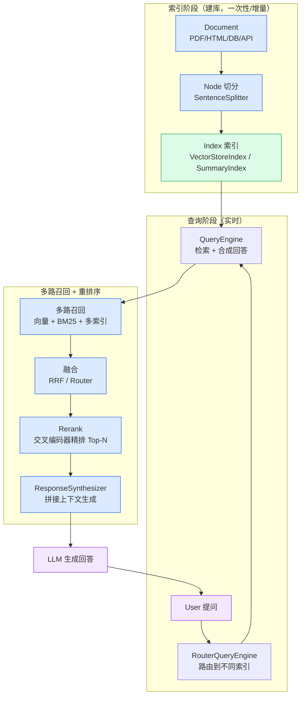

# 第 6 章 · LlamaIndex 与检索增强进阶

> 阶段 B · 核心组件 · 难度 ★★★
> 配套：[diagrams/06_llamaindex.mmd](../diagrams/06_llamaindex.mmd) · [examples/05_llamaindex_demo.py](../examples/05_llamaindex_demo.py)

---

## 6.1 本章导读

第 5 章我们用 LangChain 跑通了 RAG，并初步接触了多路召回与 Rerank。这一章换一个视角——用 **LlamaIndex**（另一个 RAG 主流框架）再看一遍同样的检索增强，并把第 5 章点到为止的 **重排序（Rerank）** 与 **多路召回（Multi-path Retrieval）** 深入讲透。

为什么要专门一章讲 LlamaIndex？因为实际开发中，做知识库问答这类 "纯 RAG" 场景时，LlamaIndex 常常比 LangChain 更顺手——它对 "索引" 和 "查询" 的抽象更贴合检索这件事本身。

读完你能：
- 说清 LangChain 与 LlamaIndex 的分工，什么时候选谁；
- 掌握 LlamaIndex 的核心抽象：Document / Node / Index / QueryEngine；
- 用 LlamaIndex 跑通基础 RAG、Rerank 重排序、路由式多路召回；
- 看懂一张完整的 "检索增强技术栈全景"，知道还有哪些主流库该补。

---

## 6.2 LangChain 与 LlamaIndex 的分工

两个框架经常被拿来对比，其实**定位不同、可互补**：

| 维度 | LangChain | LlamaIndex |
|---|---|---|
| 定位 | 通用 LLM 应用编排框架 | RAG / 数据驱动框架 |
| 强项 | Prompt/Chain/Agent/Memory 灵活组合（LCEL） | 索引构建、检索策略、数据连接器 |
| 核心抽象 | Runnable / Chain / Tool | Index / QueryEngine / Retriever |
| 数据连接 | 靠 community 的 Loader | **LlamaHub** 一站式连接器（数百种） |
| 适合场景 | 与 Agent 集成、多组件编排 | 纯 RAG、精细控制索引/检索 |

**Java 类比**：LangChain ≈ Spring Integration（通用集成与编排），LlamaIndex ≈ 一个专为搜索打造的框架（类似 Elasticsearch 生态的检索层）。

**一句话选型**：
- 要搭 Agent、要和各种工具/记忆/流程深度编排 → **LangChain / LangGraph**；
- 就是做知识库问答、文档检索、精细调索引与检索策略 → **LlamaIndex**；
- 两者也能混用：LlamaIndex 提供了 LangChain 的适配层，可以在 LangChain 的 Agent 里挂一个 LlamaIndex 的 QueryEngine 当工具。

> 本章的 Rerank 与多路召回，两个框架都支持。第 5 章用 LangChain 讲，本章用 LlamaIndex 讲——**两套 API 背后是同一套检索原理**，学会原理比记 API 更重要。

---

## 6.3 核心概念

LlamaIndex 围绕 "数据如何被索引、如何被查询" 组织抽象：

| 概念 | 作用 | LangChain 类比 |
|---|---|---|
| **Document** | 原始数据单元（一段文本、一页 PDF、一行 DB 记录） | `Document(page_content=...)` |
| **Node** | 切分后的最小检索单元（Document 会被切成多个 Node） | chunk |
| **Index** | 索引结构，决定 "怎么存、怎么找" | VectorStore + Retriever |
| **Retriever** | 从索引里按 query 取相关 Node | retriever |
| **NodePostprocessor** | 检索结果的后处理（过滤、Rerank 精排） | `ContextualCompressionRetriever` |
| **ResponseSynthesizer** | 把检索到的 Node 拼成 Prompt 生成回答 | 组装 prompt 的 chain |
| **QueryEngine** | 一站式问答入口（检索 + 合成） | RAG chain |
| **ChatEngine** | 带对话记忆的多轮 QueryEngine | 带 Memory 的 chain |

**三种最常用的 Index**：
- **VectorStoreIndex**：向量索引，语义检索，最常用；
- **SummaryIndex**：把文档摘要式组织，适合 "对整个文档集合提问"（如 "总结一下这些制度"）；
- **KeywordTableIndex**：按关键词建表，字面匹配，可做稀疏检索的一路。

---

## 6.4 索引与查询两阶段

LlamaIndex 把 RAG 分成两个清晰的阶段：

**阶段一：索引（Indexing）** —— 建库，一次性/增量
```
Document → 切分(Node) → Embedding → 存进 Index
```

**阶段二：查询（Querying）** —— 实时
```
Query → Retriever 召回 → NodePostprocessor 精排 → ResponseSynthesizer 生成
```

全局配置用 `Settings`，类比 Spring 的全局 Bean，配置一次处处生效：

```python
from llama_index.core import Settings
Settings.llm = llm                       # 生成模型
Settings.embed_model = embed_model       # 向量模型
Settings.chunk_size = 200                # 切分粒度
Settings.chunk_overlap = 30              # 重叠
```

> 这一点和 LangChain 不同：LangChain 把配置显式传在每个组件上，LlamaIndex 用 `Settings` 隐式全局注入。好处是代码更短，坏处是容易 "全局污染"（见 6.9 陷阱）。

---

## 6.5 架构图解读

上图（源码在 [diagrams/06_llamaindex.mmd](../diagrams/06_llamaindex.mmd)）分三块：



**关键认知**：索引阶段与查询阶段是解耦的。查询阶段里，"多路召回 → 融合 → Rerank → 合成" 这条精排链，就是本章要深入的重点。

---

## 6.6 代码逐段精讲

打开 [examples/05_llamaindex_demo.py](../examples/05_llamaindex_demo.py)。三个能力对应三段。

### 全局配置

```python
from llama_index.llms.openai_like import OpenAILike
from llama_index.embeddings.huggingface import HuggingFaceEmbedding

llm = OpenAILike(
    model="deepseek-chat", api_key=os.getenv("DEEPSEEK_API_KEY"),
    api_base="https://api.deepseek.com", is_chat_model=True, temperature=0.1,
)
embed_model = HuggingFaceEmbedding(model_name="BAAI/bge-small-zh-v1.5")
Settings.llm = llm
Settings.embed_model = embed_model
```

**精讲**：
- `OpenAILike` 是 LlamaIndex 接 OpenAI 兼容端点的类，`api_base` 指向 DeepSeek（和 LangChain 的 `ChatDeepSeek` 一回事）。
- `HuggingFaceEmbedding` 本地向量模型，和第 5 章同一个 `bge-small-zh`，**建库与查询必须用同一模型**。
- 设进 `Settings` 后，下面所有 index / engine 都自动用它俩，不用再传。

### 能力 1：基础 RAG

```python
docs = [Document(text=t) for t in texts]
index = VectorStoreIndex.from_documents(docs)
engine = index.as_query_engine(similarity_top_k=3)
resp = engine.query("入职 3 年能休几天年假？")
print(str(resp))
```

**精讲**：
- `Document(text=...)` 是 LlamaIndex 的数据单元，等价 LangChain 的 `Document(page_content=...)`。
- `VectorStoreIndex.from_documents(docs)` 一步完成 "切分 + 向量化 + 建索引"（内部用 `Settings.chunk_size` 切分）。
- `as_query_engine(similarity_top_k=3)` 直接拿到一个可问答的引擎，比 LangChain 的 LCEL 链更 "开箱即用"。

### 能力 2：Rerank 重排序（自定义 Postprocessor）

```python
class CrossEncoderRerank(NodePostprocessor):
    def __init__(self, model_name="BAAI/bge-reranker-base", top_n=3):
        super().__init__()
        self._model = CrossEncoder(model_name)
        self._top_n = top_n

    def _postprocess_nodes(self, nodes, query_bundle=None):
        if query_bundle is None or not nodes:
            return nodes
        pairs = [[query_bundle.query_str, n.get_content()] for n in nodes]
        scores = self._model.predict(pairs)           # 交叉编码器打分
        for score, node in zip(scores, nodes):
            node.score = float(score)
        nodes = sorted(nodes, key=lambda n: n.score, reverse=True)
        return nodes[: self._top_n]

retriever = VectorIndexRetriever(index=index, similarity_top_k=6)   # 粗召回 6 条
rerank = CrossEncoderRerank(top_n=3)                                # 精排到 3 条
engine = RetrieverQueryEngine(retriever=retriever, node_postprocessors=[rerank])
```

**精讲**：
- `NodePostprocessor` 是 LlamaIndex 的后处理器接口，在 "检索之后、生成之前" 统一精排，类比 Java 的拦截器。
- `_postprocess_nodes` 拿到 `(nodes, query)`，交叉编码器对每对 `(query, doc)` 打分，按分排序取 `top_n`。**这就是 Rerank 的完整原理**，十几行代码讲透了第 5 章说的 "交叉编码器精排"。
- LlamaIndex 也内置 `SentenceTransformerRerank`，效果一样；手写一版是为了让学员看清内部逻辑。

### 能力 3：多路召回（RouterQueryEngine 路由）

```python
leave_tool = QueryEngineTool.from_defaults(
    query_engine=leave_index.as_query_engine(similarity_top_k=3),
    metadata=ToolMetadata(name="leave_policy", description="查询请假制度（年假、病假…）"),
)
reimburse_tool = QueryEngineTool.from_defaults(
    query_engine=reimburse_index.as_query_engine(similarity_top_k=3),
    metadata=ToolMetadata(name="reimburse_policy", description="查询报销制度（差旅、住宿…）"),
)
router = RouterQueryEngine(
    selector=LLMSingleSelector.from_defaults(),
    query_engine_tools=[leave_tool, reimburse_tool],
)
router.query("出差住宿费每晚最多报多少？")
```

**精讲**：
- 两个索引（请假库、报销库）各自包成 `QueryEngineTool`，用 `description` 描述各自能答什么。
- `RouterQueryEngine` 用 LLM（`LLMSingleSelector`）判断问题属于哪一路，再路由过去。**这就是 "多路召回" 的第一种形态：路由（Routing）**——按问题类型分派到不同数据源。

### 运行预期

```bash
$ python examples/05_llamaindex_demo.py
[配置] LLM=deepseek-chat | Embedding=BAAI/bge-small-zh-v1.5

==== 能力 1：基础 RAG ====
❓ 入职 3 年能休几天年假？
✅ 入职满 3 年可享 10 天年假。

==== 能力 2：Rerank 重排序 ====
❓ 出差住宿费每晚最多报多少？
✅ 一线城市每晚不超过 500 元，二线不超过 350 元。

==== 能力 3：多路召回（路由） ====
❓ 请病假需要什么证明？
✅ 需提供三甲医院证明。
❓ 出差住宿费每晚最多报多少？
✅ 交通实报实销，一线住宿不超过 500 元/晚…
```

---

## 6.7 多路召回与 Rerank 的三种形态

第 5 章在 LangChain 里讲了多路召回与 Rerank，这里在 LlamaIndex 里对应三种实现，**搞懂这三类，任何框架都能套**：

### 形态 1：路由（Routing）—— 按问题分派

一个问题只走一路：用 `RouterQueryEngine`（上例）或 `RouterRetriever`，LLM 判断该查哪个索引。适合**数据源边界清晰**的场景（制度库 vs 报销库 vs 客户库）。

### 形态 2：融合（Fusion / Hybrid）—— 多路结果合并

一个问题同时走多路，结果融合排序。典型是 **向量 + BM25** 混合，用 RRF 融合：

```python
from llama_index.core.retrievers import QueryFusionRetriever, BM25Retriever, VectorIndexRetriever

vector = VectorIndexRetriever(index=index, similarity_top_k=10)     # 稠密路
bm25 = BM25Retriever.from_defaults(nodes=nodes, similarity_top_k=10) # 稀疏路（需 pip install llama-index-retrievers-bm25）
fusion = QueryFusionRetriever(
    [vector, bm25], similarity_top_k=5,
    mode="reciprocal_rerank",   # RRF 融合
)
```

`QueryFusionRetriever` 的 `mode="reciprocal_rerank"` 就是 RRF。和 LangChain 的 `EnsembleRetriever` 是同一件事。

### 形态 3：子问题分解（Sub-question）—— 复杂问题拆解

一个问题拆成多个子问题，各自检索，再汇总。用 `SubQuestionQueryEngine`：

```python
from llama_index.core.query_engine import SubQuestionQueryEngine
from llama_index.core.tools import QueryEngineTool

engine = SubQuestionQueryEngine.from_defaults(
    query_engine_tools=[tool_a, tool_b],
)
# 问 "对比一下请假和报销的审批流程" → 拆成两个子问题分别查 → 汇总
```

适合 "跨数据源比较/汇总" 类问题。**三者可叠加**：先路由/融合召回，再 Rerank 精排，最后合成。

---

## 6.8 实际应用场景

**场景 1：企业知识库问答**
公司制度、产品手册、FAQ 用 LlamaIndex 建索引，`RouterQueryEngine` 按部门路由，`SentenceTransformerRerank` 精排。这是 LlamaIndex 最典型的用法。

**场景 2：多数据源 RAG**
客户资料在 PG、文档在网盘、工单在 ES——用 LlamaHub 连接器分别建索引，路由/融合统一查询。

**场景 3：研究型问答**
"对比两家竞品的定价策略" → `SubQuestionQueryEngine` 拆子问题分别查，再让 LLM 汇总成报告。

---

## 6.9 陷阱与最佳实践

**陷阱 1：LlamaIndex API 版本变化快**
0.9 → 0.10 → 0.11 → 0.12 迁移频繁，网上旧教程的 import 路径经常失效。**务必锁定版本**（本教程 `llama-index>=0.12,<0.13`），查文档以你安装的版本为准。

**陷阱 2：`Settings` 全局污染**
`Settings.llm` 一旦设置，所有 index 都用它。多租户/多模型场景要小心：要么按需改回，要么用 `index.as_query_engine(llm=专用模型)` 局部覆盖。类比 Java 里滥用全局单例。

**陷阱 3：建库和查询 Embedding 不一致**
和第 5 章同一个坑：`Settings.embed_model` 换了，旧索引就废了，必须重建。

**陷阱 4：Rerank 的 `top_n` 调得不对**
`top_n` 太小漏关键片段，太大浪费 token 且引入噪音。生产常取 3~5，配合粗召回 `similarity_top_k=20~50`。

**陷阱 5：路由不准没有兜底**
`RouterQueryEngine` 靠 LLM 选路，LLM 判断错了就答非所问。**给每个 Tool 写清楚 description**（这是 LLM 选路的依据），必要时加兜底引擎（如 `RouterQueryEngine` 的 `default_tool`）。

**最佳实践：检索质量评估**
和第 5 章一致——建测试集，用 RAGAS 等工具量化 "召回命中率 + 回答正确率"，改检索策略前后对比。

**最佳实践：与 LangChain 混合**
LlamaIndex 的 QueryEngine 可以挂到 LangChain Agent 当工具，两个框架各取所长，不必二选一。

---

## 6.10 检索增强技术栈全景

这一章顺带把**业界常用、但前面章节未展开的主流库**整理成一张全景表，方便你按需补课：

| 类别 | 主流方案 | 一句话定位 |
|---|---|---|
| RAG 框架 | **LangChain / LlamaIndex / Haystack** | 编排 / RAG 专用 / pipeline 抽象 |
| 向量库 | Milvus · Chroma · FAISS · **Qdrant** · **Weaviate** · **pgvector** · **Elasticsearch** | 选型看现有基建与规模 |
| 关键词检索 | **BM25**（rank-bm25 / ES / OpenSearch） | 多路召回里的稀疏路 |
| 重排序 | **bge-reranker** · Cohere Rerank · Jina Reranker · cross-encoder | 交叉编码器精排 |
| Embedding | **BGE / M3E / E5** · text-embedding-3 等 | 中文本地推荐 bge 系列 |
| 评估 | **RAGAS** · LangSmith · TruLens | 测召回命中率与回答质量 |
| 可观测 | **Langfuse** · LangSmith · Phoenix(Arize) | trace / token / 成本监控 |
| 长期记忆 | **mem0** · Zep · MemGPT(Letta) | 跨会话用户画像与偏好 |
| 本地推理 | **Ollama** · vLLM · llama.cpp | 私有化部署 / 离线推理 |

**在哪章展开**：
- 向量库选型、BM25 多路召回 → 第 5 章 5.4、5.9；
- Rerank 重排序 → 第 5 章 5.4.2 + 本章 6.7；
- 评估与可观测 → 第 9 章 Harness（Evaluation / Monitoring 落地）；
- 长期记忆 → 第 9 章 Harness（Memory 子能力）；
- 本地推理（Ollama/vLLM）→ 私有化部署时替代云端 DeepSeek，接口兼容 OpenAI，代码几乎不用改。

> 这些库不必一次学完。原则是：**先把你当前业务缺的那一类补上**（缺召回 → 学 BM25/多路；缺精度 → 学 Rerank；缺评估 → 学 RAGAS），其余的用到再查。

---

## 6.11 小结

- LlamaIndex 是 RAG 专用框架，与 LangChain **分工不同、可互补**：编排选 LangChain，纯 RAG 精细控制选 LlamaIndex。
- 核心抽象：**Document → Node → Index → Retriever → NodePostprocessor → ResponseSynthesizer → QueryEngine**。
- 两阶段：**索引（建库）** 与 **查询（实时）**，全局配置用 `Settings`。
- 多路召回三种形态：**路由（Router）/ 融合（RRF）/ 子问题分解（Sub-question）**。
- Rerank 重排序 = 交叉编码器精排，`NodePostprocessor` 十几行就能实现，生产几乎必加。
- 检索增强技术栈全景已整理，按需补课即可。

下一章进入工程化阶段——MCP，解决 "怎么把工具标准化地暴露给 Agent"。

---

> **上一章**：[第 5 章 · RAG 技术体系](05_rag.md)
> **下一章**：[第 7 章 · MCP](07_mcp.md)
