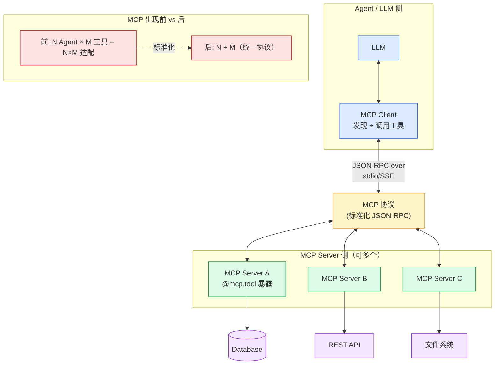

# 第 7 章 · MCP（Model Context Protocol）

> 阶段 C · 工程化能力 · 难度 ★★☆
> 配套：[diagrams/07_mcp.mmd](../diagrams/07_mcp.mmd) · [examples/06_mcp_server.py](../examples/06_mcp_server.py)

---

## 7.1 本章导读

前几章的 Agent 调工具，都是 "进程内函数"——`@tool` 装饰的 Python 函数，和 Agent 跑在同一个进程。但企业里工具分散在各个系统（HR 系统、财务系统、代码仓库），可能用不同语言写，跑在不同机器。

**MCP 解决的问题**：把 "LLM ↔ 工具" 的集成**标准化**，让一个 Agent 能接入 N 个独立工具服务，不必每个都手写适配。

读完你能：
- 说清 MCP 出现前的 "N×M 适配地狱"；
- 定义 MCP 三件套：Server / Client / Tool；
- 写一个最小 MCP Server 暴露工具。

---

## 7.2 MCP 出现前：适配地狱

假设公司有 3 个 Agent（客服、研发、运维），要接 5 个系统（HR、财务、Jira、Git、监控）。

**不用 MCP**：每个 Agent 自己写 5 套适配代码。3 Agent × 5 系统 = **15 套适配**。新增一个 Agent 要再写 5 套，新增一个系统所有 Agent 都要改。

```
N 个 Agent × M 个工具 = N × M 套适配代码
```

**用 MCP**：每个系统包成一个 MCP Server，暴露标准化工具。每个 Agent 用统一的 MCP Client 连。变成 **N + M**：

```
3 Agent + 5 Server = 8 个独立组件，互不耦合
```

> 类比：MCP 之于 Agent 工具，就像 gRPC 之于微服务。没有 gRPC，每个服务对每个调用方写一套协议；有了 gRPC，统一接口。

---

## 7.3 MCP 三件套

| 角色 | 职责 | Java 类比 |
|---|---|---|
| **MCP Server** | 暴露工具 / 资源 / Prompt | RPC Server / 服务提供方 |
| **MCP Client** | LLM 侧调用方，发现并调用工具 | RPC Client / 服务消费方 |
| **Tool** | 一个可被 LLM 调用的函数 | 一个 RPC 方法 |

### 协议细节

- 基于 **JSON-RPC 2.0**（和 Language Server Protocol 同源）。
- 传输方式：
  - **stdio**：本地进程间，子进程标准输入输出。适合本地工具。
  - **SSE / Streamable HTTP**：远程，走 HTTP。适合分布式。

### 工作流程

```
1. MCP Server 启动，用 @mcp.tool() 注册工具
2. MCP Client 连接 Server，调 list_tools() 发现工具
3. Client 把工具 schema 给 LLM
4. LLM 决定调某工具 → Client 调 Server 的 call_tool → 返回结果
5. 结果回灌 LLM 生成回答
```

---

## 7.4 架构图解读

下面是内嵌的架构图（源码同步保存在 [diagrams/07_mcp.mmd](../diagrams/07_mcp.mmd)）：



- 上半：Agent 侧（LLM + MCP Client）；
- 中间：MCP 协议（JSON-RPC over stdio/SSE）；
- 下半：多个 MCP Server，各自接一个企业系统（DB / API / 文件）。
- 右下：痛点对比，N×M → N+M。

**关键认知**：MCP Server 是独立服务，可以用**任何语言**写（Python/Go/Rust）。Agent 用 Python 调，工具服务用 Go 写，协议统一就能互通。这是比 LangChain `@tool`（必须同进程同语言）的根本优势。

---

## 7.5 代码逐段精讲

打开 [examples/06_mcp_server.py](../examples/06_mcp_server.py)。

### 部分 1：用 FastMCP 写 Server

```python
from mcp.server.fastmcp import FastMCP

mcp = FastMCP("employee-tools")

@mcp.tool()
def query_employee(emp_id: str) -> dict:
    """
    查询企业 HR 系统中的员工信息。
    
    参数:
        emp_id: 员工工号（如 E001）
    
    返回:
        员工姓名、部门、职位
    """
    db = {
        "E001": {"name": "张三", "dept": "研发部", "title": "高级工程师"},
        "E002": {"name": "李四", "dept": "产品部", "title": "产品经理"},
    }
    return db.get(emp_id, {"error": f"工号 {emp_id} 不存在"})

if __name__ == "__main__":
    mcp.run()  # 启动 MCP Server（默认 stdio 传输）
```

**逐段精讲**：

- `FastMCP("employee-tools")`：创建一个 MCP Server 实例，名字是服务标识。
- **`@mcp.tool()` 装饰器**：把普通函数注册成 MCP 工具。
  - 函数名 → 工具名（`query_employee`）
  - **docstring → 工具描述**（关键！LLM 看这个决定何时用。要写清楚用途、参数、返回）
  - **类型提示 → 参数 schema**（`emp_id: str` → `{"type": "string"}`，`-> dict` → 返回结构）
  - 和 LangChain `@tool` 类似，但 MCP 工具是**跨进程**的。
- `mcp.run()`：启动服务，默认 stdio 传输，等 Client 连接。

> Python 知识点：装饰器 `@mcp.tool()`。等价于 `query_employee = mcp.tool()(query_employee)`，把函数包装后重新赋值。Java 类比：`@Tool` 注解 + 注解处理器。

### 部分 2：Client 怎么用（伪代码）

```python
from mcp import ClientSession, StdioServerParameters
from langchain_mcp_adapters.client import MultiServerMCPClient

# 连接多个 MCP Server
client = MultiServerMCPClient({
    "hr": {"command": "python", "args": ["06_mcp_server.py"]},  # 本地 stdio
    "finance": {"url": "http://finance-svc:8080/sse"},           # 远程 SSE
})

# 发现所有工具
tools = await client.get_tools()
# tools = [query_employee, submit_expense, ...]  来自不同 Server

# 把工具绑给 Agent
from langchain.agents import create_agent
agent = create_agent(model, tools)
result = await agent.ainvoke({"messages": [{"role": "user", "content": "查 E001 员工"}]})
```

**精讲**：
- `MultiServerMCPClient` 同时连多个 Server，`get_tools()` 把所有工具汇总成一个列表。
- Agent 拿到工具后，用法和普通 `@tool` 完全一样——**LLM 不感知工具是本地还是 MCP**。
- `async/await`：MCP 调用是异步的（IO 密集）。`async def` 定义协程，`await` 等待结果。Java 类比：WebFlux 的 Mono/Flux。

> Python 知识点：`async def` + `await`。`async def f()` 定义异步函数（协程），调用 `f()` 返回协程对象而非结果，必须 `await f()` 才执行。类比 Java 的 `CompletableFuture`，但语法更轻。

### 运行预期

```bash
# 终端1：启动 Server
$ python examples/06_mcp_server.py
MCP Server 'employee-tools' running on stdio...

# 终端2：Agent 调用（伪代码 demo）
$ python examples/06_mcp_server.py --demo
发现工具: [query_employee]
调用 query_employee(emp_id='E001')
结果: {"name": "张三", "dept": "研发部", "title": "高级工程师"}
```

---

## 7.6 实际应用场景

**场景 1：统一企业数据接入**
把 HR、财务、CRM 各包成一个 MCP Server，Agent 一次接入所有系统。新增系统只需加一个 Server，Agent 不用改。

**场景 2：跨语言工具复用**
数据团队用 Go 写了个高性能查询服务，包成 MCP Server。Python Agent 直接用，不用重写。

**场景 3：Claude Desktop / Cursor 接插件**
Claude Desktop、Cursor、Cline 都已支持 MCP。你写的 MCP Server 能直接被这些产品用，复用性极强。

**场景 4：本地开发工具**
写个 MCP Server 暴露 "读文件 / 跑测试 / 查 Git 状态"，本地 Agent（如 Claude Code）直接调用，做研发自动化。

---

## 7.7 陷阱与最佳实践

**陷阱 1：docstring 写得太简略**
MCP 工具的 docstring 是 LLM 选工具的唯一依据。写 "查询员工" 不如写 "查询企业 HR 系统中的员工信息。参数 emp_id 是工号如 E001。返回姓名部门职位。" 描述越具体，LLM 选择越准。

**陷阱 2：工具粒度太粗或太细**
一个 Server 暴露 50 个工具，LLM 选不过来；一个工具做 10 件事，参数复杂。建议**一个工具做一件事**，按业务领域分 Server。

**陷阱 3：忘记错误处理**
工具抛异常要让 LLM 知道（返回 `{"error": "..."}`），否则 LLM 不知道调用失败，会瞎编。**永远返回结构化结果，失败也返回 error 字段**。

**陷阱 4：stdio 和远程混用没区分**
stdio 适合本地开发，远程必须用 SSE/HTTP。生产环境几乎都用 HTTP，便于独立部署和扩缩容。

**最佳实践：工具要幂等且安全**
查询类工具随便调；修改类工具（删数据、发邮件）要在 Server 侧加权限校验，或要求 "确认参数"。MCP Server 是工具的边界，安全责任在 Server。

**最佳实践：版本化**
MCP Server 升级工具签名要向后兼容，或开新版本号。Agent 依赖的工具变了会报错。

---

## 7.8 MCP vs LangChain Tool

| 维度 | LangChain `@tool` | MCP Tool |
|---|---|---|
| 部署 | 同进程 | 独立服务 |
| 语言 | 必须 Python | 任意语言 |
| 复用 | 项目内 | 跨项目跨产品 |
| 协议 | 无（函数调用） | JSON-RPC 标准 |
| 适合 | 快速原型、简单工具 | 企业级、跨系统 |

**选型**：本地快速实验用 LangChain `@tool`；要接企业多系统、跨语言、被多个 Agent/产品复用，用 MCP。两者可混用——Agent 同时挂本地 Tool 和 MCP Tool。

---

## 7.9 小结

- MCP 解决 "LLM ↔ 工具" 的标准化集成，把 N×M 适配降到 N+M。
- 三件套：**Server（暴露工具）/ Client（发现调用）/ Tool（函数）**，基于 JSON-RPC。
- `FastMCP` + `@mcp.tool()` 让普通函数变跨进程工具，**docstring 是工程关键**。
- MCP Server 可用任意语言写，被多个 Agent/产品复用。
- 和 LangChain `@tool` 互补：本地简单用前者，企业跨系统用后者。

MCP 解决 "一个 Agent 接 N 个工具"。下一章 A2A 解决 "N 个 Agent 之间协作"。

---

> **上一章**：[第 6 章 · LlamaIndex 与检索增强进阶](06_llamaindex.md)
> **下一章**：[第 8 章 · A2A](08_a2a.md)
