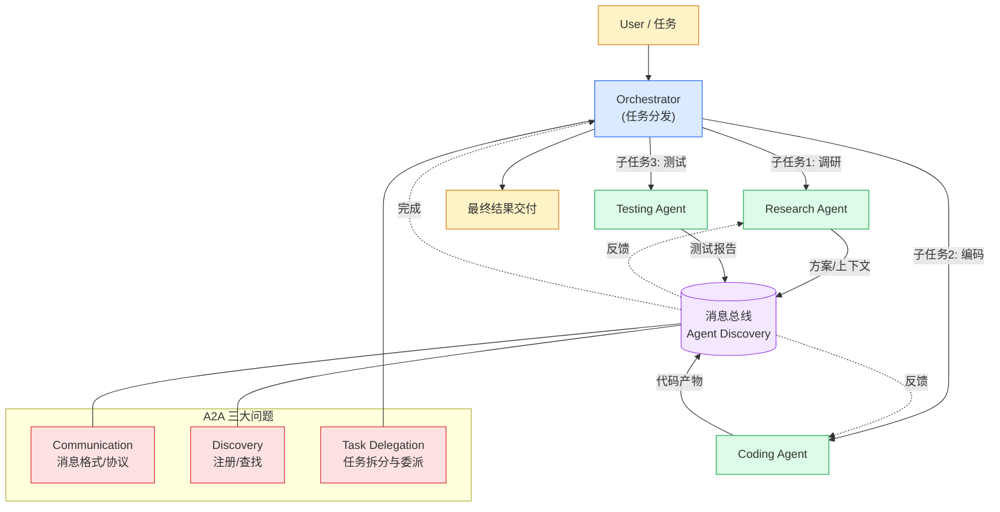

# 第 8 章 · A2A（Agent To Agent）

> 阶段 C · 工程化能力 · 难度 ★★★
> 配套：[diagrams/08_a2a.mmd](../diagrams/08_a2a.mmd) · [examples/07_a2a_demo.py](../examples/07_a2a_demo.py)

---

## 8.1 本章导读

前面几章都是 "一个 Agent 干活"。但很多任务单 Agent 搞不定：
- **任务太复杂**：一个 Agent 上下文塞不下所有信息；
- **角色太多**：研发流程有调研、编码、测试，每个要不同工具和 Prompt；
- **要隔离**：每个 Agent 用不同工具集和权限，避免互相干扰。

A2A = Agent To Agent，**多 Agent 协作**。本质是 "微服务化" 在 Agent 层的重演——把大单体 Agent 拆成多个专职 Agent，协同完成任务。

读完你能：
- 说清多 Agent 协作的三大问题；
- 描述 Research → Coding → Testing 协作流程；
- 用伪代码实现一个最小多 Agent 系统。

---

## 8.2 三个核心问题

多 Agent 协作要解决三个工程问题，和微服务一一对应：

| 问题 | 含义 | 微服务类比 |
|---|---|---|
| **Communication** | Agent 间怎么通信？消息格式？ | RPC / 消息总线 |
| **Discovery** | 怎么找到对方？ | 服务注册中心 |
| **Task Delegation** | 怎么把任务派给合适的 Agent？ | 路由 / 负载均衡 |

### Communication（通信）

Agent 间传递的消息需要结构化。典型格式：

```python
@dataclass
class AgentMessage:
    sender: str          # 谁发的
    receiver: str        # 发给谁
    content: str         # 内容
    context: dict        # 携带的上下文（方案、代码、报告等）
```

通信方式两种：
- **直接调用**：A 直接调 B 的方法/接口。简单，但耦合。
- **消息总线**：所有 Agent 往总线发消息，订阅者接收。解耦，可异步。

### Discovery（发现）

Agent 怎么知道有哪些其他 Agent？两种：
- **注册中心**：Agent 启动时注册，需要时查注册表。类比 Eureka。
- **配置硬编码**：在 Orchestrator 里写死。简单但不灵活。

### Task Delegation（任务委派）

谁决定把子任务派给哪个 Agent？两种模式：
- **监督者模式**：一个 Orchestrator 统一派活，其他 Agent 听指挥。
- **对等模式**：Agent 之间平等协商，自己决定接不接。

---

## 8.3 三种协作模式

### 模式 1：流水线（Pipeline）
```
Research → Coding → Testing
```
顺序执行，前一个的输出是后一个的输入。最简单，适合流程明确的场景。

### 模式 2：监督者（Orchestrator）
```
        Orchestrator
       /     |      \
   Research  Coding  Testing
```
Orchestrator 接任务，拆分派给专职 Agent，汇总结果。灵活，适合复杂任务。

### 模式 3：对等（Peer-to-peer）
```
AgentA ↔ AgentB ↔ AgentC
```
Agent 间平等对话协商。适合探索性、无固定流程的任务。

---

## 8.4 架构图解读

下面是内嵌的架构图（源码同步保存在 [diagrams/08_a2a.mmd](../diagrams/08_a2a.mmd)）：



- 顶部：User → Orchestrator；
- 中部：三个专职 Agent（Research / Coding / Testing）；
- 中间：消息总线（Agent Discovery + Communication）；
- 三大问题标注在右侧。

**数据流**：User 任务 → Orchestrator 拆分 → Research 出方案 → Coding 写代码 → Testing 跑测试 → 结果回灌总线 → Orchestrator 汇总交付。

---

## 8.5 代码逐段精讲

打开 [examples/07_a2a_demo.py](../examples/07_a2a_demo.py)。这是伪代码级实现（无需 API Key 也能跑），展示多 Agent 协作骨架。

### 部分 1：消息与 Agent 基类

```python
from abc import ABC, abstractmethod
from dataclasses import dataclass, field

@dataclass
class AgentMessage:
    sender: str
    receiver: str
    content: str
    context: dict = field(default_factory=dict)

class BaseAgent(ABC):
    def __init__(self, name: str):
        self.name = name
        self.inbox: list[AgentMessage] = []

    def receive(self, msg: AgentMessage):
        self.inbox.append(msg)

    @abstractmethod
    def run(self) -> AgentMessage:
        ...
```

**精讲**：
- `@dataclass`：自动生成构造器、`__repr__` 等。Java 类比 Lombok `@Data`。
- `field(default_factory=dict)`：可变默认值必须用 factory，不能用 `={}`（Python 陷阱：默认值在类定义时创建，所有实例共享）。类比 Java 的 `new HashMap<>()` 不能写默认值。
- `ABC + @abstractmethod`：抽象基类，强制子类实现 `run()`。Java 的 `abstract class` + `abstract method`。
- `list[AgentMessage]`：泛型容器，Python 3.9+ 支持小写泛型。Java 的 `List<AgentMessage>`。

### 部分 2：三个专职 Agent

```python
class ResearchAgent(BaseAgent):
    def run(self) -> AgentMessage:
        task = self.inbox[-1].content
        plan = f"技术方案: 基于 {task}，用 Python+FastAPI..."
        return AgentMessage(self.name, "CodingAgent", plan)

class CodingAgent(BaseAgent):
    def run(self) -> AgentMessage:
        plan = self.inbox[-1].content
        code = f"```python\nfrom fastapi import FastAPI\n...```"
        return AgentMessage(self.name, "TestingAgent", code)

class TestingAgent(BaseAgent):
    def run(self) -> AgentMessage:
        code = self.inbox[-1].content
        report = "3 用例通过 / 0 失败，建议补异常处理"
        return AgentMessage(self.name, "Orchestrator", report)
```

**精讲**：每个 Agent 取收件箱最新消息，处理后返回给下一个 Agent 的消息。真实场景每个 `run` 里调 LLM，这里用伪逻辑演示流程。

### 部分 3：Orchestrator 编排

```python
class Orchestrator:
    def __init__(self):
        self.registry: dict[str, BaseAgent] = {}  # Discovery：注册中心

    def register(self, agent: BaseAgent):
        self.registry[agent.name] = agent

    def execute(self, user_task: str) -> str:
        # Task Delegation：拆分 + 委派
        research = self.registry["ResearchAgent"]
        coding = self.registry["CodingAgent"]
        testing = self.registry["TestingAgent"]

        # 流水线
        research.receive(AgentMessage("Orchestrator", "ResearchAgent", user_task))
        msg1 = research.run()
        coding.receive(msg1)
        msg2 = coding.run()
        testing.receive(msg2)
        msg3 = testing.run()
        return msg3.content
```

**精讲**：
- `self.registry` 是 Discovery——Agent 注册中心。
- `execute` 是 Task Delegation——把用户任务依次派给三个 Agent。
- 流水线模式：Research 的输出 → Coding 的输入 → Testing 的输入。

### 运行预期

```bash
$ python examples/07_a2a_demo.py
=======================================================
A2A 多 Agent 协作演示（伪代码级，无需 API Key）
=======================================================
最终交付：
【测试报告】对代码片段做静态检查：
  - ✅ FastAPI 路由定义规范
  - ✅ Pydantic 模型校验
  - ⚠️  缺少异常处理，建议补 try/except
源码：
【代码产出】依据方案：
【技术方案】基于需求 '实现一个接收 JSON 请求的 HTTP 接口'：...
```

三个 Agent 接力完成 "需求 → 方案 → 代码 → 测试报告"。

---

## 8.6 实际应用场景

**场景 1：软件研发流水线**
Research Agent 调研方案 → Coding Agent 写代码 → Testing Agent 跑测试 → Deployment Agent 部署。每个 Agent 专精一个领域，用不同工具集。第 13 章案例 2 就是这个。

**场景 2：内容生产**
Research Agent 查资料 → Writer Agent 写初稿 → Editor Agent 润色 → Reviewer Agent 审核合规。

**场景 3：数据分析**
Query Agent 写 SQL 取数 → Analysis Agent 做分析 → Viz Agent 生成图表 → Report Agent 写结论。

**场景 4：客服协作**
Triage Agent 分类问题 → FAQ Agent 答常见问题 / Expert Agent 处理复杂问题 → Feedback Agent 收集反馈。

---

## 8.7 陷阱与最佳实践

**陷阱 1：Agent 太多导致协调成本爆炸**
3-4 个 Agent 协作效果好，超过 5 个协调成本陡增（消息传递、上下文同步、错误处理）。**别为了拆而拆**，能单 Agent 干完的就别上多 Agent。

**陷阱 2：上下文在 Agent 间丢失**
A 把方案传给 B，但 B 没拿到 A 的完整上下文，重新理解一遍浪费 token。**用结构化 context dict 传递关键信息**，别只传自然语言。

**陷阱 3：死循环**
A 让 B 做，B 做不了让 A 做，A 又让 B 做……要设**最大轮次**和**终止条件**（成功 / 失败 / 超时）。

**陷阱 4：错误处理缺失**
一个 Agent 失败了，整个流程怎么办？要设计**重试 / 降级 / 人工介入**。第 9 章 Harness 的思路在多 Agent 里更重要。

**最佳实践：明确角色边界**
每个 Agent 的职责、工具、权限要清晰定义。Research 只读不写，Coding 只改代码不部署。**权限隔离是多 Agent 的安全优势**。

**最佳实践：用框架别造轮子**
真实多 Agent 系统用 **AutoGen**（对话式）或 **CrewAI**（角色式），它们处理了消息传递、注册、错误恢复。本教程的伪代码只演示原理。

---

## 8.8 A2A 协议现状

2025 年 Google 提出了 **A2A Protocol** 草案，类似 MCP 之于工具，想把 Agent 间通信标准化。但目前远不如 MCP 成熟，多 Agent 协作主要靠框架内部约定。

```
MCP：标准化 "Agent ↔ 工具"（已成熟，Anthropic 主导）
A2A：标准化 "Agent ↔ Agent"（草案阶段，Google 主导）
```

可以关注 A2A Protocol 演进，但短期多 Agent 还是用 AutoGen / CrewAI / LangGraph。

---

## 8.9 小结

- A2A 解决 "单 Agent 搞不定的复杂任务"，本质是微服务化在 Agent 层的重演。
- 三大问题：**Communication（通信）/ Discovery（发现）/ Task Delegation（委派）**。
- 三种模式：**流水线 / 监督者 / 对等**。
- Orchestrator 负责拆分派活，Agent 间用结构化消息传递上下文。
- 真实实现用 AutoGen / CrewAI / LangGraph，别造轮子。
- Agent 不宜过多（3-4 个为宜），要有终止条件和错误处理。

Agent 多了，**稳定性**就是大问题。下一章 Harness，讲怎么让 Agent 稳定跑起来。

---

> **上一章**：[第 7 章 · MCP](07_mcp.md)
> **下一章**：[第 9 章 · Harness Engineering](09_harness.md)
