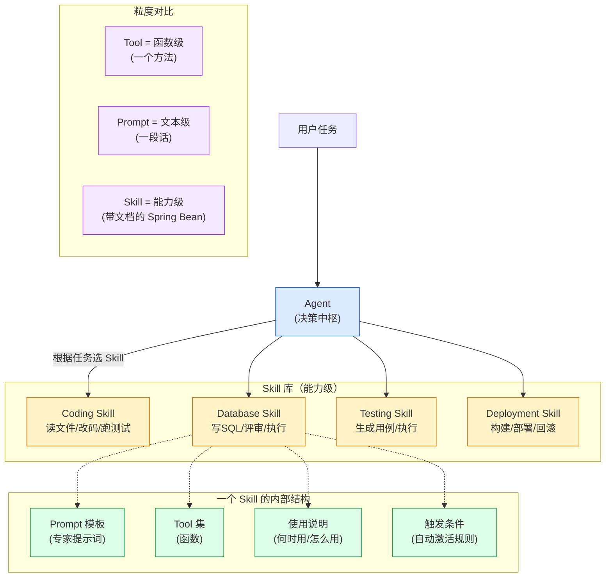

# 第 10 章 · Agent Skill

> 阶段 C · 工程化能力 · 难度 ★★☆
> 配套：[diagrams/10_skill.mmd](../diagrams/10_skill.mmd) · [examples/09_skill_demo.py](../examples/09_skill_demo.py)

---

## 10.1 本章导读

前面讲的 Tool 是 "函数级"——一个 `@tool` 函数。但真实专家能力往往更复杂：不只是调一个函数，还包含 "怎么做这件事" 的专家经验（Prompt 模板）、多个工具的组合、何时该用的判断。

**Skill 是能力级封装**：把 Prompt + Tool + 使用说明 + 触发条件打包成一个可复用能力。

读完你能：
- 区分 Skill / Tool / Prompt 三者；
- 说出 Skill 的内部结构；
- 实现一个 DatabaseSkill。

---

## 10.2 Skill / Tool / Prompt 的区别

| 概念 | 粒度 | 内容 | Java 类比 |
|---|---|---|---|
| **Tool** | 函数级 | 一个可调用函数 | 一个方法 |
| **Prompt** | 文本级 | 一段提示词 | 一段注释/配置 |
| **Skill** | 能力级 | Prompt + Tool + 使用说明 + 触发条件 | 带 `@Component` 的 Spring Bean |

**类比理解**：
- Tool 是 "一个方法"：`execute_sql(sql)`。
- Prompt 是 "一段说明"："你是 SQL 专家，只生成 SELECT"。
- Skill 是 "一个完整能力包"：包含 SQL 专家 Prompt + execute_sql/review_sql 两个工具 + "用户问数据库时触发" 的规则 + 使用文档。

**核心价值**：把**专家经验**沉淀成可复用能力。专家写的 Prompt 模板和工具组合封装成 Skill，新人 Agent 装上就能用，不用重新摸索。

---

## 10.3 Skill 的内部结构

一个 Skill 包含四部分：

```
┌─────────────────────────────┐
│         Skill（能力）         │
├─────────────────────────────┤
│ 1. Prompt 模板    专家提示词   │  ← 告诉 LLM "怎么做这件事"
│ 2. Tool 集        多个函数    │  ← 实际能调的工具
│ 3. 使用说明       何时用      │  ← 发给 LLM 让它选
│ 4. 触发条件       自动激活    │  ← 关键词/规则匹配
└─────────────────────────────┘
```

### 典型 Skill 清单

| Skill | Prompt 模板 | Tool 集 | 触发条件 |
|---|---|---|---|
| **Coding Skill** | "你是代码专家，遵循 PEP8..." | read_file / write_file / run_test | "写代码/改 bug/重构" |
| **Database Skill** | "你是 SQL 专家，只生成安全 SELECT..." | execute_sql / review_sql | "查询/SQL/数据库" |
| **Testing Skill** | "根据函数生成 pytest 用例..." | gen_test / run_pytest | "测试/用例" |
| **Deployment Skill** | "按规范构建并部署..." | build / deploy / rollback | "部署/发布" |

---

## 10.4 架构图解读

下面是内嵌的架构图（源码同步保存在 [diagrams/10_skill.mmd](../diagrams/10_skill.mmd)）：



- 顶部：用户任务 → Agent（决策中枢）；
- 中部：Skill 库（4 个 Skill）；
- Agent 根据任务选 Skill；
- 右侧：一个 Skill 的内部结构（Prompt / Tool / 说明 / 触发）；
- 底部：粒度对比（Tool / Prompt / Skill）。

**关键认知**：Agent 是 "决策中枢"，Skill 是 "能力库"。Agent 不直接调工具，而是先选 Skill，由 Skill 内部协调 Prompt 和 Tool。这层抽象让 Agent 更聚焦 "做什么"，而非 "怎么做"。

---

## 10.5 代码逐段精讲

打开 [examples/09_skill_demo.py](../examples/09_skill_demo.py)。

### 部分 1：Skill 基类

```python
from abc import ABC, abstractmethod
from dataclasses import dataclass, field

@dataclass
class BaseSkill(ABC):
    name: str
    description: str              # 干什么用（发给 LLM 选 Skill 用）
    prompt_template: str          # 专家 Prompt
    trigger_keywords: list = field(default_factory=list)

    @property
    @abstractmethod
    def tools(self) -> list:
        """工具集。子类必须实现。"""
        ...

    @abstractmethod
    def run(self, task: str) -> str:
        """执行 Skill。"""
        ...

    def matches(self, user_input: str) -> bool:
        """触发条件：关键词命中。"""
        return any(kw in user_input for kw in self.trigger_keywords)
```

**精讲**：
- `@dataclass` + `ABC`：既是数据类又是抽象基类。Python 支持多重继承的灵活用法。
- `@property` + `@abstractmethod`：把抽象方法变属性。子类要把 `tools` 实现成 `@property`，访问 `skill.tools` 像访问属性而非调方法。Java 类似 Lombok `@Getter` 但更灵活。
- `matches`：默认触发逻辑是关键词命中。真实场景可以让 LLM 看 description 决定。

### 部分 2：DatabaseSkill 实现

```python
class DatabaseSkill(BaseSkill):
    def __init__(self):
        super().__init__(
            name="DatabaseSkill",
            description="当用户需要查询/修改数据库时使用。能写 SQL、做安全评审、执行查询。",
            prompt_template="你是数据库专家，根据需求生成安全的 SQL。只允许 SELECT...",
            trigger_keywords=["查询", "SQL", "数据库", "表"],
        )

    @property
    def tools(self):
        def execute_sql(sql: str) -> str:
            """执行 SQL（模拟）。"""
            return "执行结果（模拟）: 5 行数据"

        def review_sql(sql: str) -> str:
            """SQL 安全评审。"""
            danger = ["DROP", "TRUNCATE", "DELETE FROM"]
            if any(d in sql.upper() for d in danger):
                return "❌ 危险 SQL，已拦截"
            return "✅ 通过安全评审"
        return [execute_sql, review_sql]

    def run(self, task: str) -> str:
        # 真实场景：用 prompt_template 调 LLM 生成 SQL
        generated_sql = f"SELECT * FROM orders WHERE status='pending' LIMIT 100; -- {task}"
        review_tool = self.tools[1]
        execute_tool = self.tools[0]
        review_result = review_tool(generated_sql)
        if "通过" in review_result:
            exec_result = execute_tool(generated_sql)
            return f"生成 SQL:\n{generated_sql}\n{review_result}\n{exec_result}"
        return f"SQL 未通过评审:\n{review_result}"
```

**精讲**：
- `tools` 是 `@property`，返回**两个函数**的列表。每次访问都重新创建（闭包）。
- `run` 是 Skill 的执行逻辑：先生成 SQL → 评审 → 通过才执行。**评审是安全护栏**，危险 SQL 被拦截。
- 这体现了 Skill 的价值：不只是调 execute_sql，而是 "生成→评审→执行" 的完整安全流程，封装了 DBA 的专家经验。

### 部分 3：SkillAgent 选 Skill

```python
class SkillAgent:
    def __init__(self, skills: list[BaseSkill]):
        self.skills = skills

    def select_skill(self, user_input: str):
        for s in self.skills:
            if s.matches(user_input):
                return s
        return None

    def run(self, user_input: str) -> str:
        skill = self.select_skill(user_input)
        if not skill:
            return "没有匹配的 Skill"
        return skill.run(user_input)
```

**精讲**：
- `select_skill`：遍历 Skill 库，第一个命中触发条件的就用。真实场景把所有 Skill 的 description 发给 LLM，让它选最匹配的。
- Agent 不直接调工具，而是选 Skill → 由 Skill 内部调工具。**职责分离**：Agent 管 "做什么"，Skill 管 "怎么做"。

### 运行预期

```bash
$ python examples/09_skill_demo.py
用户: 查询订单表里待处理的记录
Agent: [DatabaseSkill] 生成 SQL:
SELECT * FROM orders WHERE status='pending' LIMIT 100; -- 任务: 查询订单表里待处理的记录
评审: ✅ 通过安全评审
执行结果（模拟）: 5 行数据

用户: 给 add 函数写测试用例
Agent: [TestingSkill] 生成 3 个用例并执行 → 全部通过
  覆盖: 给 add 函数写测试用例

用户: 帮我画一张架构图
Agent: 没有匹配的 Skill，请补充能力库。
```

**重点看**：
- "查询订单" → 命中 DatabaseSkill 的 "查询" 关键词 → 生成 SQL + 评审 + 执行；
- "写测试用例" → 命中 TestingSkill 的 "测试" → 生成用例执行；
- "画架构图" → 无 Skill 命中 → 返回 "无匹配"。这就是 Skill 库要扩充的信号。

---

## 10.6 实际应用场景

**场景 1：沉淀 DBA 经验**
DBA 的 SQL 评审规则（禁止 DROP、必须加 LIMIT、敏感表只读）封装成 DatabaseSkill，所有 Agent 装上就自动遵守，不用每个 Agent 重写。

**场景 2：研发 Agent 多能力**
Coding Skill（写代码）+ Testing Skill（跑测试）+ Deployment Skill（部署）组成研发 Agent 的能力库。Agent 根据任务阶段选不同 Skill，第 13 章案例 2 用到。

**场景 3：领域专家经验产品化**
法务专家的合同审查流程（找风险条款、对照法规、出意见）封装成 LegalReviewSkill，非法律背景的 Agent 也能做合同初审。

**场景 4：Skill 市场**
团队各自写 Skill，沉淀成内部 Skill 市场。新 Agent 按需挂载，快速具备各种能力。类比 Spring 的 starter 生态。

---

## 10.7 陷阱与最佳实践

**陷阱 1：Skill 和 Tool 边界模糊**
一个 Skill 只包一个 Tool，等于退化成 Tool。Skill 的价值在 "Prompt + 多 Tool + 流程" 的组合。**单函数用 Tool，多步骤专家流程用 Skill**。

**陷阱 2：触发条件太宽或太窄**
关键词太宽（"数据"）什么都触发；太窄（"查询订单表 status=pending"）命中率低。要平衡，或用 LLM 做 semantic 匹配。

**陷阱 3：Skill 之间职责重叠**
两个 Skill 都处理 "数据库"，Agent 不知道选哪个。**Skill 要正交**，职责不重叠，有冲突时合并或细分。

**陷阱 4：Prompt 模板写死不迭代**
专家 Prompt 写一次就不管了。实际要持续优化：跑评估集 → 看 bad case → 改 Prompt → 再评估。Prompt 是要持续维护的 "代码"。

**最佳实践：Skill 要可测试**
每个 Skill 配测试集（输入 → 期望输出），改 Prompt / 换模型后跑回归。Skill 是独立单元，应该像单元测试一样可测。

**最佳实践：description 要写清楚**
description 是 LLM 选 Skill 的依据。写 "数据库操作" 不如写 "当用户需要查询或修改数据库时使用。能生成安全 SQL、做评审、执行查询。不支持 DROP 等危险操作。"

**最佳实践：Skill 文档化**
每个 Skill 配 README：解决什么问题、何时用、不用什么、示例。让团队其他人能复用和改进。

---

## 10.8 Skill vs MCP Tool

| 维度 | MCP Tool | Skill |
|---|---|---|
| 粒度 | 单个函数 | 能力包（Prompt+多Tool+流程） |
| 重点 | 标准化暴露 | 专家经验封装 |
| 适合 | 接企业系统 | 沉淀领域知识 |
| 内部 | 无 Prompt | 含专家 Prompt |

**关系**：Skill 内部的 Tool 可以是 MCP Tool。Skill 是更高层封装——把 MCP Tool + 专家 Prompt + 触发规则组合成能力。两者互补。

---

## 10.9 小结

- Skill 是**能力级封装** = Prompt + Tool + 使用说明 + 触发条件。
- 与 Tool/Prompt 区别：Tool 是方法，Prompt 是说明，Skill 是带文档的能力包（类比 Spring Bean）。
- Skill 内部包含专家 Prompt、多个 Tool、安全流程（如 SQL 评审）。
- Agent 是决策中枢，选 Skill；Skill 内部协调工具执行。
- 价值：把专家经验沉淀成可复用、可测试、可迭代的能力。
- 和 MCP Tool 互补：Skill 可包含 MCP Tool + 专家 Prompt。

前面各章是组件。接下来先讲框架选型，再把它们拼成**企业级架构**。

---

> **上一章**：[第 9 章 · Harness Engineering](09_harness.md)
> **下一章**：[第 11 章 · 主流框架选型与生态进阶](11_framework_selection.md)
