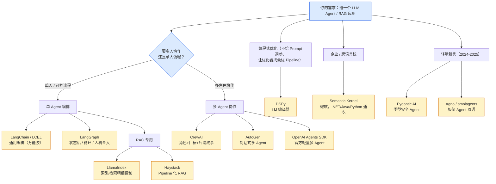

# 第 11 章 · 主流框架选型与生态进阶

> 阶段 C · 工程化能力 · 难度 ★★☆
> 配套：[diagrams/11_framework_selection.mmd](../diagrams/11_framework_selection.mmd) · [examples/10_framework_selection.py](../examples/10_framework_selection.py)

---

## 11.1 本章导读

前 10 章你已经认识了 Agent 工具箱里的核心件：**LangChain**（万能胶）、**LangGraph**（状态机）、**RAG / LlamaIndex**（知识）、**MCP / A2A**（接系统 / 协作）、**Harness**（上生产）。但每次动手前你还是会纠结一个问题：

> **"这么多框架，我到底该用哪个？"**

这一章不做第二个 LangChain 教程，而是给你一张**选型地图**——把业界最主流的 Agent / RAG 框架按 "解决什么场景" 摆清楚，配一张决策图（[diagrams/11_framework_selection.mmd](../diagrams/11_framework_selection.mmd)），让你 5 分钟定位该学哪个、该跳过哪个。




核心论断：**框架是手段不是目的**。Java 后端转 AI 的你，真正要掌握的是 "编排 / 检索 / 协作 / 护栏" 这几类**能力模式**；框架只是把这些模式打包好了。看懂模式，换框架只是换 API。

读完你能回答：单 Agent 还是多 Agent？要精细控制 RAG 选谁？多角色协作选谁？企业跨语言栈选谁？

---

## 11.2 先问三个问题（决策框架）

选型前先回答三个问题，答案直接指向框架：

| 问题 | 选 A | 选 B | 指向 |
|---|---|---|---|
| **1. 单 Agent 还是多 Agent？** | 单人可控流程 | 多角色协作 | 单→LangChain/LangGraph；多→CrewAI/AutoGen |
| **2. 重 RAG 还是重流程？** | 要精细控制索引/检索 | 通用编排 | RAG 重→LlamaIndex/Haystack |
| **3. 企业跨语言栈？** | 纯 Python | .NET/Java/Python 通吃 | 跨栈→Semantic Kernel |

还有两个 "进阶问题"：要不要**编程式自动优化** Prompt/管线（→DSPy）？要不要**极轻量、少依赖**（→Pydantic AI / Agno / smolagents）？

---

## 11.3 单 Agent 编排：LangChain vs LangGraph

这两位你已熟（第 3、4 章），这里只给**选型口诀**：

- **LangChain / LCEL**：通用编排，"把 Prompt / 检索 / 记忆 / 工具串成链"。适合**线性、一次性**的 LLM 流程，像 Java 里的 Spring 装配。
- **LangGraph**：当流程出现**循环、分支、状态、人工介入**时用。像工作流引擎（Activiti / Flowable），节点 + 状态机 +  checkpoint。

> 口诀：**"一条线用 LangChain，带圈圈用 LangGraph。"**

---

## 11.4 RAG 专用：LlamaIndex vs Haystack

第 5、6 章讲了 LlamaIndex。它的对手 **Haystack**（deepset）也是老牌 RAG 框架，区别在 "风格"：

| | LlamaIndex | Haystack |
|---|---|---|
| 哲学 | "以数据为中心"，索引/检索 API 极细 | "以 Pipeline 为中心"，组件化拼装 |
| 强项 | 索引类型多（tree / keyword / summary）、QueryEngine 灵活 | Pipeline 可视化、企业集成（Elasticsearch、混合检索原生） |
| 何时选 | 要**精细控制**检索策略、做复杂 QueryEngine | 要**标准化 RAG 流水线**、和现有搜索/ES 栈打通 |

两者都能和 LangChain 混用。**新手先 LlamaIndex 入门，企业已有 ES 栈的看 Haystack。**

---

## 11.5 多 Agent 协作：CrewAI / AutoGen / OpenAI Agents SDK

这是近年最热的方向——把任务拆给多个带 "角色" 的 Agent 协作。三种主流范式：

### 11.5.1 CrewAI（角色化，最易上手）

CrewAI 的核心是 **Agent(role + goal + backstory) + Crew(agents + tasks + process)**。每个 Agent 像剧组里一个演员，Crew 是导演，按顺序或层级把任务串起来。

```python
from crewai import Agent, Crew, Task

researcher = Agent(role="研究员", goal="搜集关键事实", backstory="10 年行业经验", llm=llm)
writer = Agent(role="作家", goal="写成易懂文章", backstory="前记者", llm=llm)

crew = Crew(
    agents=[researcher, writer],
    tasks=[
        Task(description="调研向量数据库", agent=researcher),
        Task(description="润色成文", agent=writer),
    ],
    process="sequential",   # 也可 "hierarchical"（有 Manager 分配）
)
crew.kickoff()
```

**适用**：内容生产、研究综述、明确的多角色流水线。**特点**：API 直观、上手快、社区活跃。

> 本章示例 [examples/10_framework_selection.py](../examples/10_framework_selection.py) 用「零依赖」代码复刻了 CrewAI 的 role/goal/backstory 模式，先跑通它再装 crewai，理解成本最低。

### 11.5.2 AutoGen（微软，对话式多 Agent）

AutoGen 强调 **Agent 之间用对话解决问题**：一个 UserProxy（人或代码执行器）+ 多个 Assistant，通过消息来回协商。特别适合 "让 Agent 自己写代码并运行验证" 的场景（类似 ChatDEV）。

**适用**：需要 Agent 间**多轮协商**、自动写码执行的研发场景。**特点**：对话驱动、可群聊、可接管人工。

### 11.5.3 OpenAI Agents SDK（官方轻量多 Agent）

OpenAI 2025 年推出的官方 SDK（前身 Swarm），主打**极简**：Agent + Handoff（把任务交给另一个 Agent）+ Guardrails + Tracing 一体化。少抽象、少依赖，和 OpenAI 模型深度整合，也能接其他模型。

**适用**：想用**官方、轻量、自带观测**方案，不想绑重框架。**特点**：API 极简、和 tracing/eval 打通。

> 口诀：**"要角色剧组用 CrewAI，要对话协商用 AutoGen，要官方轻量用 OpenAI Agents SDK。"**

---

## 11.6 编程式优化：DSPy（LM 编译器）

前面所有框架都是 **"你手写 Prompt / 管线"**。DSPy 反其道而行：**你只声明 '输入→输出' 的签名（Signature）和优化指标，DSPy 自动帮你找最优的 Prompt / 少样本示例 / 管线结构**。它把 "调 Prompt" 变成 "编译程序"。

```python
import dspy

class QA(dspy.Signature):
    """回答问题""" 
    question: str = dspy.InputField()
    answer: str = dspy.OutputField()

# 声明式定义后，用优化器（如 BootstrapFewShot）在数据集上自动找最优 few-shot
qa = dspy.Predict(QA)
compiled = dspy.BootstrapFewShot(metric=...)  # 像 "编译"
```

**适用**：有**标注数据**、想系统化提升效果而非手工调参；研究/效果驱动型项目。**特点**：思想超前（"LM 即编译器"），学习曲线陡，但效果上限高。

---

## 11.7 企业跨语言栈：Semantic Kernel（微软）

如果你的团队是 **.NET / Java 为主、Python 为辅**（很多传统企业正是如此），**Semantic Kernel（SK）** 是天然选择：它用**插件（Plugin）/ 函数（Function）** 抽象 LLM 能力，同一套概念在 C#、Java、Python 三语言通用，和现有企业中间件（Azure、Spring）集成顺滑。

**适用**：**企业级、跨语言、要和现有 Java/.NET 后端共存**的 Agent 项目。**特点**：微软背书、企业友好、概念稳定。

> 对 Java 后端背景的你尤其值得一看——它是少数把 "LLM 能力" 当成 "可注册函数/技能" 来设计的框架，和 Spring 的依赖注入思想很搭。

---

## 11.8 轻量新秀：Pydantic AI / Agno / smolagents

2024–2025 冒出一批**极简、少抽象**的框架，反对 LangChain 的 "重封装"：

| 框架 | 一句话定位 |
|---|---|
| **Pydantic AI** | 给 Agent 加 **类型安全**（基于 Pydantic），输出结构化、可校验，Python 开发者亲切 |
| **Agno**（原 Phidata） | 极简 Agent + 内置 RAG/记忆，号称 "最快的 Agent 框架" |
| **smolagents**（HuggingFace） | 一个文件级 Agent，主打 **Code Agent**（让 LLM 直接写代码行动） |

**适用**：想要**最小依赖、最大透明**的工程师；做 demo / 嵌入现有服务时很香。**特点**：代码即文档，没有黑盒。

---

## 11.9 一张表收尾（选型速查）

| 你的场景 | 首选 | 备选 | 章节回顾 |
|---|---|---|---|
| 通用 LLM 编排 | LangChain | — | 第 3 章 |
| 有循环/状态/人工介入 | LangGraph | — | 第 4 章 |
| 精细控制 RAG | LlamaIndex | Haystack | 第 5、6 章 |
| 角色化多 Agent 流水线 | CrewAI | AutoGen | 本章 11.5 |
| 对话协商 / 自动写码 | AutoGen | OpenAI Agents SDK | 本章 11.5 |
| 官方轻量多 Agent | OpenAI Agents SDK | CrewAI | 本章 11.5 |
| 有数据想自动优化 | DSPy | — | 本章 11.6 |
| 企业跨语言（.NET/Java/Py） | Semantic Kernel | — | 本章 11.7 |
| 极简 / 类型安全 | Pydantic AI | Agno / smolagents | 本章 11.8 |
| 接系统工具 | MCP | — | 第 7 章 |
| 多服务 Agent 协作 | A2A | — | 第 8 章 |
| 上生产（监控/护栏） | LangSmith + Guardrails | Langfuse / Opik | 第 9 章 |

**最重要的提醒**：别为了 "框架" 选框架。先想清楚要解决的能力模式（编排 / 检索 / 协作 / 护栏），再选最贴合的那个。**框架会过时，能力模式不会。**

---

## 11.10 小结

- 选型三问：**单/多 Agent？重 RAG/重流程？跨语言栈？** 答案直接指向框架。
- 单 Agent：LangChain（线） / LangGraph（圈）；RAG 专用：LlamaIndex（细）/ Haystack（企业）。
- 多 Agent：**CrewAI**（角色剧组）/ **AutoGen**（对话协商）/ **OpenAI Agents SDK**（官方轻量）。
- 进阶：**DSPy**（编程式优化，LM 编译器）、**Semantic Kernel**（企业跨语言）、**Pydantic AI / Agno / smolagents**（极简新秀）。
- 框架是手段，**能力模式**才是要掌握的本质。

选型清楚了，下一章把这些能力**拼成企业级架构图**，说清每层职责。

---

> **上一章**：[第 10 章 · Agent Skill](10_skill.md)
> **下一章**：[第 12 章 · 企业级 Agent 架构](12_enterprise_arch.md)
