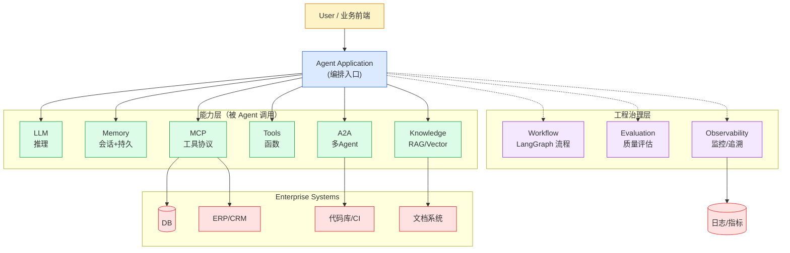

# 第 12 章 · 企业级 Agent 架构

> 阶段 D · 架构与实战 · 难度 ★★★
> 配套：[diagrams/12_enterprise.mmd](../diagrams/12_enterprise.mmd) · [examples/11_enterprise_arch.py](../examples/11_enterprise_arch.py)

---

## 12.1 本章导读

前面各章讲了组件能力：LangChain、LangGraph、RAG、LlamaIndex、MCP、A2A、Harness、Skill；第 11 章讲了框架选型。这一章把它们**拼成一张企业级架构图**，说清每层职责。

核心论断：**Agent 应用 ≠ 一个 LLM 调用**。上生产的 Agent = LLM + 编排 + 6 类能力 + 工程治理。读完你能向架构评审会讲清 Agent 系统设计。

---

## 12.2 为什么需要分层架构

裸 LLM 调用（第 2 章那段 8 行代码）只是 demo。企业级 Agent 要解决：

- **接多个系统**：HR、财务、代码库、文档库，不能每个手写适配（→ MCP）；
- **用私有知识**：内部制度、产品文档（→ RAG）；
- **复杂流程**：多步推理、循环、人工审批（→ LangGraph）；
- **跨会话记忆**：用户画像、历史决策（→ Memory）；
- **稳定运行**：上下文管理、权限、监控、评估（→ Harness）；
- **能力复用**：专家经验沉淀（→ Skill）；
- **多角色协作**：复杂任务拆分（→ A2A）。

这些需求叠加，必然演化出分层架构。和 Java 后端从 "Servlet + JDBC" 演化到 "Controller-Service-DAO + 中间件" 是一个道理。

---

## 12.3 六层架构

从上到下六层：（下面内嵌架构图，源码见 [diagrams/12_enterprise.mmd](../diagrams/12_enterprise.mmd)）：




### 第 1 层：用户 / 业务前端
- Web 界面、移动 App、内嵌聊天框、API 调用方。
- 职责：接收用户输入，展示 Agent 结果。
- 技术：React/Vue 前端，或内部系统的 API 调用。

### 第 2 层：Agent Application（编排入口）
- 对外暴露 API，接收请求，调编排层，返结果。
- Java 类比：Controller + Service 入口。
- 技术：**FastAPI**（Python Web 框架）。
- 职责："接请求、调编排、返结果"。
- 这层要做：鉴权（SA-Token/JWT）、限流、请求日志。

### 第 3 层：编排层 Workflow
- 决定 "Agent 怎么跑"：节点、边、状态、循环、人工介入。
- 技术：**LangGraph**（复杂流程）/ LangChain（简单流程）。
- 职责：把任务拆成节点，按流程执行，管理状态。
- 这层是 Agent 的 "大脑指挥中枢"。

### 第 4 层：能力层（被编排层调用）
6 类能力：

| 能力 | 技术 | 作用 |
|---|---|---|
| **LLM** | DeepSeek SDK（OpenAI 兼容）/ 通义千问 SDK | 推理 |
| **Memory** | 向量记忆/DB | 会话+持久记忆 |
| **Knowledge** | RAG + Vector DB | 私有知识 |
| **Tools** | LangChain @tool | 进程内工具 |
| **MCP** | MCP Server/Client | 跨系统标准化工具 |
| **A2A** | AutoGen/CrewAI | 多 Agent 协作 |

### 第 5 层：工程治理层
让 Agent **可控可观测**：

| 子能力 | 工具 | 作用 |
|---|---|---|
| **Evaluation** | LangSmith/RAGAS | 自动测质量 |
| **Observability** | LangFuse/自建 trace | 全链路监控 |
| **Permission** | Harness 权限模型 | 危险操作审批 |

这层是第 9 章 Harness 的工程化落地。

### 第 6 层：Enterprise Systems（企业既有系统）
- DB（MySQL/PostgreSQL）、ERP/CRM、代码库（GitLab）、文档系统（Wiki/Confluence）。
- Agent 通过 **MCP**（标准化）和 **A2A**（多 Agent）访问。
- 这层是企业已有资产，Agent 不替代，而是**调用**。

---

## 12.4 数据流走一遍

用一个例子串起来：**员工问 "我上个月报销了多少？"**

```
1. 用户在 Web 前端输入问题
2. Agent Application（FastAPI）接收请求，鉴权后调编排层
3. 编排层（LangGraph）启动工作流：
   a. Memory 节点：加载用户历史（"张三，工号 E001"）
   b. LLM 节点：理解问题，决定调 MCP 工具 query_expense(E001, last_month)
   c. MCP Client 调 Finance MCP Server → 查财务系统 → 返回 "3850 元"
   d. LLM 节点：基于结果生成 "您上月报销 3850 元，含差旅 2000、餐补 1850"
4. 工程治理层全程记录：每步决策、token 消耗、工具调用
5. Agent Application 返回结果给前端
6. 用户看到答案
```

**关键**：一个简单问题，背后经过 6 层协作。这就是 "Agent 应用 ≠ 一个 LLM 调用"。

---

## 12.5 代码示例：架构的代码版

打开 [examples/11_enterprise_arch.py](../examples/11_enterprise_arch.py)。这是 "代码版架构图"，每层一个类，跑一下打印分层职责。

```python
class EnterpriseAgentSystem:
    """企业级 Agent 系统的分层架构（代码版）。"""
    def __init__(self):
        self.user_layer = UserLayer()
        self.app_layer = AgentApplication()
        self.workflow_layer = WorkflowLayer()
        self.capability_layer = CapabilityLayer()
        self.governance_layer = GovernanceLayer()
        self.enterprise_layer = EnterpriseSystems()

    def describe(self):
        # 打印每层职责
        ...
```

**精讲**：每个 Layer 类封装本层职责，`describe` 打印架构说明。这不是可运行的业务代码，而是**架构的可视化**——架构评审时可以用它讲解分层。真实实现每层会接入具体技术（FastAPI/LangGraph/MCP 等）。

### 运行预期

```bash
$ python examples/11_enterprise_arch.py
============================================================
  企业级 Agent 架构（代码版）
============================================================
┌─ 1. User Layer
│  职责: 用户交互入口（Web/移动/内嵌聊天）
...
┌─ 6. Enterprise Systems
│  职责: DB / ERP / Git / Wiki（通过 MCP+A2A 访问）

============================================================
  关键论断：Agent 应用 ≠ 一个 LLM 调用
  上生产的 Agent = LLM + 编排 + 6 类能力 + 工程治理
============================================================
```

---

## 12.6 每层职责一句话总结

| 层 | 一句话职责 |
|---|---|
| 用户层 | 接输入、展结果 |
| Agent Application | 接请求、调编排、返结果（含鉴权限流） |
| 编排层 | 决定 Agent 怎么跑（节点/边/状态/循环） |
| 能力层 | 被调用的 6 类能力（LLM/Memory/Knowledge/Tools/MCP/A2A） |
| 工程治理层 | 让 Agent 可控可观测（评估/监控/权限） |
| Enterprise Systems | 企业既有资产，被 Agent 调用 |

---

## 12.7 实际应用场景

**场景 1：架构评审汇报**
CTO 问 "你们的 Agent 系统怎么设计的？" 你拿出这张六层图，逐层讲职责和技术选型，说清 "为什么需要每一层"。

**场景 2：技术选型决策**
"我们要不要上 Milvus？"——看架构图，Milvus 在能力层的 Knowledge。如果文档量百万以下，Chroma 够；千万级才上 Milvus。架构图帮你定位每个组件的位置和必要性。

**场景 3：故障定位**
线上 Agent 答错，按层排查：是编排层流程错了？能力层 LLM/检索出了问题？还是治理层没监控到？分层架构让排查有方向。

**场景 4：团队分工**
按层分团队：Web 团队管 1-2 层，AI 团队管 3-4 层，SRE 管第 5 层，业务团队维护第 6 层的 MCP Server。架构清晰才能分工。

---

## 12.8 陷阱与最佳实践

**陷阱 1：一上来就上全套六层**
小项目不需要全套。从 "Application + LLM + 一两个 Tool" 开始，按需加层。**架构是演化出来的，不是设计出来的**。

**陷阱 2：编排层和能力层职责混淆**
把业务逻辑写进 LLM Prompt（能力层越权），或让编排层直接调 DB（编排层越权）。**严格分层**：编排层只管流程，能力层管具体能力。

**陷阱 3：忽视工程治理层**
很多团队只搭 1-4 层就上线，没有评估和监控。线上答错全靠用户投诉。**治理层不是可选**，是上生产的硬要求。

**陷阱 4：企业系统直连**
Agent 直接 SQL 查 DB，绕过 MCP。短期快，长期每个 Agent 重写适配，回到 N×M 地狱。**坚持用 MCP 标准化接入**。

**最佳实践：先画架构图再写代码**
任何 Agent 项目，先用本层架构画图，明确每层用什么、数据怎么流。架构图是团队共识的基础。

**最佳实践：关键路径加监控**
编排层的每个节点、能力层的每次 LLM/工具调用，都要打 trace。出问题能快速定位是哪层。

**最佳实践：能力层组件可替换**
LLM 换模型、Vector DB 换库、MCP Server 换实现，都不应该影响编排层。靠接口抽象实现解耦，和 Java 的面向接口编程一回事。

---

## 12.9 和 Java 后端架构的对照

| Python Agent 层 | Java 后端层 | 相似点 |
|---|---|---|
| 用户层 | 前端 | 交互 |
| Agent Application | Controller + 网关 | 接请求、鉴权 |
| 编排层 | Service + 流程引擎 | 业务流程 |
| 能力层 | DAO + 外部服务调用 | 数据/外部能力 |
| 工程治理层 | 监控 + 测试 + 权限 | 可控可观测 |
| Enterprise Systems | DB + 中间件 | 基础设施 |

**关键认知**：你已有的 Java 后端架构经验（分层、解耦、接口抽象、监控）在 Agent 架构里**全部适用**。只是组件换了名字，多了 LLM 这个 "会推理的外部服务"。

---

## 12.10 小结

- 企业级 Agent = **六层架构**：用户 / Application / 编排 / 能力 / 治理 / 企业系统。
- 每层职责清晰：编排管流程，能力管执行，治理管可控，企业系统是被调用资产。
- **Agent 应用 ≠ 一个 LLM 调用**，是 LLM + 编排 + 6 类能力 + 工程治理的组合。
- 架构是演化出来的，从最小集开始按需加层。
- Java 后端架构经验全部适用，只是换了组件名。

下一章用两个综合案例把全部串起来。

---

> **上一章**：[第 11 章 · 主流框架选型与生态进阶](11_framework_selection.md)
> **下一章**：[第 13 章 · 综合案例](13_cases.md)
