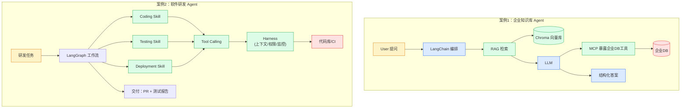

# 第 13 章 · 综合案例

> 阶段 D · 架构与实战 · 难度 ★★★
> 配套：[diagrams/13_cases.mmd](../diagrams/13_cases.mmd) · [examples/12_case_knowledge_agent.py](../examples/12_case_knowledge_agent.py) · [examples/13_case_dev_agent.py](../examples/13_case_dev_agent.py)

---

## 13.1 本章导读

最后这一章用两个端到端案例把前 12 章全部串起来：

- **案例 1：企业知识库 Agent** —— Python + LangChain + RAG + Chroma + MCP
- **案例 2：软件研发 Agent** —— Python + LangGraph + Skill + Tool Calling + Harness

两个案例代表两类典型 Agent：一个偏 "知识 + 检索"，一个偏 "流程 + 工具"。读完你能看懂真实 Agent 项目怎么搭。

---

## 13.2 架构图解读

左右两个案例并列（下面内嵌架构图，源码见 [diagrams/13_cases.mmd](../diagrams/13_cases.mmd)）：



**左半（案例 1）**：用户提问 → LangChain 编排 → RAG 检索 → Chroma 向量库 → LLM → MCP 暴露企业 DB 工具 → 企业 DB → 结构化答案。

**右半（案例 2）**：研发任务 → LangGraph 工作流 → Coding / Testing / Deployment Skill → Tool Calling → Harness（上下文/权限/监控）→ 代码库/CI → 交付：PR + 测试报告。


**两案例对比**：

| 维度 | 案例 1 知识库 Agent | 案例 2 研发 Agent |
|---|---|---|
| 核心 | 知识 + 检索 | 流程 + 工具 |
| 编排 | LangChain（够用） | LangGraph（必须，有循环） |
| 知识 | RAG + Chroma | 不需要 |
| 工具 | MCP 查 DB | Skill + Tool Calling |
| 治理 | 基础 | Harness（权限/监控） |
| 选型原则 | 检索为主上 LangChain+RAG | 流程复杂上 LangGraph |

---

## 13.3 案例 1：企业知识库 Agent

### 业务场景
企业内部助手：员工问制度（年假/报销）查知识库，问员工信息查 HR 系统。一个 Agent 同时覆盖 "文档知识" 和 "业务数据"。

### 技术栈
Python + LangChain + RAG + Chroma + MCP

### 架构
```
用户提问
   │
   ▼
LangChain Agent（create_agent）
   │
   ├─ 工具1: search_policy（RAG）
   │    └─ Chroma 向量库（企业制度文档）
   │
   ├─ 工具2: query_employee_db（MCP）
   │    └─ MCP Server → 企业 HR 系统
   │
   └─ LLM 决定调哪个工具 → 生成回答
```

### 代码逐段精讲

打开 [examples/12_case_knowledge_agent.py](../examples/12_case_knowledge_agent.py)。

**第 1 部分：MCP 工具——暴露企业 DB 查询**

```python
from langchain_core.tools import tool

@tool
def query_employee_db(emp_id: str) -> str:
    """
    查询企业 HR 系统中的员工信息。
    参数 emp_id: 员工工号（如 E001）
    当用户问到具体员工时调用。
    """
    db = {
        "E001": "张三 / 研发部 / 高级工程师",
        "E002": "李四 / 产品部 / 产品经理",
    }
    return db.get(emp_id, f"工号 {emp_id} 不存在")
```

**精讲**：真实场景这是 MCP Server 暴露的工具，跨进程调用。这里简化成进程内 `@tool`，逻辑等价。**docstring 是关键**——LLM 看这个决定何时调。

**第 2 部分：RAG——企业知识文档入库**

```python
def build_knowledge_retriever():
    docs = TextLoader("company_policy.txt", encoding="utf-8").load()
    chunks = RecursiveCharacterTextSplitter(
        chunk_size=100, chunk_overlap=20
    ).split_documents(docs)
    embeddings = SentenceTransformerEmbeddings(model_name="BAAI/bge-small-zh-v1.5")
    db = Chroma.from_documents(chunks, embeddings)
    return db.as_retriever(search_kwargs={"k": 2})
```

**精讲**：第 5 章学的 6 步管线，这里一步到位。制度文档 → 切分 → 向量化 → 入 Chroma → 转 Retriever。

**第 3 部分：把 RAG 也包成 Tool**

```python
@tool
def search_policy(query: str) -> str:
    """搜索企业制度文档。当用户问报销/年假/出差制度时调用。"""
    docs = retriever.invoke(query)
    return "\n".join(d.page_content for d in docs)
```

**精讲**：**关键设计**——把 RAG 检索包装成 Tool。这样 Agent 不直接调 Retriever，而是通过 Tool Calling 决定 "要不要检索"。LLM 自己判断：问制度 → 调 search_policy；问员工 → 调 query_employee_db。这是 "Agent 自主选能力" 的体现。

**第 4 部分：组装 Agent**

```python
from langchain_deepseek import ChatDeepSeek
from langchain.agents import create_agent

tools = [search_policy, query_employee_db]   # RAG Tool + MCP Tool
model = ChatDeepSeek(model=os.getenv("DEEPSEEK_MODEL", "deepseek-chat"), temperature=0.1, api_key=os.getenv("DEEPSEEK_API_KEY"))
# create_agent：组装能同时用 RAG + MCP 工具的 Agent（LangChain 1.x 推荐入口）
agent = create_agent(
    model,
    tools,
    system_prompt="你是企业知识库助手。可以用 search_policy 查制度，用 query_employee_db 查员工。",
)
return agent
```

**精讲**：
- `tools` 同时含 RAG Tool 和 MCP Tool——Agent 一个入口，背后两种能力。
- `temperature=0.1`：低温度，问答要稳定不发散。
- system prompt 明确告诉 LLM 有哪些工具、各自用途。
- `agent_scratchpad` 是 Agent 临时记忆区，必须包含。

### 运行预期

```bash
$ python examples/12_case_knowledge_agent.py
❓ 用户: 出差住宿每晚最多能报多少？
[Agent 决策] 调用 search_policy("出差住宿")
[检索] 命中片段: 住宿：一线城市 500/晚，二线 350/晚
✅ Agent: 出差住宿一线城市每晚最多 500 元，二线 350 元。

❓ 用户: 查一下工号 E001 的员工信息
[Agent 决策] 调用 query_employee_db(emp_id='E001')
[MCP 工具] 返回: 张三 / 研发部 / 高级工程师
✅ Agent: 工号 E001 是张三，研发部高级工程师。

❓ 用户: 年假满 3 年有几天？
[Agent 决策] 调用 search_policy("年假")
✅ Agent: 满 3 年享有 10 天年假。
```

**重点**：Agent **自主选工具**——问制度调 search_policy，问员工调 query_employee_db。一个 Agent 同时覆盖文档知识库（RAG）和企业业务系统（MCP 工具），这是企业内部助手的典型形态。

### 应用场景
- 企业内部 "问知识 + 查数据" 统一助手；
- 客服 Agent（查 FAQ + 查订单）；
- 运维 Agent（查文档 + 查监控）。

---

## 13.4 案例 2：软件研发 Agent

### 业务场景
从需求到交付的端到端研发 Agent：调研 → 编码 → 测试 → 人工评审 → 部署。真实形态是 Claude Code / Cursor / Devin 的内核。

### 技术栈
Python + LangGraph + Skill + Tool Calling + Harness

### 架构
```
研发任务
   │
   ▼
LangGraph 工作流
   │
   ├─ research 节点（调研）
   ├─ coding 节点 → CodingSkill
   ├─ testing 节点 → TestingSkill
   │     │
   │     └─ 条件边: 测试失败 → 回 coding（循环！）
   │              测试通过 → human_review
   ├─ human_review 节点（人工介入）
   │     │
   │     └─ 条件边: 批准 → deploy / 拒绝 → END
   └─ deploy 节点 → DeploymentSkill
   │
   ▼
交付：PR + 测试报告
   ↑
Harness 全程管理：上下文/权限/监控
```

### 代码逐段精讲

打开 [examples/13_case_dev_agent.py](../examples/13_case_dev_agent.py)。

**第 1 部分：State 定义**

```python
from typing import TypedDict, Annotated
import operator

class DevState(TypedDict):
    task: str                                       # 原始需求
    messages: Annotated[list, operator.add]         # 消息流（追加）
    artifacts: Annotated[list, operator.add]        # 产出物（追加）
    step: int
```

**精讲**：
- `messages` 和 `artifacts` 都用 `operator.add` reducer，**追加而非覆盖**。
- `artifacts` 累积各阶段产出（方案/代码/测试报告/部署链接），最后汇总交付。
- `step` 是普通字段，默认覆盖，用来计步防死循环。

**第 2 部分：Skill（复用第 10 章思路）**

```python
class CodingSkill:
    @staticmethod
    def run(state: DevState) -> dict:
        task = state["task"]
        code = f"# 实现: {task}\ndef solution():\n    return 'ok'\n"
        return {
            "artifacts": [f"```python\n{code}```"],
            "messages": ["CodingSkill 产出代码"],
            "step": state["step"] + 1,
        }

class TestingSkill:
    @staticmethod
    def run(state: DevState) -> dict:
        latest = state["artifacts"][-1]
        report = f"3 用例通过 / 0 失败"
        return {
            "artifacts": [f"测试报告: {report}"],
            "messages": ["TestingSkill 测试通过"],
            "step": state["step"] + 1,
        }

class DeploymentSkill:
    @staticmethod
    def run(state: DevState) -> dict:
        return {
            "artifacts": ["部署完成: https://app.example.com/v1.2.3"],
            "messages": ["DeploymentSkill 部署成功"],
            "step": state["step"] + 1,
        }
```

**精讲**：每个 Skill 是一个静态类，`run` 接 State 返回要更新的字段。真实场景每个 Skill 内部调 LLM + 工具，这里用伪逻辑演示流程。

**第 3 部分：Harness（精简版）**

```python
@dataclass
class Harness:
    max_steps: int = 10
    log: list = field(default_factory=list)

    def check_step(self, state: DevState) -> bool:
        """防止 Agent 跑飞。"""
        if state["step"] >= self.max_steps:
            self.log.append("⚠️  超过最大步数，强制停止")
            return False
        return True

    def record(self, node: str, state: DevState):
        self.log.append(f"[step {state['step']}] 节点 {node} 执行")
```

**精讲**：Harness 这里只做两件——步数限制（防死循环）和决策日志。真实 Harness 还应有上下文管理、权限、监控（第 9 章）。

**第 4 部分：Node 函数（Skill 包成节点）**

```python
def node_coding(state: DevState) -> dict:
    harness.record("coding", state)
    return CodingSkill.run(state)

def node_testing(state: DevState) -> dict:
    harness.record("testing", state)
    return TestingSkill.run(state)

def human_review(state: DevState) -> dict:
    """人工评审节点：部署前暂停等人审。"""
    print("[人工评审] 当前产出：")
    for a in state["artifacts"]:
        print(f"  - {a[:60]}")
    print("  → 模拟审批通过 ✅")
    return {"step": state["step"] + 1}
```

**精讲**：每个 Node 是 "Harness 记录 + Skill 执行" 的组合。`human_review` 是人工介入节点，真实场景暂停等人输入。

**第 5 部分：条件边（循环 + 分支）**

```python
def after_testing(state) -> Literal["human_review", "coding"]:
    """测试通过 → 人工评审；测试失败 → 回 coding 修。"""
    last = state["artifacts"][-1]
    if "失败" in last:
        return "coding"      # 回环：修代码
    return "human_review"

def after_human(state) -> Literal["deploy", "__end__"]:
    return "deploy"          # 简化：默认通过
```

**精讲**：
- `after_testing`：**测试失败回到 coding 重写**——这是 LangGraph 循环的威力，Chain 做不到。
- `after_human`：审批通过才部署，否则结束。

**第 6 部分：组装 Graph**

```python
g = StateGraph(DevState)
g.add_node("research", node_research)
g.add_node("coding", node_coding)
g.add_node("testing", node_testing)
g.add_node("human_review", node_human)
g.add_node("deploy", node_deploy)

g.add_edge(START, "research")
g.add_edge("research", "coding")
g.add_edge("coding", "testing")
g.add_conditional_edges("testing", after_testing, {
    "human_review": "human_review",
    "coding": "coding",       # 回环
})
g.add_conditional_edges("human_review", after_human, {
    "deploy": "deploy",
    "__end__": END,
})
g.add_edge("deploy", END)
return g.compile()
```

**精讲**：
- `testing → coding` 这条边形成**回环**：测试失败自动回去改代码。
- `human_review` 前可加 `interrupt_before` 实现真人工介入。
- 整个流程：research → coding → testing →（失败回 coding / 通过 human_review）→ deploy → END。

### 运行预期

```bash
$ python examples/13_case_dev_agent.py
综合案例2：软件研发 Agent（无需 API Key，伪逻辑演示流程）

最终产出：
  - 技术方案: 基于 实现用户登录接口
  - ```python\n# 实现: 实现用户登录接口\n...```
  - 测试报告: 3 用例通过 / 0 失败
  - 部署完成: https://app.example.com/v1.2.3

总步数: 5

Harness 日志：
  [step 0] 节点 research 执行
  [step 1] 节点 coding 执行
  [step 2] 节点 testing 执行
  [step 3] 节点 human_review 执行
  [step 4] 节点 deploy 执行
```

**重点**：从需求到部署，5 步完成，Harness 全程记录。如果测试失败，会回到 coding 重写（循环）。真实形态就是 Claude Code / Devin 的内核。

### 应用场景
- 研发自动化：需求 → 代码 → 测试 → 部署；
- 运维 Agent：告警 → 诊断 → 修复 → 验证；
- 数据流水线：取数 → 清洗 → 分析 → 报告。

---

## 13.5 两案例对比与选型

| 维度 | 案例 1 知识库 Agent | 案例 2 研发 Agent |
|---|---|---|
| **核心需求** | 查知识 + 查数据 | 多步流程 + 工具协作 |
| **编排框架** | LangChain（够用） | LangGraph（必须，有循环） |
| **知识** | RAG + Chroma | 不需要 |
| **工具** | MCP + RAG Tool | Skill + Tool Calling |
| **治理** | 基础 | Harness（步数限制/日志/人工介入） |
| **复杂度** | 中 | 高 |
| **典型产品** | 企业内部助手 | Claude Code / Devin |

**选型原则**：
- **检索为主、流程简单** → LangChain + RAG（案例 1 模式）；
- **流程复杂、有循环、要人工介入** → LangGraph + Skill + Harness（案例 2 模式）；
- **两者混合** → LangGraph 编排，节点里用 LangChain 的 RAG/Tool（完全可以混用）。

---

## 13.6 从案例到生产

这两个案例是教学版，上生产要补：

| 维度 | 教学版 | 生产版要补 |
|---|---|---|
| LLM | 伪逻辑/单次调用 | 真实 LLM + 错误重试 + 超时 |
| 工具 | 模拟 | 真实 MCP Server + 沙箱 + 权限 |
| 记忆 | 内存 | 数据库/向量库持久化 |
| 监控 | print | LangSmith/LangFuse 全链路 trace |
| 评估 | 无 | 测试集 + 回归 + 质量基线 |
| 部署 | 本地 | 容器化 + 弹性扩缩 + 灰度 |
| 安全 | 无 | 鉴权 + 限流 + 敏感数据脱敏 |

**关键认知**：案例演示的是**架构骨架**，生产要在这骨架上加血肉（治理、监控、安全、运维）。骨架对了，加肉不难；骨架错了，补不动。

---

## 13.7 陷阱与最佳实践

**陷阱 1：案例照搬上生产**
教学版省略了错误处理、并发、安全。直接上生产会出事。要按 11.6 的清单补齐。

**陷阱 2：选错编排框架**
简单问答上 LangGraph 杀鸡用牛刀；复杂流程用 LangChain Chain 表达不了循环。**按流程复杂度选**。

**陷阱 3：工具和知识不分**
该用 RAG 的（查文档）硬用工具调；该用工具的（查实时数据）硬塞进 Prompt。**静态知识用 RAG，动态数据用工具**。

**陷阱 4：没有人工介入**
研发 Agent 自动部署、运维 Agent 自动重启服务——危险操作必须人工审批。案例 2 的 `human_review` 节点不是装饰，是安全要求。

**最佳实践：先跑通骨架再加治理**
先把案例的骨架跑通（research→coding→testing→deploy 能走完），再加 Harness、监控、评估。别一上来就全套，调试困难。

**最佳实践：用真实数据测**
用公司真实文档、真实接口测，发现真实问题。模拟数据跑通的，真实场景往往翻车。

---

## 13.8 全教程总结

恭喜读完全教程。回顾三个核心问题：

### 1. Python AI 生态是什么？（第 1-2 章）
一套工具链，分五层：Web / 编排 / 能力 / 知识 / 运行时。Python 成为 AI 主流因为工具链原生。8 个基础术语（Prompt/Token/Context/Embedding/Retrieval/Tool Calling/Memory/Agent）是共同语言。

### 2. 每个组件解决什么问题？（第 3-9 章）
- **LangChain**：把 Prompt/检索/记忆组件化，LCEL 用 `|` 串联；
- **LangGraph**：显式状态机，处理循环/状态/人工介入；
- **RAG**：让 LLM 用私有知识，6 步管线 + 多路召回 + Rerank；
- **LlamaIndex**：RAG 专用框架，与 LangChain 互补；
- **MCP**：标准化工具接入，N×M 降到 N+M；
- **A2A**：多 Agent 协作，三大问题（通信/发现/委派）；
- **Harness**：Agent 上生产的工程基础设施，7 个子能力；
- **Skill**：能力级封装，沉淀专家经验。

### 3. 如何组合形成 Agent 应用？（第 11-12 章）
六层架构：用户 / Application / 编排 / 能力 / 治理 / 企业系统。两个案例演示 "知识 + 检索" 和 "流程 + 工具" 两种典型形态。

### 下一步
按 `course-outline.md` 的学习路径做实战：
1. 跑通所有 examples；
2. 用 LangChain + RAG 做内部文档问答；
3. 用 LangGraph 做带循环的 Agent；
4. 接 MCP Server，写 Skill。

你已有 Java 后端经验，这些组件都能找到对应物。剩下的就是动手。祝你玩得开心。

---

> **上一章**：[第 12 章 · 企业级 Agent 架构](12_enterprise_arch.md)
> **返回**：[README.md](../README.md) · [课程大纲](../course-outline.md)
