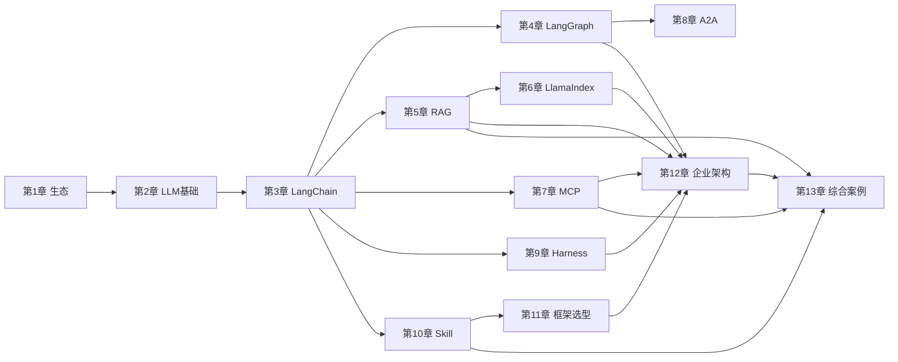

# 章节地图与学习路径

> 配套：`chapters/`（教程正文）/ `diagrams/`（架构图）/ `examples/`（代码）
> 本文件不设时间约束，按学习深度与依赖关系组织。

---

## 一、学习阶段总览

教程分四个阶段，建议按顺序学习。每个阶段回答一个核心问题。

```
阶段 A · 认知地基        阶段 B · 核心组件        阶段 C · 工程化        阶段 D · 架构实战
(第 1-2 章)              (第 3-6 章)              (第 7-11 章)           (第 12-13 章)
   │                        │                        │                      │
   ▼                        ▼                        ▼                      ▼
 生态是什么？           组件解决什么？          怎么接系统/协作/稳？      怎么组合成应用？
```

| 阶段 | 章节 | 阶段目标 | 前置依赖 |
|---|---|---|---|
| A | 1, 2 | 建立 Python AI 生态全局认知 | 能读 Python |
| B | 3, 4, 5, 6 | 掌握 LangChain/LangGraph/RAG/LlamaIndex 四大件 | 阶段 A |
| C | 7, 8, 9, 10, 11 | 掌握 MCP/A2A/Harness/Skill/框架选型 工程能力 | 阶段 B（至少第 3 章） |
| D | 12, 13 | 拼装企业级架构与端到端案例 | 阶段 B + C |

---

## 二、逐章地图

每章统一结构：**导读 → 核心概念 → 原理剖析 → 架构图 → 代码逐段精讲 → 运行预期 → 应用场景 → 陷阱与最佳实践 → 小结**。

### 第 1 章 · Python AI 生态概览
- **难度**：★☆☆ 入门
- **教程正文**：[`chapters/01_python_ai_ecosystem.md`](chapters/01_python_ai_ecosystem.md)
- **架构图**：`diagrams/01_python_ai_ecosystem.mmd`
- **代码**：`examples/00_setup.py`
- **核心问题**：为什么 AI 项目都用 Python？技术栈分几层？
- **关键产出**：能向同事解释 "为什么 AI 后端用 Python，网关仍可用 Java"
- **学习时长参考**：通读约 20 分钟

### 第 2 章 · LLM Application 开发基础
- **难度**：★★☆ 基础
- **教程正文**：[`chapters/02_llm_app_basics.md`](chapters/02_llm_app_basics.md)
- **架构图**：`diagrams/02_llm_app_stack.mmd`
- **代码**：`examples/01_llm_basics.py`
- **核心问题**：Prompt/Token/Context/Embedding/Retrieval/Tool Calling/Memory/Agent 这 8 个术语是什么？
- **关键产出**：画出 User→App→LLM→Tools→Knowledge→Memory 完整数据流
- **学习时长参考**：通读约 25 分钟

### 第 3 章 · LangChain
- **难度**：★★☆ 基础
- **教程正文**：[`chapters/03_langchain.md`](chapters/03_langchain.md)
- **架构图**：`diagrams/03_langchain.mmd`
- **代码**：`examples/02_langchain_demo.py`
- **核心问题**：怎么把 Prompt/检索/记忆组件化？LCEL 的 `|` 是什么？
- **关键产出**：写出 "调 LLM → Prompt 模板 → LCEL Chain → Agent 选 Tool" 四段代码
- **学习时长参考**：通读约 35 分钟

### 第 4 章 · LangGraph
- **难度**：★★★ 进阶（本教程重点）
- **教程正文**：[`chapters/04_langgraph.md`](chapters/04_langgraph.md)
- **架构图**：`diagrams/04_langgraph.mmd`
- **代码**：`examples/03_langgraph_demo.py`
- **核心问题**：怎么表达循环、状态、人工介入的 Agent 流程？为什么 Chain 不够？
- **关键产出**：实现一个带 State/Node/Edge/人工介入的 Agent 工作流
- **学习时长参考**：通读约 40 分钟

### 第 5 章 · RAG 技术体系
- **难度**：★★★ 进阶
- **教程正文**：[`chapters/05_rag.md`](chapters/05_rag.md)
- **架构图**：`diagrams/05_rag.mmd`
- **代码**：`examples/04_rag_demo.py` / `examples/04b_rag_advanced.py`
- **核心问题**：怎么让 LLM 用上私有知识？向量检索 6 步管线？多路召回与 Rerank 怎么配？
- **关键产出**：跑通 Document→Chunk→Embedding→VectorDB→Retriever→LLM 全流程，并实现多路召回 + Rerank
- **学习时长参考**：通读约 40 分钟

### 第 6 章 · LlamaIndex 与检索增强进阶
- **难度**：★★★ 进阶
- **教程正文**：[`chapters/06_llamaindex.md`](chapters/06_llamaindex.md)
- **架构图**：`diagrams/06_llamaindex.mmd`
- **代码**：`examples/05_llamaindex_demo.py`
- **核心问题**：LlamaIndex 和 LangChain 怎么分工？多路召回与 Rerank 三种形态？
- **关键产出**：用 LlamaIndex 跑通基础 RAG、Rerank 重排序、Router 路由式多路召回
- **学习时长参考**：通读约 35 分钟

### 第 7 章 · MCP（Model Context Protocol）
- **难度**：★★☆ 基础
- **教程正文**：[`chapters/07_mcp.md`](chapters/07_mcp.md)
- **架构图**：`diagrams/07_mcp.mmd`
- **代码**：`examples/06_mcp_server.py`
- **核心问题**：怎么标准化地把工具暴露给 Agent？MCP 解决了什么适配地狱？
- **关键产出**：写一个 FastMCP Server 暴露工具并让 Agent 调用
- **学习时长参考**：通读约 30 分钟

### 第 8 章 · A2A（Agent To Agent）
- **难度**：★★★ 进阶
- **教程正文**：[`chapters/08_a2a.md`](chapters/08_a2a.md)
- **架构图**：`diagrams/08_a2a.mmd`
- **代码**：`examples/07_a2a_demo.py`
- **核心问题**：多个 Agent 怎么协作？Communication/Discovery/Task Delegation 三大问题？
- **关键产出**：描述 Research→Coding→Testing 协作流程
- **学习时长参考**：通读约 30 分钟

### 第 9 章 · Harness Engineering
- **难度**：★★★ 进阶（上生产关键）
- **教程正文**：[`chapters/09_harness.md`](chapters/09_harness.md)
- **架构图**：`diagrams/09_harness.mmd`
- **代码**：`examples/08_harness_demo.py`
- **核心问题**：怎么让 Agent 稳定上生产？7 个子能力分别解决什么？
- **关键产出**：理解 Claude Code/Codex 背后的工程基础设施
- **学习时长参考**：通读约 35 分钟

### 第 10 章 · Agent Skill
- **难度**：★★☆ 基础
- **教程正文**：[`chapters/10_skill.md`](chapters/10_skill.md)
- **架构图**：`diagrams/10_skill.mmd`
- **代码**：`examples/09_skill_demo.py`
- **核心问题**：Skill 和 Tool/Prompt 有什么区别？怎么封装专家经验？
- **关键产出**：实现一个 DatabaseSkill 含 Prompt+Tool+触发条件
- **学习时长参考**：通读约 25 分钟

### 第 11 章 · 主流框架选型与生态进阶
- **难度**：★★☆ 进阶
- **教程正文**：[`chapters/11_framework_selection.md`](chapters/11_framework_selection.md)
- **架构图**：`diagrams/11_framework_selection.mmd`
- **代码**：`examples/10_framework_selection.py`
- **核心问题**：CrewAI / AutoGen / OpenAI Agents SDK / DSPy / Semantic Kernel / Haystack 等怎么选？拿到需求怎么定位该用哪个框架？
- **关键产出**：不被框架营销带偏，能按 "单/多 Agent、重 RAG/重流程、跨语言栈" 快速选型
- **学习时长参考**：通读约 25 分钟

### 第 12 章 · 企业级 Agent 架构
- **难度**：★★★ 进阶
- **教程正文**：[`chapters/12_enterprise_arch.md`](chapters/12_enterprise_arch.md)
- **架构图**：`diagrams/12_enterprise.mmd`
- **代码**：`examples/11_enterprise_arch.py`
- **核心问题**：完整分层架构长什么样？每层职责？为什么 "Agent ≠ 一个 LLM 调用"？
- **关键产出**：能向架构评审会讲清 Agent 系统设计
- **学习时长参考**：通读约 30 分钟

### 第 13 章 · 综合案例
- **难度**：★★★ 进阶
- **教程正文**：[`chapters/13_cases.md`](chapters/13_cases.md)
- **架构图**：`diagrams/13_cases.mmd`
- **代码**：`examples/12_case_knowledge_agent.py` / `examples/13_case_dev_agent.py`
- **核心问题**：两个端到端案例怎么把前 12 章串起来？
- **案例 1**：企业知识库 Agent（Python + LangChain + RAG + Chroma + MCP）
- **案例 2**：软件研发 Agent（Python + LangGraph + Skill + Tool Calling + Harness）
- **学习时长参考**：通读约 40 分钟

---

## 三、章节依赖关系



**关键依赖**：
- 第 3 章 LangChain 是核心枢纽，第 4–11 章大多依赖它；
- 第 12、13 章依赖前面所有章节；
- 第 6 章 LlamaIndex 依赖第 5 章 RAG；第 7 章 MCP 和第 8 章 A2A 相对独立，可单独学。

---

## 四、代码示例索引

| 示例文件 | 对应章节 | 是否需 API Key | 是否需额外库 | 难度 |
|---|---|---|---|---|
| `00_setup.py` | 第 1 章 | 是 | openai | ★ |
| `01_llm_basics.py` | 第 2 章 | 是 | openai | ★★ |
| `02_langchain_demo.py` | 第 3 章 | 是 | langchain | ★★ |
| `03_langgraph_demo.py` | 第 4 章 | 是 | langgraph | ★★★ |
| `04_rag_demo.py` | 第 5 章 | 是 | chromadb, sentence-transformers | ★★★ |
| `04b_rag_advanced.py` | 第 5 章 | 否（检索部分） | rank-bm25, sentence-transformers | ★★★ |
| `05_llamaindex_demo.py` | 第 6 章 | 是 | llama-index, sentence-transformers | ★★★ |
| `06_mcp_server.py` | 第 7 章 | 是 | mcp | ★★ |
| `07_a2a_demo.py` | 第 8 章 | 否（伪代码级） | 无 | ★★ |
| `08_harness_demo.py` | 第 9 章 | 否（FakeModel） | 无 | ★★★ |
| `09_skill_demo.py` | 第 10 章 | 否（伪逻辑） | 无 | ★★ |
| `10_framework_selection.py` | 第 11 章 | 否 | 无 | ★★ |
| `11_enterprise_arch.py` | 第 12 章 | 否 | 无 | ★★ |
| `12_case_knowledge_agent.py` | 第 13 章 | 是 | langchain, chromadb | ★★★ |
| `13_case_dev_agent.py` | 第 13 章 | 否（伪逻辑） | langgraph | ★★★ |

> 无需 API Key 的示例：`07_a2a_demo.py`、`08_harness_demo.py`、`09_skill_demo.py`、`10_framework_selection.py`、`11_enterprise_arch.py`、`13_case_dev_agent.py`（纯逻辑验证）；`04b_rag_advanced.py` 的检索/融合/精排部分无需 Key；其余需配置 `DEEPSEEK_API_KEY`（DeepSeek 兼容端点）。

---

## 五、学习路径（实战进阶）

读完教程后，按以下路径动手实战：

| 阶段 | 动作 | 目标 | 预估投入 |
|---|---|---|---|
| 第 1 周 | 跑通所有 examples，改提示词看效果 | 熟悉工具链手感 | 5h |
| 第 2 周 | 用 LangChain + RAG 做一个内部文档问答 | 掌握 RAG 全流程 | 10h |
| 第 3 周 | 用 LangGraph 做一个带循环的 Agent | 掌握状态机编排 | 10h |
| 第 4 周 | 接一个 MCP Server，写一个 Skill | 掌握工具协议与能力封装 | 8h |
| 持续 | 读 LangGraph / MCP 官方文档与源码 | 深入原理 | — |

### 推荐资料
- LangChain 官方文档：https://python.langchain.com
- LangGraph 文档：https://langchain-ai.github.io/langgraph
- MCP 规范：https://modelcontextprotocol.io
- LlamaIndex：https://docs.llamaindex.ai
- DeepSeek API 文档：https://platform.deepseek.com/api-docs
- Anthropic MCP 介绍：https://www.anthropic.com/news/model-context-protocol

---

## 六、三个核心问题对照

| 核心问题 | 对应章节 | 读完后你应该能回答 |
|---|---|---|
| Python AI 生态是什么？ | 第 1、2 章 | 说出 5 层技术栈、8 个基础术语 |
| 每个组件解决什么问题？为什么需要它？ | 第 3–10 章 | 逐个组件说清 "痛点 → 方案 → 何时用" |
| 如何组合形成 Agent 应用？ | 第 12、13 章 | 画出企业级架构，跑通两个端到端案例 |
